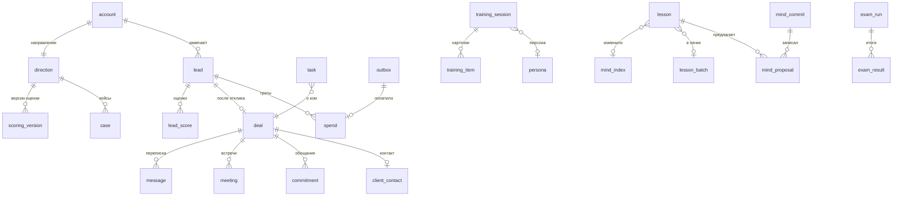

# Словарь данных

| | |
|---|---|
| Версия | 1.0, 22.10.2026 |
| Связано | спецификация 7.1 и 8; контракты C1, C7; модель угроз, раздел «Данные» |
| Правила | время только UTC (`timestamptz`); деньги целым числом в рублях; переход этапа только функцией `transition`; каждое изменение порождает событие C1 |

## 1. Классы данных

| Класс | Что | Пример | Где первая запись | Обращение |
|---|---|---|---|---|
| **Н** | не персональные | балл, цена отклика, настройки | ядро | без ограничений |
| **П** | персональные данные клиента | имя, текст заказа, переписка | схема `node` на сервере | минимум, обезличивание перед моделью (ADR-016), сроки хранения |
| **К** | контакт клиента | телефон, почта, мессенджер | схема `core` на сервере | только для встречи, удаление через 30 дней после неё |
| **С** | секрет | сессия Профи.ру, токены | там, где используется | зашифровано (sops и age), права 600, не в базе в открытом виде |

## 2. Схема `node`: сырые данные площадки

Пишет только служба Профи-MCP. Отдельная схема нужна, чтобы её можно
было перенести в управляемую базу в России, если этого потребует юрист
(ADR-022).

| Таблица | Поля | Класс | Срок |
|---|---|---|---|
| `raw_event` | `id`, `account_id`, `kind` (`rtp`, `response`, `dom`), `received_at`, `body` (jsonb), `shipped_at` | П | 30 дней, затем удаление (в ядре остаются разобранные данные) |
| `raw_order` | `order_id`, `account_id`, `seen_at`, `body` | П | 30 дней |
| `raw_message` | `platform_message_id`, `chat_id`, `account_id`, `author_side` (`client`, `specialist`), `sent_at`, `text` | П | 2 года для закрытых, как в ядре |
| `outbox_node` | `event_id`, `payload`, `attempts`, `next_try_at`, `confirmed_at` | П | до подтверждения + 7 дней |
| `bid_attempt` | `idempotency_key`, `account_id`, `order_id`, `due_rub`, `pressed_at`, `result` (jsonb): нажатие, записанное до кнопки, которая открывает форму, и подтверждённый ответ. Остановка до «Откликнуться» стирает запись, если кошелёк на странице не изменился | Н | 30 дней |
| `node_flag` | `account_id`, `name`, `reason`, `set_at`: остановка, которую узел поставил себе сам (например `form_calibration`: кошелёк уменьшился после открытия формы) | Н | пока человек не снимет |
| `browser_profile` | папка профиля на диске, вне базы | С | пока аккаунт активен |

## 3. Схема `core`: рабочая база ядра

### 3.1 Аккаунты и направления

| Таблица | Поле | Тип | Класс | Смысл |
|---|---|---|---|---|
| `account` | `id` | text | Н | короткое имя, например `hance-marketing` |
| | `title` | text | Н | название в пульте |
| | `profi_profile_id` | text | Н | номер анкеты на площадке |
| | `login_state` | enum `alive`, `dead`, `banned`, `unknown` | Н | состояние входа |
| | `presence` | bool | Н | присутствие включено |
| | `egress_ip` | inet | Н | IP аккаунта на сервере |
| | `balance_rub` | int | Н | баланс кошелька, последний замер |
| | `balance_at` | timestamptz | Н | когда замерен |
| | `paused` | bool | Н | пауза аккаунта |
| `direction` | `id`, `account_id`, `title`, `description`, `stop_factors` (jsonb), `scoring_version_id`, `bid_format` (jsonb), `speed_mode` (`normal`, `fast`), `daily_budget_rub`, `max_bid_rub`, `auto_bid_rule` (jsonb, по умолчанию выключено) | | Н | направление аккаунта |
| `scoring_version` | `id`, `direction_id`, `version`, `gates` (jsonb), `criteria` (jsonb: критерий, вес, как мерить), `threshold`, `calibration_agreement` (numeric), `created_at`, `approved_by_boris_at` | | Н | система оценки с версиями |
| `calibration` | `id`, `scoring_version_id`, `lead_id`, `boris_fit` (bool), `model_fit` (bool), `model_score`, `note` | | Н | отметки калибровки |
| `case` | `id`, `direction_id`, `url`, `title`, `tags` (text[]), `show_rule` | | Н | кейсы для откликов |

### 3.2 Заявки и клиенты

| Таблица | Поле | Тип | Класс | Смысл |
|---|---|---|---|---|
| `lead` | `id` | text | Н | номер заказа Профи.ру |
| | `account_id` | text | Н | каким аккаунтом замечен первым |
| | `title`, `category`, `city` | text | Н | тема, категория, город |
| | `text` | text | П | описание заказа |
| | `client_name` | text | П | имя клиента, как на площадке |
| | `budget_text` | text | Н | бюджет словами |
| | `bid_price_rub` | int | Н | цена отклика сейчас; 0: неизвестна (доска её не показывает, страницу заказа ещё не читали или не смогли прочитать). С неизвестной ценой отклик через Сару не уходит; отклик дороже карточки обновляет её ценой со страницы |
| | `place` | int | Н | место отклика, если известно |
| | `is_open` | bool | Н | заказ открыт |
| | `seen_at` | timestamptz | Н | когда замечен |
| | `routed_direction_id` | text | Н | выбранное направление |
| | `status` | enum `new`, `sorted_out`, `scored_out`, `stale`, `closed`, `bid_already`, `held`, `queued`, `decided`, `bid_sent`, `skipped`, `expired` | Н | судьба заявки. `closed`: страница заказа показала, что он закрыт; `bid_already`: на него уже есть отклик с нашего аккаунта (оба без карточки) |
| | `draft_text` | text | П | текст отклика с приветствием: черновик Аналитика или правка Бориса; null, пока черновика нет (FR-LEAD-6) |
| | `draft_price_rub` | int | Н | «Стоимость услуги» в отклике; null: её нет, и «Откликнуться» сначала спрашивает её у Бориса (поле обязательно на площадке). Борис задаёт её строкой «цена 5000» после «Изменить» или ответом на вопрос; правка пишется в журнал `draft.priced` |
| | `draft_analysis` | jsonb | П | разбор Аналитика: шаги чтения заказа (`reading`: явное, неявные слои, чего хочет, кто это, риски, работа для нас) и короткий итог (`hidden_need`, `risk`, `condition`); null: разбора нет |
| | `client_info` | jsonb | П | что страница заказа говорит о клиенте (контракт `ClientInfo`): на Профи.ру с какой даты, номер подтверждён, отзывы других специалистов и их теги; читается `profi.get_order`, когда заявка прошла Оценщика; null: страницу не читали или клиент не показан |
| `lead_score` | `lead_id`, `direction_id`, `scoring_version_id`, `gates_passed` (bool), `score` (0-100), `reasons` (jsonb), `confidence`, `model_call_id` | | Н | оценка заявки направлением |
| `deal` | `id` | uuid | Н | клиент после отклика |
| | `lead_id`, `account_id`, `direction_id` | | Н | связи |
| | `chat_id` | text | Н | номер чата на площадке |
| | `stage` | enum (спецификация 7.2) | Н | этап |
| | `owner`, `turn` | | Н | не используются с M4: дом владельца и чьего хода `conversation` (ADR-024); колонки остаются до сужения |
| | `amount_rub`, `outcome`, `outcome_reason` | | Н | итог |
| `conversation` (M4) | `id` | uuid | Н | один чат аккаунта, уникально `account_id` и `chat_id` (ADR-024) |
| | `account_id`, `chat_id`, `order_id`, `deal_id` | | Н | связи; `deal_id` пусто у чатов, начатых откликом v1 |
| | `origin` | enum `sara`, `v1` | Н | кто сделал отклик |
| | `owner`, `owner_reason` | enum `sara`, `boris`, `paused`; `take`, `wrote`, `topic` | Н | кто ведёт и почему |
| | `boris_note` | text | П | указание Бориса при возврате Саре |
| | `closed_at`, `handled_through`, `last_client_heard_at`, `typing_at`, `unclear_count` | | Н | закрыт ли, до какого сообщения клиента отвечено, когда ядро слышало клиента и «печатает», сколько неясных авторов подряд |
| `chat_message` (M4) | `id` | uuid | Н | вся переписка, живая и выгруженная, уникально `account_id` и `platform_message_id` |
| | `side` | enum `client`, `specialist`, `system`, `unknown` | Н | сторона на площадке |
| | `author`, `author_basis` | enum `client`, `boris`, `sara`, `sara_v1`, `system`, `unknown`; почему так | Н | чей голос (дизайн M4, 5.1) |
| | `text` | text | П | текст |
| | `sent_at`, `approx_time`, `heard_at`, `read` | | Н | время со страницы, приблизительное ли, когда услышало ядро, прочитано |
| | `source` | enum `node`, `v1`, `telegram_export` | Н | откуда |
| `conv_turn` (M4) | `id` (номер процесса), `conversation_id`, `kind`, `anchor_message_id`, `message_ids`, `mind_version`, `recalled`, `understanding`, `move`, `text`, `fact_ids`, `example_ids`, `checks`, `decision`, `outcome`, `model_call_ids`, `task_id`, `card_message_id`, `boris_text`, `actual_message_id`, `actual_author`, `similarity`, `timings` | | П (`text`, `boris_text`) | трасса хода из 8 шагов (FR-OPS-4); строка вида `reminder` это шаг напоминания клиенту, номер `conv-remind:<разговор>:<сообщение>:<шаг>` (FR-CONV-12) |
| `client_contact` | `deal_id`, `kind` (`phone`, `email`, `messenger`), `value`, `delete_after` | | К | контакт для встречи |

### 3.3 Работа и надёжность

| Таблица | Поля | Класс | Смысл |
|---|---|---|---|
| `event` | конверт C1 | Н, в `payload` бывает П | журнал, только добавление; ссылки на П по номерам, а не копией текста |
| `task` | `id`, `kind`, `entity_kind`, `entity_id`, `priority`, `due_at`, `state` (`open`, `resolved`, `expired`), `resolution`, `telegram_message_id` | Н | что ждёт Бориса |
| `outbox` | `id`, `kind` (`bid`, `message`), `idempotency_key` (уникален), `payload`, `permit`, `attempts`, `state` (`queued`, `confirmed`, `uncertain`, `failed`), `confirmed_at`, `error_class` | П | действия наружу. Отклик, который служба не нажала, строку удаляет (заявка снова у Бориса, следующее нажатие это новая строка со своим процессом `outbox:<id>`); `failed` остаётся у закрытого заказа (`ORDER_CLOSED`) и у отклика, который уже был на странице (`ALREADY_ON_PAGE`). `uncertain` позже сверяется с `get_order` и становится `confirmed`, если отклик нашёлся |
| `commitment` | `id`, `deal_id`, `what`, `due_at`, `workflow_id`, `state` | Н | обещания с таймером |
| `meeting` | `id`, `deal_id`, `starts_at`, `duration_min`, `channel`, `brief`, `outcome`, `amount_rub` | Н | встречи |
| `availability` | `id`, `weekday`, `from_time`, `to_time`, `slot_min`, `max_per_day`, `exceptions` (jsonb) | Н | свободное время Бориса |
| `spend` | `id`, `lead_id`, `account_id`, `amount_rub`, `balance_before`, `balance_after`, `at`, `outbox_id` | Н | траты |
| `model_call` | `id`, `role`, `role_version`, `model`, `priority`, `started_at`, `duration_ms`, `ok`, `error_class`, `est_tokens_in`, `est_tokens_out`, `pseudonymized` (bool; false, если вызов нёс слова клиента, а имени клиента не знал, и имя в тексте могло уйти) | Н | вызовы Claude, без текста |
| `setting`, `setting_history` | `key`, `value` (jsonb), `changed_by`, `changed_at` | Н | настройки C7 |
| `owner_auth` | `password_hash`, `telegram_user_id`, `telegram_chat_id`, `updated_at` | С | вход владельца |

### 3.4 Разум и учёба

| Таблица | Поля | Класс | Смысл |
|---|---|---|---|
| `mind_index` | `record_id`, `path`, `type`, `scope`, `topic`, `tones`, `stages`, `title`, `body`, `example_client`, `example_boris`, `version`, `mind_version`, `tsv` (полнотекстовый по-русски), `embedding` (vector 384) | Н (обезличено) | индекс подтверждённых записей разума |
| `mind_gap` (M4) | `id`, `turn_id` (ход, `teacher:…` или `sim:…`), `text`, `topic`, `question_id`, `lesson_id` (M5: урок интервью, закрывший пробел) | Н | чего не хватило (FR-MIND-4) |
| `mind_proposal` (M4) | `id`, `path` (уникален), `content`, `kind`, `source`, `state` (`new`, `exported`, `accepted`, `declined`), `exported_at`; M5: `lesson_id`, `action` (`create`, `update`, `outdate`), `record_id`, `section`, `base_version`, `change` (jsonb, из чего писатель собирает файл), `decided_at`, `commit_id`, `reject_reason` | Н (обезличено) | предложения в разум до «да» Бориса (FR-MIND-3) |
| `lesson` (M5) | `id`, `n` (порядковый номер, из него номера записей), `source` (`edit`, `say`, `compare`, `training`, `interview`, `teacher`, `review`, `history`, `import`), `source_ref` (уникален с `source`), `scope`, `topic`, `tone`, `question_type`, `client_text`, `before`, `after`, `insight`, `kind`, `state` (`new`, `ready`, `asked`, `yes`, `no`, `skip`, `dropped`), `in_place`, `sim`, `attempts`, `batch_id`, `task_id`, `reason`, `model_call_id`, `commit_id`, `created_at`, `decided_at` | П (обезличено, 2 года) | уроки (FR-TRAIN-6) |
| `lesson_batch` (M5) | `id`, `lesson_ids`, `task_id`, `telegram_message_id`, `sent_at`, `closed_at`, `commit_id` | Н | пачка уроков в Telegram |
| `mind_commit` (M5) | `id` (строка `Sara-Commit`), `sha`, `kind` (`accept`, `revert`, `sync`), `proposal_ids`, `lesson_ids`, `mind_version_before`, `reverts_id`, `created_at`, `pushed_at` | Н | коммиты писателя разума (ADR-025) |
| `persona` (M5) | `id` (`p-…`), `archetype`, `niche`, `task`, `mood`, `style`, `questions`, `topics`, `order`, `difficulty`, `hard`, `source_refs` (не пуст, проверка в базе), `handmade`, `active`, `built_at`, `run_id` | Н (обезличено) | персоны тренажёра (FR-TRAIN-2) |
| `training_session` (M5) | `id`, `mode`, `persona_id`, `via`, `started_at`, `finished_at`, `ended_by`, `items_count`, `avg_similarity`, `lessons_yes`, `mind_version` | Н | тренировки; слепой тест недели это режим `blind` |
| `training_item` (M5) | `id`, `session_id`, `mode`, `state`, `persona_id`, `chat_id`, `source_ref`, `dialog`, `client_text`, `sara_text`, `sara_plan`, `boris_text`, `real_boris_text`, `similarity`, `verdict`, `topic`, `tone`, `question_type`, `blind_week`, `blind_flip`, `judge`, `lesson_id`, `model_call_ids`, `mind_version`, `prepared_at`, `answered_at` | П для реальных чатов («Угадай Бориса», слепой тест), иначе Н | карточки тренировки |
| `autonomy_counter` (M5) | `topic`, `scope` (ключ), `streak`, `last_edit_at`, `last_substantial_at`, `last_reason`, `last_turn_id`, `trainer_good`, `trainer_total`, `proposed_at`, `proposal_task_id`, `snoozed_until`, `updated_at` | Н | серии одобрений; сам уровень темы в настройке `conv.autonomy` (M4) |
| `exam_run`, `exam_result` | `id`, `mind_version`, `roles_version`, `scenario_set`, `started_at`, `finished_at`, `score`, `s1`, `s2`, `s3`, `passed`, `compared_to`, M5: `kind` (`deploy`, `weekly`, `golden`), `trigger`; по сценарию: ход, текст, проверки, оценка судьи, тяжесть, итог | Н | экзамены |
| `sim_dialog` (M5) | `id`, `run_id`, `persona_id`, `client_messages` (только реплики клиента с темой), `gaps`, `created_at` (30 дней) | Н | сгенерированные диалоги, никогда не знание (FR-TRAIN-9) |

## 4. Сроки хранения и удаление

| Данные | Срок | Как |
|---|---|---|
| Переписка закрытых клиентов (`message.text`, `lead.text`, `client_name`) | 2 года после закрытия | ночная задача очищает текст, оставляя цифры для аналитики |
| Контакты (`client_contact`) | 30 дней после встречи | ночная задача |
| Сырые данные площадки (`node.raw_*`) | 30 дней | ночная задача |
| Удаление по просьбе клиента | сразу | одна команда из пульта: схемы `node` и `core`, событие `privacy.erased` без данных |
| Бэкапы | 30 дней | удалённое из базы исчезает из бэкапов за 30 дней |

## 5. Схема связей

