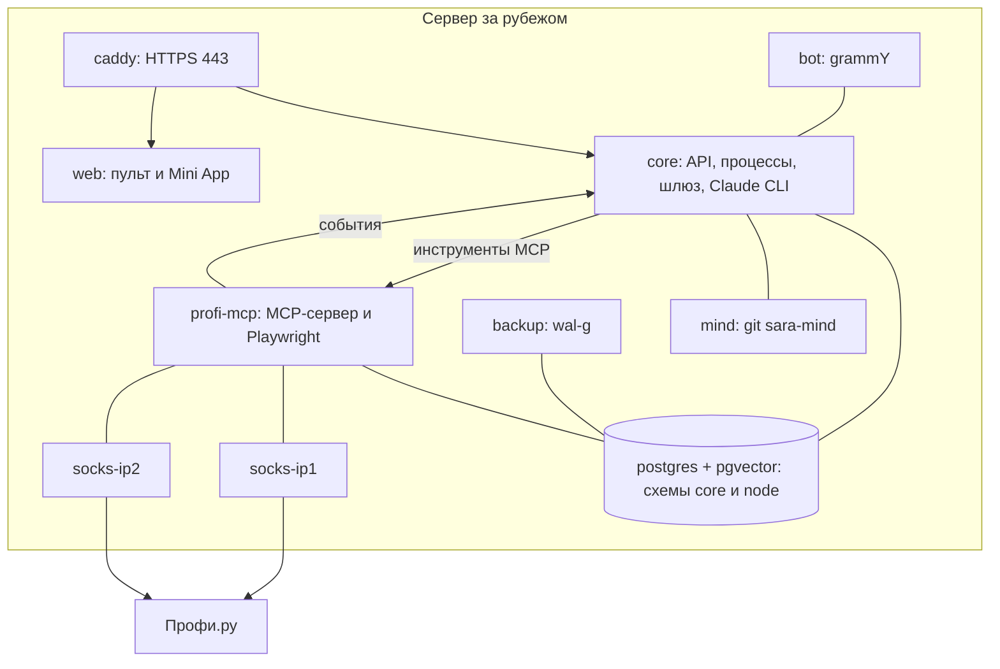
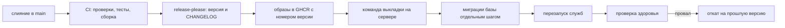

# Развёртывание

| | |
|---|---|
| Версия | 1.1, 22.10.2026 |
| Изменение | один сервер за рубежом вместо двух узлов (ADR-021, решение Бориса 22.10) |
| Связано | спецификация 6.5, ADR-003, ADR-021, ADR-022; SLO `docs/ops/slo.md`; инструкции на случай сбоя `docs/ops/runbooks.md` |

## 1. Окружения

| Окружение | Где | Профи.ру | Telegram | Claude | Зачем |
|---|---|---|---|---|---|
| Локальное | Мак Бориса, Docker | фальшивый | бот для разработки | токен `setup-token` на Маке | разработка и тесты |
| CI | GitHub Actions | фальшивый | нет | нет (модель в CI не вызывается) | проверки каждого изменения |
| Тень | сервер за рубежом | живой, только чтение и черновики | бот для работы | отдельная подписка | проверка на живой площадке |
| Работа | тот же сервер | живой, с отправкой | бот для работы | отдельная подписка | работа |

Тень и работа это один и тот же сервер. Разницу задают флаги:
`outbound.bids`, `outbound.messages` (выключены в тени). Переключение
по частям (`docs/ops/migration-and-cutover.md`) это включение флагов по
одному.

## 2. Сервер и службы

Один сервер за рубежом, как у v1, но отдельный от сервера v1 (v1
работает до переключения). Размер: 2-4 ядра, 4-8 ГБ памяти, 60 ГБ диска,
по одному IPv4 на аккаунт Профи.ру.

| Служба | Порт | Наружу | Данные |
|---|---|---|---|
| `caddy` | 443 | да, HTTPS | сертификаты |
| `core` | 3000 | нет, через caddy | |
| `bot` | нет | исходящие к Telegram | |
| `web` | статика через caddy | да | |
| `postgres` | 5432 | нет | том `pg`; схема `core` (ядро) и схема `node` (сырые данные площадки и очередь событий службы Профи-MCP) |
| `mind` | нет | push в GitHub `sara-mind` | том `mind` |
| `backup` | нет | исходящие к S3 | |
| `profi-mcp` | 7070 только во внутренней сети Docker | исходящие к Профи.ру через SOCKS своего IP | том `browser-profiles` |
| `socks-ipN` | 1080+N локально | исходящие с IP аккаунта N | |
| `voice` | 7080 только во внутренней сети Docker | нет (модель Silero в образе, ADR-028) | нет; модель в памяти только во время разговора, предел 1 ГБ |

Наружу открыт только 443; SSH только по ключу. Служба Профи-MCP
недоступна снаружи: её вызывает только ядро.

## 3. IP на аккаунт

У сервера несколько IPv4. На каждый IP поднимается локальный
SOCKS-сервер, привязанный к этому адресу. Браузерный контекст аккаунта
ходит через свой SOCKS. Проверка при старте: внешний IP вкладки совпадает
с IP аккаунта, иначе аккаунт не запускается (ST-M1-02).

**Если Профи.ру не пускает зарубежный IP:** служба ждёт и повторяет с
паузой, Борису одно 🌐 «Нет связи с Профи.ру» и одно «Связь вернулась»
(как в v1). Если блокировки станут частыми, запасной путь: выход браузера
аккаунта через российский прокси, без хранения данных в России. Решает
Борис (ADR-021).

## 4. Выкладка

- Команда `sara-deploy <версия>` на сервере: тянет образы, запускает
  миграции, перезапускает службы, ждёт проверку здоровья.
- Откат: `sara-deploy <прошлая версия>`. Миграции пишутся в порядке
  «расширить, потом сузить» (ADR-020), поэтому прошлая версия кода
  работает на новой схеме.
- Служба Профи-MCP перезапускается отдельно и бережно: перед
  перезапуском дожидается конца текущего действия на площадке.
- Выкладка, меняющая поведение Сары (роли, процедуры), идёт только после
  экзамена не хуже прошлой версии.

## 5. Бэкапы

| Что | Как | Где | Проверка |
|---|---|---|---|
| База (обе схемы) | непрерывный архив WAL и ежедневный снимок (wal-g) | S3 у другого провайдера, зашифровано | восстановление раз в неделю автоматически |
| Разум | git | сервер и GitHub `sara-mind` | каждая запись это коммит |
| Профили браузеров | ежедневная копия тома | S3, зашифровано | при переезде сервера |
| Секреты | sops-файлы в репозитории, ключи age у Бориса | Мак Бориса и менеджер паролей | при смене секретов |

Цели: потеря данных не больше 5 минут, восстановление не дольше 1 часа
(NFR-REL-2).

## 6. Наблюдение

- **Снаружи:** проверка доступности сервера раз в минуту сторонним
  сервисом (бесплатный план), тревога в Telegram.
- **Изнутри:** метрики считаются из журнала (`docs/ops/slo.md`), ошибки
  по классам в GlitchTip, свежесть бэкапа, время последнего события
  площадки.
