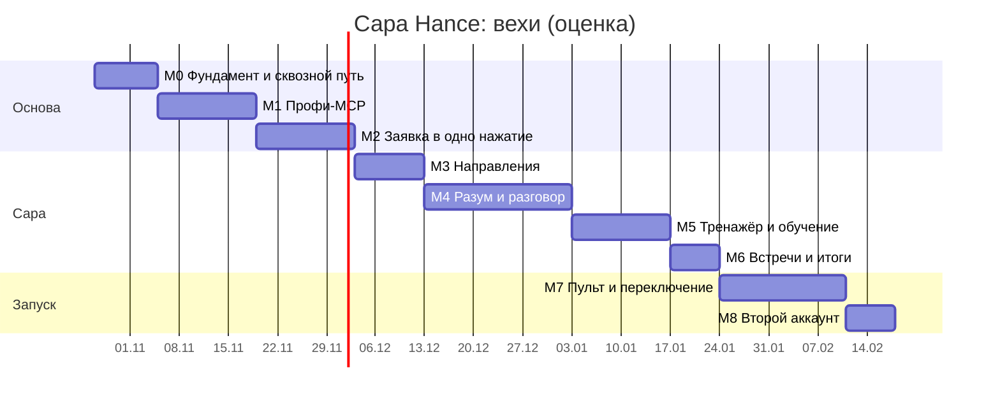

# Дорожная карта

| | |
|---|---|
| Версия | 1.0, 22.10.2026 |
| Основа | вехи спецификации (раздел 16), карта историй `docs/product/story-map.md` |

## 1. Как читать

- **Веха** это законченный кусок, который Борис может увидеть и принять.
- **Аппетит** (метод Shape Up из Basecamp): сколько времени мы готовы
  потратить. Время фиксировано, объём гибкий: если не успеваем, режем
  второстепенное, а не сдвигаем веху.
- **Ворота**: что должно быть готово до старта вехи. Почти всегда это
  действие или решение Бориса.
- **Даты ориентировочные**: старт после «да» на пакет документов.
  Новогодние праздники не учтены.

## 2. Вехи

| Веха | Аппетит | Ориентир | Что получает Борис | Ворота (до старта) | Приёмка |
|---|---|---|---|---|---|
| M0 Фундамент и сквозной путь | 1-1,5 недели | начало ноября | на Маке одной командой поднимается система; заявка с фальшивого Профи.ру приходит карточкой в бот, «да» даёт фальшивый отклик и запись в журнале | «да» на пакет; репозитории; бот для разработки; `claude setup-token` на Маке | показ сквозного пути; CI зелёный |
| M1 Профи-MCP | 2 недели | ноябрь | Сара на сервере видит живую ленту и чаты меньше чем за минуту, вход живым экраном с телефона | сервер за рубежом с 2 IP; консультация юриста до записи данных клиентов | 48 часов тени: сообщения замечены меньше чем за 60 секунд, автор у 100% |
| M2 Заявка в одно нажатие | 2 недели | начало декабря | карточка заявки меньше чем за 2 минуты, отклик по «да» за минуту | отдельная подписка Claude; бот для работы | в тени 90% карточек меньше 2 минут; один пробный отклик по «да» |
| M3 Направления | 1,5 недели | середина декабря | онбординг направления, система оценки, калибровка, маршрутизатор | 20 минут Бориса на калибровку | маркетинг откалиброван от 85% |
| M4 Разум и разговор | 3 недели | январь | Сара пишет черновики ответов клиентам голосом Бориса | выгрузка истории, 30 минут интервью | экзамен построен; черновики в тени сравниваются с Борисом |
| M5 Тренажёр и обучение | 2 недели | январь | тренировки в пульте, уроки, самостоятельность по темам | 3 тренировки Бориса | уроки попали в разум; экзамен не хуже |
| M6 Встречи и итоги | 1 неделя | конец января | «встреча назначена», итоги, цена договора | свободное время в настройках | итог встречи виден в аналитике |
| M7 Пульт и переключение | 2-3 недели | февраль | веб-пульт и Mini App, переключение с v1 | решение Бориса о переключении | условия выхода из тени выполнены 7 дней |
| M8 Второй аккаунт | 1 неделя | конец февраля | IT-направление рядом с маркетингом | второй аккаунт есть и разрешён | два аккаунта, ни одного двойного отклика |

Итого около 16-18 недель работы. Переключение с v1 ориентировочно в
феврале 2027.

## 3. Схема

## 4. Вариант: раннее переключение откликов

Сейчас переключение с v1 стоит в M7, то есть ценность доходит до Бориса
только в феврале. Можно раньше:

- **После M3** (середина декабря) новая Сара берёт ленту и отклики: быстрые
  карточки, отклик в одно нажатие, системы оценки направлений.
- Разговоры после отклика до M4 ведёт Борис сам: новая Сара пересылает ему
  каждое сообщение клиента (💬) и показывает его в пульте. v1 переводится
  на паузу исходящих (`npm run pause on` в старом проекте), чтобы не
  писать клиентам параллельно.
- **Плюс:** скорость откликов растёт на 2 месяца раньше. **Минус:** до M4
  переписку ведёт Борис руками.

Решение за Борисом к концу M3 (открытый вопрос В-2 в документе «Видение и
границы»).

## 5. Ворота: что нужно от Бориса и когда

| Когда | Что | Время Бориса |
|---|---|---|
| до M0 | прочитать пакет, «да» или комментарии | 30-60 минут |
| до M0 | создать бота для разработки у @BotFather; `claude setup-token` на Маке | 5 минут |
| до M1 | сервер за рубежом с 2 IP, как у v1, но отдельный (дам требования и инструкцию) | 20 минут |
| до M1 | консультация юриста по 152-ФЗ (раздел «Данные» в модели угроз) | по договорённости |
| до M2 | отдельная подписка Claude; бот для работы | 15 минут |
| M3 | калибровка направления на 20 заявках | 20 минут |
| M4 | интервью о Hance карточками | 30 минут |
| M5 | 3 тренировки по 5-10 минут | 30 минут |
| M7 | решение о переключении | |
| до M8 | вопрос в поддержку Профи.ру о втором аккаунте | 10 минут |

## 6. Ритм

- После каждой вехи: показ Борису, приёмка по критериям, «Что нового»
  в Telegram простым языком.
- Раз в неделю: короткий отчёт (что сделано, что дальше, что нужно от
  Бориса).
- После каждого блока работы: обновляется документ передачи дел
  (`docs/handoff/`).
