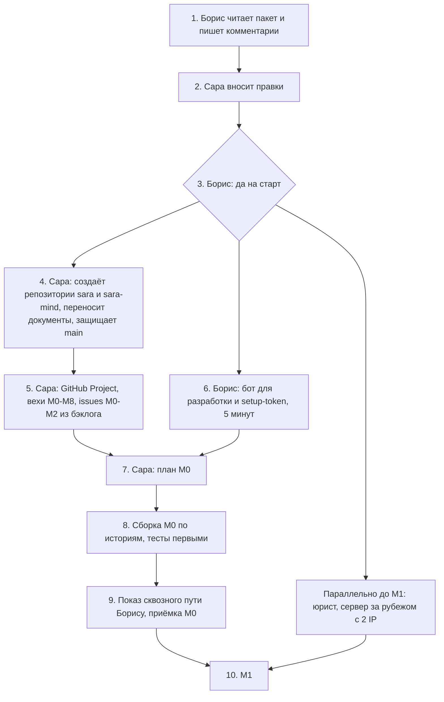

# Порядок старта разработки

| | |
|---|---|
| Версия | 1.0, 22.10.2026 |
| Зачем | что и в каком порядке происходит от утверждения документов до первой рабочей вехи |

## 1. Ворота «Готово к разработке»

Разработка M0 начинается, когда выполнено всё:

| № | Условие | Кто | Состояние |
|---|---|---|---|
| 1 | Спецификация утверждена | Борис | «все ок» 22.10; сервер за рубежом, 22.10 |
| 2 | Пакет документов прочитан, комментарии внесены | Борис, Сара | «меня всё устраивает, можно приступать» 22.10 |
| 3 | Репозитории `sara` и `sara-mind` созданы, документы в `main` | Сара по «да» Бориса | сделано 22.10 |
| 4 | Бэклог M0-M2 перенесён в GitHub (вехи и issues), истории M0 по DoR | Сара | сделано 22.10 |
| 5 | Бот для разработки создан, токен у Сары | Борис, 2 минуты | ждёт |
| 6 | `claude setup-token` на Маке выполнен | Борис, 1 минута | ждёт |
| 7 | План M0 написан (навык writing-plans) | Сара | после 3 |

## 2. Последовательность

## 3. Шаги подробно

| Шаг | Кто | Что получается | Сколько |
|---|---|---|---|
| 1. Прочитать пакет | Борис | комментарии на странице | 30-60 минут |
| 2. Правки | Сара | документы v1.1 | 1 блок |
| 3. «Да» на старт | Борис | разрешение создать репозитории | |
| 4. Репозитории | Сара | приватные `perpetumxcompany-alt/sara` и `perpetumxcompany-alt/sara-mind`; этот репозиторий (`~/Sara-Hance`) стал `sara`. Сделано 22.10. Защита `main` на бесплатном плане для приватных репозиториев недоступна: правило «только через пул-реквест с зелёным CI» держится в CLAUDE.md, пока Борис не решит про GitHub Pro | 15 минут |
| 5. Задачи | Сара | вехи M0-M8 (GitHub Milestones), 16 историй M0 и 23 истории M1-M2 как issues с меткой `story`. Сделано 22.10 | 30 минут |
| 6. Бот и токен | Борис | бот для разработки у @BotFather; `claude setup-token` | 5 минут |
| 7. План M0 | Сара | `docs/superpowers/plans/…-m0.md`: задачи по 2-5 минут, тесты, команды | 1 блок |
| 8. Сборка M0 | Сара | код по историям ST-M0-01..16 | 1-1,5 недели |
| 9. Приёмка M0 | Борис | чек-лист `docs/quality/acceptance/M0.md`, показ | 15 минут |

## 4. Что параллельно готовит Борис

| Что | К какой вехе | Подсказка |
|---|---|---|
| Консультация юриста по 152-ФЗ | до M1 | вопросы в модели угроз, раздел 5 |
| Сервер за рубежом с 2 IPv4, как у v1, но отдельный | до M1 | можно у того же провайдера; Сара даст требования и пошаговую инструкцию |
| Хранилище бэкапов (S3) у другого провайдера | до M1 | там же |
| Отдельная подписка Claude для Сары | до M2 | по ней `claude setup-token` для сервера |
| Бот для работы | до M2 | в мастере запуска |
| Вопрос в поддержку Профи.ру о втором аккаунте | до M8 | текст вопроса подготовит Сара |
