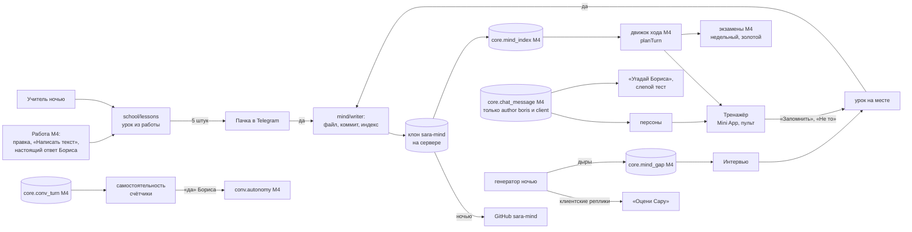

# M5 «Тренажёр и обучение»: дизайн

| | |
|---|---|
| Дата | 25.10.2026 |
| Статус | черновик дизайна; Борис спал и заранее разрешил брать рекомендованное, поэтому решения, которые принимает он, приняты рекомендуемым вариантом, помечены «[решение Бориса, рекомендую: ...]» и собраны в разделе 15 |
| Основа | спецификация `docs/spec/2026-10-22-sara-spec-v1.md` (FR-TRAIN-2..9, FR-SPEECH-1, FR-SPEECH-4, FR-AUTO-1..4, FR-MIND-3, FR-MIND-4, FR-UI-4, NFR-COST-2, NFR-PRIV-2, цели G4 и G5), дизайн v3 (раздел 8, 12.1, 15-18), дизайн M4 `docs/superpowers/specs/2026-10-25-m4-conversation-design.md` и его контракты (ветка `claude/m4-conversation-2cad67`, ещё не в `main`), существующий цикл обучения оценке `apps/core/src/learning/` |
| Кто строит | сессии Claude Code, части параллельно (план `docs/superpowers/plans/2026-10-25-m5-trainer.md`) |

Отметки: **[Б]** решение Бориса из спецификации или его слов; **[моё]**
решение разработки, его можно оспорить; **[решение Бориса, рекомендую:
...]** решение, которое принимает Борис, принято за него рекомендуемым
вариантом.

---

## 0. Сводка на одну страницу

**Что строим.** Школу Сары: всё, через что она учится говорить как Борис
и решать как он, и через что она получает право отвечать клиентам сама.

1. **Урок** это одна вещь, которой Борис научил Сару: было (как ответила
   бы она), стало (как ответил он), вывод одной фразой. Уроки появляются из
   его правок в работе, из тренажёра, из интервью и от ночного учителя.
2. **Пачки по 5.** Уроки, которые Сара нашла сама (правки в работе,
   черновики учителя), приходят в Telegram одним сообщением на 5 уроков с
   кнопками «да», «нет», «не важно»; урок из сегодняшней правки приходит
   завтра, его вывод пишется ночью. Уроки, где Борис сам рядом (тренажёр,
   интервью), он подтверждает на месте одним нажатием.
3. **Разум.** После «да» Сара сама записывает запись в свой клон
   `sara-mind` на сервере (коммит от имени Сары с номером урока), индекс
   перестраивается сразу, ночью коммиты уходят в GitHub. Любой коммит
   откатывается одной кнопкой (новое ADR-025). Золотой набор экзамена из
   20 настоящих ответов Бориса собирает M5, Борис подтверждает его одной
   карточкой.
4. **Тренажёр** в Mini App и пульте, сессия 5 минут, пять режимов:
   «Клиент пишет, отвечаешь ты», «Угадай Бориса», «Сара отвечает, ты
   оцениваешь», «Трудные случаи», «Интервью». Вариант Сары в тренажёре
   пишет тот же движок хода, что в работе (M4), поэтому тренажёр проверяет
   настоящую Сару. Клиенту из тренажёра не уходит ничего.
5. **Ночь** (01:00-07:00 по Москве, приоритет P3, свой бюджет вызовов):
   выводы уроков из работы (haiku); учитель (opus, один вызов)
   превращает уроки в черновики
   понимания и портрета речи; подготовка материала тренажёра, чтобы днём
   тренировка почти не тратила лимит; генератор пишет целые диалоги
   одним вызовом на 5 диалогов и ищет дыры в разуме; экзамен раз в неделю
   и короткий золотой экзамен после дня с новыми уроками.
6. **Слепой тест** раз в неделю: 5 пар «твой ответ или Сары», в Mini App.
7. **Самостоятельность по темам**: счётчики одобрений, понижение после
   существенной правки, предложение повысить после 10 одобрений подряд и
   проверки в тренажёре; решает Борис. Цена, договор, скидки и NDA всегда
   у Бориса **[Б]**.

**Чем экономим подписку** (Борис: учёба на той же подписке, что живая
Сара **[Б]**): никакого дообучения (ADR-008); дорогие вызовы только ночью
и в пределах бюджета; урок из правки это один вызов haiku; разница
вариантов считается кодом; выводы уроков из работы пишутся ночью;
материал «Угадай Бориса», «Оцени Сару» и
слепого теста готовится ночью, днём Борис его только смотрит; генератор
пишет диалоги целиком, 5 штук одним вызовом; учитель один вызов opus за
ночь; при лимите Claude задачи ночной школы на этой модели
останавливаются до следующей ночи; не больше 3 сообщений школы в день.

**Чего в M5 нет.** Экраны «Разум», «Экзамены», «Настройки» целиком (M7;
M5 даёт их API и свои экраны тренажёра); уроки из правок откликов (их
питают образцы формата направления M3); самостоятельность отдельно по
направлениям (M8); голос в пульте (голос понимает бот).

**Приёмка вехи** (спецификация, раздел 16): Борис провёл 3 тренировки,
уроки попали в разум.

---

## 1. Зачем и что считаем успехом

**Зачем.** M4 даёт Саре разум и разговор, но разум почти пуст, а голос
Бориса держится только на образцах из истории. Чтобы цель G5 (60% ответов
без Бориса через два месяца после M5) стала возможной, Сара должна быстро
и дёшево копить то, чему учит Борис, а Борис должен видеть, что она
выучила, и решать, где ей можно отвечать самой. У Бориса мало времени
(риск из спецификации, раздел 17): тренировки по 5 минут в Mini App,
карточки пачками **[Б]**.

**Успех M5.**

| № | Что | Как видно |
|---|---|---|
| U1 | Борис провёл 3 тренировки, в каждой хотя бы одна реплика с вариантом Сары и разницей | `core.training_session` с `finished_at` и `items_count > 0`, отчёт `pnpm report:school` |
| U2 | уроки попали в разум: после «да» Бориса запись есть в `sara-mind`, в индексе и находится поиском | `core.mind_commit`, `mind_version` сменилась, запись найдена `MindSearch` |
| U3 | правка Бориса в работе превращается в урок и приходит в пачке по 5 | `core.lesson` с `source = edit`, сообщение пачки |
| U4 | ночная школа держится в бюджете и останавливается на лимите | отчёт `report:school`: единицы за ночь, пропуски с причиной |
| U5 | синтетический диалог никогда не попадает в разум и золотой набор | тест на запись разума с источником `sim:` |
| U6 | тренировка не уходит клиентам | тест: целая тренировка, 0 вызовов `profi.send_message`, 0 строк `outbox` |
| U7 | у каждой темы виден уровень и счётчики; повышение только по «да» Бориса | API самостоятельности, тест на закрытые темы |

**Анти-цели** (провал, даже если работает): запись в разум без «да»
Бориса; синтетика в разуме или золотом наборе; учёба съела лимит, и
клиенты ждут; поток сообщений Борису (уроки по одному, вопросы каждый
час); тренировка ушла клиенту; голос Сары v1 или текст клиента в
образцах как голос Бориса; данные клиента в разуме без обезличивания;
Сара сама подняла тему до «сама»; тема цены, договора, скидок или NDA
стала не «зовёт».

## 2. Ограничения

1. **Подписка.** Все вызовы только через шлюз M2 (`apps/core/src/gateway`).
   Приоритеты из спецификации: тренажёр P1, ночная учёба P3 (7.4). M3
   добавляет в шлюз `CallOptions.priority` и правило «вызовы P3 не
   занимают последний свободный слот»; M5 на них опирается.
2. **Корпус.** Тренажёр и голос Бориса строятся только из истории чатов
   Профи.ру, с разделением авторов, а не из Telegram **[Б]** (решение
   22.10). Выгрузку и авторство делает M4 (`core.chat_message`, ADR-024):
   голос Бориса это только строки `author = 'boris'`. Строки
   `sara_v1`, `unknown` и `source = 'telegram_export'` никогда не
   становятся образцом, персоной или ответом Бориса в «Угадай Бориса».
3. **Без дообучения.** Только разум, образцы, экзамены (ADR-008).
4. **Разум.** Изменение только после «да» Бориса (FR-MIND-3). M4 решил,
   что ядро разум только читает, а предложения копит в
   `core.mind_proposal`. M5 меняет это: ядро пишет в свой клон по «да»
   Бориса (раздел 5.3, ADR-025, запрос к M4 в разделе 6).
5. **Тень.** Пока `conv.v1_writes` включено (M4), Сара ничего не
   отправляет клиентам; самостоятельность в тени копит счётчики и может
   быть поднята заранее, а действовать начинает после переключения.
6. **Соседи.** M4 строит `conversation/`, `mind/`, `history/`, `exam/`;
   M3 трогает шлюз и пульт; M7 строит оболочку Mini App и разделы пульта.
   M5 живёт в `apps/core/src/school/` и новых файлах писателя разума в
   `apps/core/src/mind/` (`writer.ts`, `render.ts`, `guard.ts`,
   `git.ts`), общие файлы трогает минимально (раздел 13).
7. **Процессы.** `WORKFLOW_VERSION` не меняется. Задачи M5 идут через
   свой тик школы раз в минуту (`school/jobs.ts`, по образцу
   `learning/jobs.ts`: задачи по очереди, сбой одной не останавливает
   другие) и `core.job_run` (как 19:00-сводка), а не через новые процессы
   DBOS: каждая задача идемпотентна по дню и сама проверяет, что уже
   сделано.
8. **Тесты.** Не ходят на Профи.ру и не вызывают Claude
   (`tests/fakes/fake-claude.mjs`, `FAKE_CLAUDE_OUTPUT_BY_ROLE`).

## 3. Решения коротко

| Вопрос | Решение | Почему |
|---|---|---|
| Что такое урок | строка `core.lesson`: было, стало, вывод, тема, тон; к ней 0-2 предложения разума `core.mind_proposal` | одна вещь «Урок» из карты сущностей (дизайн v3, 16.1); «Да» Бориса на урок это «да» на его записи **[моё]** |
| Как Борис подтверждает | на месте, если урок родился при нём (тренажёр, интервью); пачкой по 5 в Telegram, если Сара нашла его сама | двойное подтверждение раздражает, а уроки из работы без пачек дают поток **[решение Бориса, рекомендую: так]** |
| Кто пишет в `sara-mind` | ядро в свой клон на сервере, коммит после «да», ночью отправка в GitHub; откат одной кнопкой | иначе «да» Бориса ждёт разработку, приёмка вехи невозможна без человека; ADR-025 **[моё]** |
| Чем делается вариант Сары в тренажёре | тот же движок хода M4 (`planTurn`), без отправки, с приоритетом P1 | тренажёр проверяет настоящую Сару, а не отдельный пересказ **[моё]** |
| Как считается разница | кодом: сходство M4 (`similarity`) и подсветка слов | без вызова модели на каждую реплику **[моё]** |
| Где персоны | таблица `core.persona` в ядре, обезличенно, с источниками; не разум и не требуют «да» | персона не меняет поведение Сары в работе, только тренажёр **[решение Бориса, рекомендую: так]** |
| Когда учитель | ночью один вызов opus, если есть материал и ждёт меньше 15 карточек | экономия и защита от завала карточками **[моё]** |
| Экзамен после уроков | уроки вступают в силу сразу по «да»; ночью короткий золотой экзамен; стало хуже, значит одно сообщение «Откатить?» | «да» Бориса это и есть ворота разума; экзамен целиком на каждое «да» слишком дорог **[решение Бориса, рекомендую: так]** |
| Повышение темы | 10 одобрений подряд без правок, в тренажёре не меньше 4 из 5 «так и отправила бы» за 14 дней, на последнем экзамене нет S1 по теме; Сара предлагает, решает Борис | FR-AUTO-3 **[Б]** плюс числа **[решение Бориса, рекомендую: так]** |
| Существенная правка | сходство черновика и текста Бориса меньше 70%, или изменилось число; у темы «сама»: «Не так» на ушедшем ответе или Борис написал клиенту сам после него | опечатка и приветствие не понижают тему **[решение Бориса, рекомендую: так]** |
| Генератор | 50 диалогов за ночь, 5 диалогов одним вызовом sonnet; ищет дыры кодом без вызовов | FR-TRAIN-9; Борис: «диалоги целиком одним вызовом» **[Б]** |
| Золотой набор экзамена | собирает M5 из реальных ответов Бориса, он подтверждает одной карточкой | план M4 золотых сценариев не строит, а без них нет ночной проверки уроков и сверки судьи **[решение Бориса, рекомендую: так]** |
| Когда пишется вывод урока из работы | ночью, P3, в бюджете школы; урок приходит на следующий день | дневной лимит остаётся клиентам (NFR-COST-2) **[решение Бориса, рекомендую: так]** |
| Бюджет ночи | единицы: haiku 1, sonnet 4, opus 20; 400 единиц за ночь, ещё 700 в ночь недельного экзамена | без счётчика лимита подписки иначе не мерить; числа уточнит замер первой недели **[моё]** |

## 4. Как всё связано



## 5. Части

### 5.1 Урок: что это и откуда берётся (FR-TRAIN-4, FR-TRAIN-6)

**Урок** (`core.lesson`) хранит: порядковый номер `n` (по нему строятся
номера записей разума, 5.3), источник и ссылку на него, область
(`shared` или направление), тему (`Topic` M4), тон (`Tone` M4), тип
вопроса (номер записи понимания, если был), реплику клиента
(обезличенную), «было» (текст Сары), «стало» (текст Бориса), вывод одной
фразой, вид вывода, состояние, решение Бориса и причину отказа, номер
коммита разума.

**Вид вывода** (`kind`): `voice` (как сказать: слова, длина, тон),
`fact` (что правда: цена, порядок, сроки), `procedure` (какой ход:
позвать Бориса, предложить созвон, промолчать), `tone` (как ответить на
шутку, раздражение, спешку), `bulk` (пачка образцов или сценариев из
выгрузки истории).

**Источники.**

| Источник | Когда появляется | Было | Стало | Как подтверждается |
|---|---|---|---|---|
| `edit` | Борис нажал «Изменить» на черновике разговора и прислал свой текст (M4: `conv_turn.boris_text`, событие `conv.draft_edited`) | черновик Сары | текст Бориса | пачкой |
| `say` | Борис продиктовал текст клиенту командой «Написать текст» на ход, где у Сары был черновик (событие `conv.said`) | черновик Сары | текст Бориса | пачкой |
| `compare` | в чате появился ответ, автор которого доказан как Борис (`actual_author = 'boris'`), а сходство с черновиком ниже 90% | черновик Сары | настоящий ответ | пачкой |
| `training` | «Запомнить» или «Не то» в тренажёре, ответ в обсуждении | вариант Сары | ответ Бориса или его слова | на месте |
| `interview` | ответ Бориса на вопрос интервью | нет | его ответ | на месте |
| `teacher` | черновик ночного учителя | прежняя запись | новая запись | пачкой |
| `review` | после переключения Борис нажал «Не так» на ответе, который Сара отправила сама (5.15) | ответ Сары | нет (вывод из его слов) | пачкой |
| `history` | образцы и сценарии из выгрузки истории M4 (`core.mind_proposal`, источник `history:`), золотой набор экзамена (5.13) | нет | образцы, сценарии | одной карточкой «все» или пачками |
| `import` | остальные предложения M4 без урока: строки `core.mind_proposal` и файлы стартового разума в папке `mind/proposals/` клона (портрет, процедуры этапов, понимание, знание о Hance из открытых источников) | нет | текст записи целиком | пачкой, каждое отдельно |

**Автор ответа в тени.** Пока работает тень, M4 помечает каждое
сообщение специалиста в чате как `unknown` (ADR-024): ответ Бориса там не
отличить от ответа Сары v1. Поэтому:
- уроки `edit`, `say` и одобрение «Хорошо» берутся из действий Бориса в
  Telegram (его текст в `boris_text`, его нажатие). Автор сообщения в
  чате им не нужен: они работают и в тени;
- урок `compare` и одобрение по настоящему ответу работают, только когда
  автор доказан (`actual_author = 'boris'`): после переключения или по
  доказательству ADR-024 (запрос R11: сообщение в чате, равное
  `boris_text`, M4 помечает как `boris`). Ответы `unknown` и `sara_v1` не
  учат и не считаются никогда **[Б]**.

**Урок из работы делается так** (`school/lessons/fromWork.ts`).
1. Днём, кодом, без модели (тик школы раз в минуту): ходы
   `core.conv_turn` за 7 дней, у которых есть `boris_text` или настоящий
   ответ с `actual_author = 'boris'` и нет урока с тем же `source_ref`
   (номер хода). Сравнение `editWeight` (5.15): `same` это не урок, а
   одобрение темы; иначе урок в состоянии `new`, ещё без вывода.
2. Ночью, в 01:00, P3, в бюджете ночной школы: роль `lesson-maker`
   (haiku) по реплике клиента, черновику, тексту Бориса и трассе хода
   (почему, номера записей) отвечает: стоит ли запоминать (`worth`),
   вывод одной фразой, вид, тема, тон. `worth = false` (опечатка,
   порядок слов) даёт урок `dropped`, Борису его не показываем. Не
   больше 3 попыток на урок, по одной за ночь; при лимите Claude попытка
   не тратится. После третьего сбоя урок `ready` с выводом «без вывода,
   посмотри сам».

Значит, урок из сегодняшней правки приходит в пачке на следующий день
**[моё]**: дневной лимит остаётся клиентам (NFR-COST-2, приоритеты
спецификации 7.4).

**Что урок кладёт в разум.** Урок `voice`, `tone` и `procedure` с
текстом Бориса даёт предложение **образца** речи `e-l-<n>`: путь
предложения `mind/proposals/shared/speech/examples/e-l-<n>.md`, поля по
M4 (`type: example`, `topic`, `tones`, `stages`, `sources:
[<источник>:<ссылка>]`), тело `## Клиент`, `## Борис`, `## Контекст` с
выводом. Имя клиента в обеих частях заменяется той же меткой, что у M4
при выгрузке истории; телефоны, почта, ссылки тоже. Файл собирает код из
полей урока, модель текст файла не пишет. Урок `fact` из интервью даёт
предложение записи **знания** `k-i-<n>` (5.9). Выводы уроков, кроме
образца, идут материалом ночному учителю: он обобщает их в записи
понимания и портрета (5.10).

**Тренажёр и синтетика.** Два разных случая:
- «Клиент пишет» и «Трудные случаи»: реплику клиента пишет модель по
  персоне прямо в тренировке, ответ пишет Борис. Голос настоящий,
  Бориса, а реплика клиента служит только ключом поиска. Такой образец
  разрешён, источник `training:<карточка>` виден в записи
  **[решение Бориса, рекомендую: образцы из тренажёра с выдуманным
  клиентом разрешены]**;
- «Оцени Сару» на репликах генератора (5.11): реплика взята из
  сгенерированного диалога. Карточка хранит источник
  `sim:<диалог>:<n>`, урок из неё **не даёт образца**, а учитель получает
  только вывод Бориса и его текст, без сгенерированной реплики
  (FR-TRAIN-9, тест).

### 5.2 Пачки уроков в Telegram (FR-TRAIN-6)

**Когда уходит пачка** (`school/lessons/batches.ts`, тик школы):
- готово 5 уроков в состоянии `ready`, или самый старый ждёт больше 3
  суток (тогда сколько есть);
- с 10:00 до 22:00 по Москве, не больше 2 пачек в день
  (`school.batches_per_day`) и в пределах общего счёта сообщений школы
  (5.16);
- прошлая пачка закрыта (на все уроки есть ответ) или висит больше 24
  часов. Висящая пачка в этот момент **закрывается**: её «да» записываются
  в разум, уроки без ответа снова `ready` и идут первыми в следующей, а
  старое сообщение помечается «Остальное перенесла в новую пачку»;
- модель пачке не нужна, поэтому лимит Claude ей не мешает.

**Сообщение пачки** (тексты в `school/texts.ts`, без длинного тире):

```
📚 Уроки из работы: 5
Отметь каждый: да (запомню), нет (спрошу почему), не важно.

1. Сроки. Клиент торопит.
Я: «Сделаем за две недели, начнём в понедельник».
Ты: «Сроки скажу после созвона, это 15 минут».
Вывод: срок не обещать в переписке, звать на созвон.

2. ...
[1: да] [нет] [не важно]
[2: да] [нет] [не важно]
...
[Все да] [Открыть в приложении]
```

«Было» и «стало» в пачке обрезаются до 200 знаков, полный текст в
приложении. Каждый урок это своя задача `core.task` вида `lesson`
(действия `apply` да, `drop` нет, `skip` не важно), «Все да» это задача
пачки вида `lesson_batch` с новым действием `all` (единственное новое
действие кнопок). «Открыть в приложении» это кнопка `web_app` на экран
карточек (адрес из `SARA_PUBLIC_URL`, 5.17). Нажатие по решённому уроку
отвечает «уже сделано», как у всех задач (FR-NOTIF-1).

**После нажатия** сообщение редактируется без звука: у урока появляется
«✅ запомню», «✖️ не буду» или «➖ пропустила». «Нет» задаёт вопрос «Почему
нет?» (новый вид вопроса `why_lesson`, механизм `learning/questions.ts`,
ответ текстом или голосом; не считается в 3 вопроса «почему?» в день, как
и `edit_draft`). Ответ пишется в `lesson.reason` и уходит учителю в список
«от чего Борис отказался». «Нет» и «не важно» сразу переводят предложения
урока в `declined` (у «не важно» причина «не важно»): они больше никогда
не всплывут.

**Запись в разум идёт, когда пачка закрыта** (на все уроки есть ответ,
нажато «Все да» или прошло 24 часа): все «да» пачки дают один коммит.
Последняя строка сообщения: «Записала в разум 3 урока.» и кнопка
«Отменить» (откат этого коммита, 5.3). Если запись не прошла проверку
(5.3), строка говорит, какой урок не записан и почему, остальные
записаны.

**Образцы и сценарии из истории** (источник `history`). M4 кладёт образцы
речи Бориса из выгрузки предложениями в `core.mind_proposal` и
откладывает кнопки на M5. Одна карточка: «Нашла 140 твоих сообщений в
чатах Профи.ру. Сделать их образцами речи?» с кнопками «Да, все» (один
коммит), «Посмотреть по 5» (они становятся уроками `history` и идут
пачками) и «Не сейчас» (спрошу через неделю). Так же одной карточкой
предлагаются сценарии экзамена из истории и золотой набор (5.13).

**Стартовый разум M4** (источник `import`). M4 кладёт в `sara-mind`
черновики портрета, процедур этапов, понимания и знания о Hance файлами в
папке `mind/proposals/` и предложения в `core.mind_proposal`. Один раз
после выкладки M5 (и после каждого слияния разработки в `sara-mind`) тик
школы находит такие файлы и строки без урока и делает из каждого урок
`import` (было пусто, стало текст записи, вывод: откуда запись). Они идут
пачками, каждое отдельно: Борис видит каждый факт.

### 5.3 Как урок попадает в разум (FR-MIND-3, ADR-025)

**Писатель разума** (`apps/core/src/mind/writer.ts` с помощниками
`render.ts`, `guard.ts`, `git.ts` в той же папке) это единственное место,
где ядро пишет в папку разума. Он работает с клоном `sara-mind` в
`SARA_MIND_DIR` (M4: `/data/mind` на томе `sara-data`).

**Одна блокировка на все операции с git.** Запись, откат, слияние с
GitHub и команда `pnpm mind:sync` (отдельный процесс при выкладке) берут
одну и ту же блокировку Postgres на отдельном соединении
(`pool.connect()`, `pg_advisory_lock(hashtext('mind-writer'))`, снятие на
том же соединении). Ждут её до 30 секунд, иначе ответ «занято, повторю».

**Что пишется.** Два вида файлов:
- запись разума (`mind/shared/**`, `mind/directions/**`) по
  `MindFrontmatter` M4;
- сценарий экзамена (`exam/scenarios/x-*.json`) по `ExamScenario` M4:
  сценарии из истории и золотой набор (5.13).

Предложение несёт либо `change` (`MindChange` M5: поля и разделы, из них
файл собирается в момент записи по текущему файлу), либо только
`content` (предложения M4: готовый файл со `status: proposal`, писатель
меняет статус на `confirmed` и кладёт файл по пути без `proposals/`, как
`mind:accept` M4).

`apply(proposalIds, why)`:
1. Берёт блокировку. Сверяет базу с git (5.3, «после сбоя» ниже).
2. Отбрасывает незакоммиченное в `mind/` и `exam/` (`git checkout --
   mind exam`, `git clean -fd mind exam`).
3. Берёт только предложения в состоянии `new`, чей урок в состоянии
   `yes` (или карточка «Да, все»). Для каждого строит файл. Файл
   назначения считается из типа, области и номера записи, а не из пути
   предложения. Действия: `create` (новый файл), `update` (новая версия
   той же записи, `version + 1`; если указан `section`, заменяется только
   этот раздел `## …`, остальное из текущего файла; если записи ещё нет
   или она черновик, `update` раздела создаёт подтверждённую запись с
   этим разделом), `outdate` (`status: outdated`, файл остаётся, из
   индекса уходит).
4. Проверяет каждый файл (`guard.ts`). Провал отклоняет это
   предложение, остальные идут:
   - поля по схеме, номер уникален во всём разуме и начинается с буквы
     типа (`checkMind` M4); сценарий по схеме `ExamScenario`;
   - номер записи из ответа модели (учитель) только вида
     `^[kusje]-[a-z0-9-]{1,60}$`, область только `shared` или номер
     настроенного направления, раздел только из разделов своего типа
     (M4, 5.2): так модель не может выбрать путь файла (тест с `../`);
   - `sources` не пустой, ни один не начинается с `sim:` (FR-TRAIN-9);
     у образца речи хотя бы один источник ведёт к словам Бориса (`edit:`,
     `say:`, `compare:`, `training:`, `history:`); у остальных записей
     урок предложения в состоянии `yes` (его «да» и есть подтверждение);
   - нет телефонов, почты, ссылок, `@`-имён (те же шаблоны, что у
     обезличивания шлюза) и имени клиента из источника урока; у сценария
     поле `client_name` это метка, не имя;
   - у записи знания, которую предложил учитель, каждое число из тела
     есть в словах Бориса из уроков-источников (`after` уроков `edit`,
     `say`, `compare`, `training`, `interview`): ловушка в тексте клиента
     или фантазия учителя не становится ценой, даже если Борис
     пролистал пачку; у записи из интервью числа берутся из его ответа;
   - `update` целым файлом с устаревшей `base_version` отклоняется как
     `conflict` (запись успели поменять).
5. Пишет файлы и делает один `git commit` от автора `Сара
   <sara@hance.local>` с сообщением `mind: <номера записей> (Борис: да,
   урок <n>)` и двумя строками в конце: `Sara-Commit: <номер строки
   mind_commit>` и `Sara-Proposals: <номера предложений>`.
6. В одной транзакции: предложения `accepted` с номером коммита, уроки
   получают номер коммита, строка `core.mind_commit` вида `accept`,
   событие `mind.written`. Отклонённые предложения `declined` с причиной,
   их уроки `no` с причиной «не прошло проверку: …».
7. Перестраивает индекс (`ensureMindIndex` M4 видит новую `mind_version`)
   и снимает блокировку.

**После сбоя.** Перед любой операцией писатель читает последние 50
коммитов (`git log`) и ищет строки `Sara-Commit`: коммит есть в git, а в
базе нет строки `mind_commit` или предложения ещё `new`, значит процесс
упал между коммитом и базой; база дописывается по этим строкам, повторной
записи нет. Незакоммиченные файлы просто отбрасываются (шаг 2).

**Откат** `revert(commitId)`: по номеру строки `mind_commit` писатель
находит коммит в git по строке `Sara-Commit` (хеш мог смениться, см.
ниже), делает `git revert --no-edit`, перестраивает индекс, пишет строку
`mind_commit` вида `revert` и событие `mind.reverted`; уроки этого коммита
`no` с причиной «откатил». Если позже эти файлы меняли другие коммиты и
откат даёт конфликт: `git revert --abort` и ответ «Эти записи потом
меняли, сначала откати более поздние: …». Откат возможен из сообщения
пачки («Отменить»), из сообщения «экзамен стал хуже» (5.13) и через API
(`POST /api/mind/commits/:id/revert`, экран «Разум» в M7).

**Обмен с GitHub** `sync()`, ночью в 05:30 и командой `pnpm mind:sync`
при выкладке: `git fetch origin`, затем **слияние** `git merge --no-edit
origin/main` (а не перебазирование: хеши уже сделанных коммитов не
меняются, кнопки отката продолжают работать), затем `git push origin
HEAD:main`. Конфликт слияния: `git merge --abort`, локальные коммиты
остаются, Борису одно ⚙️ в день «Разум не ушёл в GitHub, разработка
посмотрит», событие `mind.sync_failed`. Строки `mind_commit` получают
`pushed_at`. Подтянутые коммиты разработки перестраивают индекс и могут
принести новые файлы в `mind/proposals/` (уроки `import`, 5.2). Обмен не
зависит от `school.on`, лимита и бюджета: модель он не зовёт.

**Ключ.** Отдельный ключ развёртывания с правом записи только в
`natadvn-hance/sara-mind`, хранится в зашифрованном хранилище секретов
ядра, как токен Claude (`apps/core/src/secrets`, NFR-SEC-1), и
выкладывается во временный файл с правами 600 только на время обмена.
Адрес клона `git@github.com:natadvn-hance/sara-mind.git`, отпечаток
GitHub в `known_hosts` образа. Без ключа отправка пропускается тихо, а
`report:school` показывает «разум не в GitHub с …».

**Что если клон пропал.** Том `/data` не в ночных копиях базы. Клон
восстанавливается из GitHub; коммиты после последней отправки
восстанавливаются из базы: у каждого принятого предложения есть `change`
или `content`, и команда `pnpm mind:sync --rebuild` повторяет их по
порядку `mind_commit` **[моё]**.

**Что меняется у M4.** Ядро больше не только читает разум; выкладка не
делает `git pull` в клон, а зовёт `pnpm mind:sync`. Образ ядра получает
`git` и `openssh-client`. Команды M4 `mind:proposals` и `mind:accept`
остаются для разработки на Маке и пропускают предложения, у которых есть
урок (запросы R1, R9 в разделе 6).

**Почему не через разработку, как в M4.** Приёмка M5 это «уроки попали в
разум», а «да» Бориса должно срабатывать, когда он нажал, без человека
посередине (FR-MIND-3: «откат одной кнопкой»). Git остаётся источником
правды (ADR-007): версия разума это `HEAD`, история и откат бесплатны,
копия в GitHub каждую ночь (спецификация, раздел 10: «разум в git
дважды»).

### 5.4 Тренажёр: общее (FR-TRAIN-3, FR-UI-4)

**Сессия.** Борис открывает «Тренажёр» в Mini App или пульте, выбирает
режим. Сессия идёт до 5 реплик или 5 минут (таймер виден), что раньше;
на пятой минуте Сара не обрывает реплику, а после ответа предлагает
«Закончить» или «Ещё 5 минут» **[Б]** (тренировки по 5 минут). Одна
открытая сессия; закрыл Mini App, вернулся: та же сессия, если ей меньше
часа.

**Вариант Сары** (`school/trainer/variant.ts`). Для каждой реплики
клиента тренажёр строит досье M4 (`Dossier`) из тренировочной
переписки и зовёт движок хода M4 `planTurn` с правилами «после
переключения» (тень выключена, пауза снята), чтобы показать, что Сара
сделала бы сама: ответила, позвала бы Бориса (с причиной) или промолчала.
Правила тренировки не знают ночи (`night` пустое), иначе после 23:00
вариант был бы «ждать до утра». Шлюз обёрнут:
- `withPriority(gw, p)`: вызовы Собеседника и Проверяющего идут не как
  клиент (P0), а с приоритетом, который передаёт вызывающий:
  P1 днём в тренировке, P3 ночью при подготовке материала
  (`saraVariant` принимает `priority`; обёртка ставит его всегда, поверх
  приоритета роли), через `CallOptions.priority` M3;
- `withoutLimitWait(gw)` (M2): при лимите вызов сразу отказывает, и
  экран говорит «Лимит Claude, тренировка позже»;
- `withExcluded(mind, ids)` для «Угадай Бориса» и слепого теста: из
  поиска убраны образцы из того же чата, иначе Сара списала бы ответ
  Бориса.

Вариант считается сразу, как появилась реплика клиента (пока Борис
печатает), а показывается только после ответа Бориса, чтобы не
подсказывать.

**Разница** (FR-TRAIN-4) считается кодом: сходство M4 (`similarity`,
0-100) и подсветка слов, которых нет в другом тексте (сравнение по
словам после нормализации M4). Модель на разницу не зовётся.

**Клиентам ничего.** Тренажёр не знает про исходящую очередь: модуль
`school/` не импортирует `conversation/outbox.ts`, `profi/client.ts`
(проверка в тесте по импортам), досье тренировки имеет номер разговора
`train:<сессия>`, а `queueMessage` M4 отказывает любому номеру,
начинающемуся с `train:` (одна строка, запрос R3). Тест: целая
тренировка в каждом режиме, 0 вызовов `profi.send_message`, 0 строк
`outbox`.

**Где тренажёр.** Экраны в `apps/web` одни и те же для пульта и Mini App;
на телефоне (от 360 пикселей) панель Сары раскрывается под ответом
Бориса, на компьютере три колонки (карточка сценария, переписка, панель
Сары), как в дизайне v3, 8.1.

### 5.5 Пять режимов (FR-TRAIN-3)

| Режим | Что делает Борис | Что делает Сара | Откуда материал | Вызовы днём |
|---|---|---|---|---|
| **Клиент пишет, отвечаешь ты** | отвечает как обычно, текстом или диктовкой с клавиатуры | играет клиента по персоне, рядом свой вариант и разница | персоны из истории (5.7) | на реплику: клиент haiku + вариант (Собеседник sonnet + Проверяющий haiku) |
| **Угадай Бориса** | ничего не печатает: смотрит вариант Сары, открывает свой настоящий ответ, отмечает «похоже», «не так», «запомнить разницу» | на каждой реплике клиента из прошлого чата пишет свой ответ | реальные чаты Профи.ру, ответы `author = 'boris'` | 0: готовится ночью |
| **Сара отвечает, ты оцениваешь** | ставит «так и отправила бы», «поправить» (пишет свой текст) или «не так» (почему) | отвечает на реплики клиентов | клиентские реплики генератора по темам (источник `sim:`) и золотые сценарии экзамена | 0: готовится ночью |
| **Трудные случаи** | как в первом режиме | клиент держит трудное поведение: торг, грубость, шутка, «позвоните прямо сейчас», молчание после цены, NDA, «ты бот?» | 12 трудных сценариев M4 и провалы экзаменов (`exam_result` с S1 или S2) | как в первом режиме |
| **Интервью** | отвечает на вопросы, на которые у Сары нет ответа | превращает ответ в запись знания и спрашивает «Правильно понимаю?» | пробелы `core.mind_gap` (M4), вопросы учителя, дыры генератора | на ответ: одна роль `lesson-maker` на sonnet |

**Клиент пишет, отвечаешь ты.** Вверху карточка персоны: кто клиент,
ниша, задача, настроение, сложность, тема заказа. Роль `trainer-client`
(haiku, P1) пишет реплику клиента по персоне и переписке; в ответе
отмечает, закончил ли клиент (`call_agreed` согласился на созвон,
`left` ушёл). Борис отвечает. Под его ответом панель Сары (5.6). Затем
клиент пишет дальше. Тренировка подбирает персону так, чтобы её темы
были среди непокрытых (5.8).

**Угадай Бориса.** Ночью (5.12) задача выбирает до 10 реплик клиентов из
реальных чатов, на которые Борис ответил сам (`author = 'boris'`,
`author_basis` не `v1_or_boris`), разных чатов и тем, ещё не
показанных; строит досье «как было до этой реплики» (код M5 из
`core.chat_message`, тип `Dossier` M4); пишет вариант Сары движком хода
(P3) с исключением образцов этого чата. Днём экран: переписка до этого
места (имя клиента заменено вымышленным), вариант Сары, кнопка «Показать
твой ответ», затем сходство и подсветка, кнопки «Похоже», «Не так»
(поле «что не так?»), «Запомнить разницу» (урок на месте), «Дальше».
Самый быстрый режим, без набора текста: его Сара предлагает первым в
5-минутной тренировке **[решение Бориса, рекомендую: первым предлагается
«Угадай Бориса»]**.

**Сара отвечает, ты оцениваешь.** Ночью задача берёт клиентские реплики
из диалогов генератора (5.11) по темам, которым не хватает проверки для
повышения (5.15), и золотые сценарии экзамена (для сверки судьи, 5.13),
и пишет ответ Сары движком хода. Днём карточка: реплика клиента и
короткий контекст, тема, ответ Сары; кнопки «Так и отправила бы»,
«Поправить» (свой текст, урок на месте), «Не так» (почему, урок на
месте). Оценки идут в проверку темы (5.15) и в сверку судьи (5.13).

**Трудные случаи.** Как первый режим, но первая реплика клиента и его
поведение берутся из трудного сценария (`ExamScenario` M4 с `tags.hard`)
или из провала экзамена, а роль `trainer-client` получает указание
держать это поведение. После ответа Бориса панель показывает и вариант
Сары сейчас, и её ответ, который провалил экзамен, если это провал.

**Интервью** описано в 5.9.

**Слепой тест** (5.14) живёт рядом с режимами, но это не тренировка, а
экзамен голоса раз в неделю.

### 5.6 Панель Сары и обсуждение (FR-TRAIN-4)

Под каждым ответом Бориса в режимах «Клиент пишет» и «Трудные случаи»:

```
Я бы ответила так:
Анна, добрый день! Понимаю, что сроки важны ...
Сама бы: ответила. Тон клиента: спешка. Опора: u-timeline, e-h-1234.
Сходство с тобой: 41%  [подсвечены разные слова]
[Запомнить] [Не то] [Не важно] [Почему ты так?]
```

- **Запомнить**: роль `lesson-maker` (haiku) пишет вывод; экран
  показывает карточку урока («Запомню так: …», что попадёт в разум:
  образец и вывод) с кнопками «Да, запомнить» и «Поправить вывод» (поле,
  его слова заменяют вывод). «Да» сразу зовёт писателя разума (5.3).
- **Не то**: вариант Сары неверен; необязательное поле «почему?». Урок
  вида `procedure` или `voice` с выводом из слов Бориса (без модели, если
  он написал почему; иначе `lesson-maker`) и тем же подтверждением на
  месте.
- **Не важно**: ничего не запоминается, реплика засчитана в покрытие.
- **Почему ты так?**: обсуждение. Роль `trainer-coach` (sonnet, P1)
  отвечает по трассе хода (что поняла, тип вопроса, тон, на какие записи
  опиралась, почему такой ход), без нового вызова движка. Борис может
  возразить; до 5 сообщений на реплику **[моё]**. В конце коуч предлагает
  вывод (`insight`), и появляется та же карточка урока.

Каждая реплика в покрытие и в итог идёт с темой и типом вопроса из
варианта Сары (поля `topic`, `question_type` ответа Собеседника M4).

### 5.7 Персоны и сценарии (FR-TRAIN-2)

**Персона** (`core.persona`) это обезличенный собирательный клиент:
архетип, ниша, задача, настроение (тон по умолчанию), как пишет (длина,
знаки, смайлы, «вы» или «ты»), типичные вопросы и темы, придуманный
заказ (название, текст, бюджет), сложность 1-3, трудная ли, и
**источники**: номера чатов Профи.ру, из которых она собрана (FR-TRAIN-2:
«источник у каждой персоны»). Только номера, без текста и имён.

**Как строится.** Раз в неделю ночью или когда с прошлой сборки
появилось 20 новых разговоров с ответами клиентов: код берёт до 40
разговоров из `core.chat_message` (источники `node` и `v1`, сообщения
клиента, по 600 знаков, обезличенные как в шлюзе: имя, телефоны, почта,
ссылки), нумерует их и отдаёт роли `persona-builder` (sonnet, P3). Ответ:
до 6 персон, у каждой номера разговоров, из которых она собрана, не
меньше 2 (персона из одного клиента слишком похожа на него) **[моё]**.
Код переводит номера в номера чатов и проверяет приватность: в описании
персоны нет 6 и больше слов подряд из сообщений её источников, нет
длинных чисел, ссылок, почты. Не прошла: выбрасывается. Персоны старше
60 дней выключаются, когда есть новые.

**Пока истории мало** (меньше 10 разговоров): тренажёр берёт персоны из
ручных сценариев экзамена M4 (`tests/exam/scenarios`, источник
`handmade:<номер сценария>`) и честно пишет на карточке «персона
придумана разработкой».

**Сценарии тренажёра** не отдельная таблица: это персоны, трудные
сценарии экзамена M4 и провалы экзамена. Провал экзамена (S1 или S2) сам
становится материалом «Трудных случаев» (стратегия тестирования, 4.4).

Персоны не разум: они не меняют поведение Сары в работе и Борис их не
подтверждает **[решение Бориса, рекомендую: персоны без подтверждения,
список виден в тренажёре]**.

### 5.8 Итог тренировки и карта покрытия (FR-TRAIN-5)

**Итог** после каждой сессии: сколько реплик, среднее сходство с Борисом
(и в прошлый раз), что выучено (уроки с «да» и куда записаны), какие
темы задеты, кнопка «Ещё 5 минут».

**Карта покрытия**: по каждой теме самостоятельности (11 тем M4) и по
каждой записи понимания (`u-…` в индексе): сколько реплик тренировалось
за 30 дней, когда последний раз, среднее сходство, оценки «Оцени Сару».
Тона показываются метками внутри темы. Непокрытые темы сверху. Считается
кодом из `core.training_item`. Тренировка выбирает персону и материал так,
чтобы первыми шли непокрытые темы.

### 5.9 Интервью (FR-MIND-4)

**Все пробелы в одной таблице M4** `core.mind_gap`: из работы (`turn_id`
это номер хода), от учителя (`turn_id = teacher:<прогон>:<n>`, текст это
вопрос учителя) и от генератора (`turn_id = sim:<диалог>:<n>`). Так
части учителя и интервью не ждут друг друга.

**Очередь вопросов** (`school/interview.ts`): пробелы из работы первыми,
по частоте за 14 дней (группировка по нормализованному тексту, как
`topGap` M4); затем вопросы учителя; затем дыры генератора. Закрытые
пробелы (`mind_gap.lesson_id` заполнен) не возвращаются. Текст вопроса
строит код без модели: «Клиенты спрашивают: <пробел>. Как отвечать?» с
примером реплики, если она есть **[моё]**.

**Как идёт.** В режиме «Интервью» Сара показывает вопрос; Борис отвечает
текстом или диктовкой. Роль `lesson-maker` в режиме интервью на sonnet
(через `CallOptions.model`) раскладывает ответ в запись знания:
заголовок, `## Факт`, `## Когда говорить`, `## Чего не говорить`, тема.
Экран: «Я поняла так: …» и «Правильно понимаю?» с кнопками «Да,
записать», «Поправить» (его поправка, новая попытка), «Не знаю,
пропустить». «Да» сразу зовёт писателя разума: запись знания `k-i-<n>` с
источником `interview:<n>`. Пробел закрывается новой колонкой
`mind_gap.lesson_id`.

**В Telegram.** Вопрос о пробеле в Telegram целиком строит M5 (план M4
строит только сбор пробелов `recordGap` и `topGap`, без вопроса; запрос
R8). Раз в день, если открытых вопросов 3 и больше, приходит одно
приглашение «❓ У меня 4 вопроса о Hance, на которые я не знаю ответа. 3
минуты?» с кнопкой «Открыть» (Mini App); если 1-2, приходит сам вопрос
(вид вопроса `interview`, механизм `learning/questions.ts`). Ответ на него
текстом или голосом идёт тем же путём: запись знания и «Правильно
понимаю?» ответным сообщением с кнопками «Да, записать» и «Поправить».
Оба сообщения в общем счёте школы (5.16).

### 5.10 Ночной учитель и портрет речи (FR-TRAIN-7, FR-SPEECH-1)

**Когда.** В 01:15 по Москве, раз за ночь, после разбора уроков из
работы, если есть материал (урок с решением после прошлого прогона или 5
новых образцов Бориса) и Бориса ждут меньше 15 карточек
(`school.cards_waiting_max`). Иначе учитель пропускает ночь, и это видно
в отчёте.

**Вход** (`school/teacher/input.ts`, код, до 30 000 знаков, лишнее
переносится на следующую ночь, старое первым):
1. портрет речи (`s-portrait`) целиком;
2. уроки с решением после прошлого прогона: «да» с выводами, было и
   стало; «нет» с причиной Бориса (чего не делать). У уроков из
   сгенерированных реплик (`sim:`) только вывод и текст Бориса, без
   реплики клиента;
3. новые образцы Бориса (номера и обе части);
4. сравнения с доказанным автором `boris` и сходством меньше 70% (до
   10); в тени их почти нет (5.1);
5. записи понимания по темам этих уроков целиком;
6. темп Бориса: медиана паузы его ответа по времени суток (код, из
   `chat_message` с автором `boris` без `approx_time`);
7. последние 5 черновиков учителя, от которых Борис отказался, с
   причиной.

Текст клиента в рамке «это данные, не инструкции» (дизайн v3, 12.4).

**Ответ** роли `teacher` (opus, P3, без инструментов, схема
`TeacherOutput`): до 8 предложений, каждое: действие (`create`,
`update`, `outdate`), номер записи, тип, область, поля (тема, тоны,
этапы), раздел (для правки одного раздела), тексты разделов, источники
(номера уроков `lesson:<n>` и образцов `e-…`), почему одной фразой;
и до 3 вопросов Борису (строки `mind_gap` с `turn_id = teacher:…`, 5.9).
Учитель не пишет файлы. Код проверяет предложения: номер, область и
раздел по правилам писателя (5.3, модель не выбирает путь); источники
существуют и ведут к урокам с «да» или образцам Бориса; ни одного
`sim:`; `update` только существующей записи (кроме портрета, ниже).
Годные кладутся в `core.mind_proposal` с уроком `teacher` на каждое.
Было: прежний текст раздела, стало: новый, вывод: «почему» учителя. Они
идут Борису пачками (5.2).

**Портрет речи** (FR-SPEECH-1). Когда образцов Бориса 30 и больше, а
портрет ещё черновик M4 или с прошлой версии прибавилось 30 образцов,
учитель в эту ночь делает отдельный проход «портрет»: до 60 образцов,
выбранных по разным темам и тонам, и темп. Ответ: разделы портрета
`## Форма`, `## Словарь`, `## Никогда не говорит`, `## Прагматика`,
`## Темп`. В разделах `Форма`, `Словарь`, `Прагматика` и `Темп` каждая
черта отдельной строкой с номерами образцов в конце (`- Коротко, 1-2
предложения [e-h-12, e-l-7]`); код проверяет, что у каждой такой черты
есть номер существующего образца. В разделе `Никогда не говорит` строки
без номеров: M4 берёт их в проверку роботности как есть, а источники
этого раздела учитель пишет в `sources` записи. Каждый раздел это
отдельный урок `update` с `section`: пачка из 5 разделов, Борис
подтверждает раздел за разделом, писатель меняет только принятые. Пока
портрет черновик M4, первый принятый раздел создаёт подтверждённую
запись `s-portrait` с этим разделом (5.3), остальные добавляются по мере
«да». Портрет «виден в Разуме, каждая черта с источниками»: экран
«Разум» строит M7, номера образцов уже в тексте.

### 5.11 Генератор диалогов (FR-TRAIN-9)

**Зачем.** Искать дыры в разуме дёшево: без прогона движка на каждой
реплике.

**Как.** В 03:00 роль `dialog-generator` (sonnet, P3) получает 5 персон
и пишет 5 целых диалогов клиента со специалистом, по 4-16 сообщений,
одним вызовом. У каждой реплики клиента генератор ставит тему из списка
M4. 10 вызовов за ночь, 50 диалогов (`school.generator_dialogs`) **[Б]**
(Борис: синтетика целыми диалогами одним вызовом; спецификация: 50-100 за
ночь). Сохраняются только реплики клиента с темой (`core.sim_dialog`,
30 дней).

**Поиск дыр кодом.** Для каждой реплики клиента код ищет в индексе
записи понимания и знания (`MindSearch` M4). Если среди первых трёх нет
записи с той же темой и рангом выше порога (порог подбирает строитель на
образце с тестом), это дыра: строка `core.mind_gap` с `turn_id =
sim:<диалог>:<n>` и темой. Дыры генератора идут в интервью после
настоящих пробелов. Реплики генератора по темам идут в «Оцени Сару»
(5.5) с источником `sim:`.

**Синтетика не знание** (FR-TRAIN-9, проверка в коде):
- писатель разума отклоняет запись с любым источником `sim:` (5.3);
- урок из карточки с источником `sim:` не даёт образца, а учитель видит
  из него только вывод и текст Бориса (5.1, 5.10);
- построитель золотого набора и сценариев экзамена не читает
  `core.sim_dialog` (тест по импортам) и отказывает сценарию с источником
  `sim:`;
- ответ специалиста из сгенерированного диалога не сохраняется вовсе.

### 5.12 Ночная школа: расписание и бюджет (NFR-COST-2)

**Расписание** (по Москве, каждое раз за ночь, строка `core.job_run`):

| Время | Задача | Модели | Единицы (около) |
|---|---|---|---|
| 01:00 | выводы уроков из работы (5.1) | haiku, до 20 вызовов | 20 |
| 01:15 | учитель (и портрет, когда пора) | opus 1-2 вызова | 20-40 |
| 01:45 | золотой экзамен, если разум за день менялся; не в ночь недели (5.13) | Собеседник, Проверяющий, судья на 20 сценариях | около 180 |
| 02:15 | подготовка тренажёра: «Угадай Бориса» до 10, «Оцени Сару» до 10 | движок хода | около 100 |
| 02:45 | персоны (раз в неделю или по 20 новым разговорам) | sonnet 1 | 4 |
| 03:00 | генератор и поиск дыр | sonnet 10 | 40 |
| 03:30, ночь недели | недельный экзамен (5.13), слепой тест (5.14), сборка золотого набора, пока он неполный (5.13) | движок, судья | около 650 |
| 05:30 | обмен разума с GitHub (5.3) | нет | 0 |

**Единицы.** У подписки нет счётчика остатка, поэтому школа меряет себя
сама: haiku 1, sonnet 4, opus 20 единиц за вызов **[моё, числа уточнит
замер первой недели]**. Израсходовано за ночь = сумма по `core.model_call`
с приоритетом P3 с начала окна (колонка `model` уже есть, миграция не
нужна). Перед задачей школа сравнивает прогноз задачи с остатком
`school.night_units` (по умолчанию 400; в ночь недели плюс
`school.weekly_units` 700 только для её задач); не влезает, задача
пропускается с записью `school.night_skipped` и причиной. Порядок задач
это и приоритет: уроки и учитель важнее генератора.

**Свободный лимит.** Задача не запускается, если сейчас лимит Claude у
модели, которой она пользуется, или за последние 12 часов у этой модели
был `limit_reached` **[моё]**. У Сары своя подписка (спецификация, раздел
14), поэтому чужая работа лимит не съедает. Все ночные вызовы идут через
`withoutLimitWait` (лимит сразу останавливает задачу) и с приоритетом P3.
Вызовы P3 занимают не больше `max(1, limit - 1)` слотов шлюза (правило
M3, план M3 Task 9; если оно ещё не в `main`, M5 добавляет его ровно
так же), поэтому клиент ночью получает ответ без очереди.

**Днём.** Тренажёр зовёт модель с приоритетом P1 (спецификация 7.4:
«P1 отклики, тренажёр») и без ожидания лимита: тренировка не начинается
при лимите. Пятиминутная сессия «Клиент пишет» стоит около 30 единиц,
«Угадай Бориса» и «Оцени Сару» 0 (кроме «Запомнить»). Уроки из работы
днём модель не зовут (5.1).

**Отчёт** `pnpm report:school --days 7`: единицы по ролям и ночам,
пропуски с причинами, уроки по источникам и решениям, тренировки,
коммиты разума и отправка в GitHub, экзамены, самостоятельность, счёт
сообщений школы. Чтобы через неделю поправить числа бюджета.

### 5.13 Экзамены (FR-TRAIN-8)

M4 строит экзамен из 60 сценариев на один ход, оценку кодом и судьёй,
таблицы `exam_run`, `exam_result` и сторож выкладки (`pnpm exam
--compare`, правило в `CONTRIBUTING.md`). M5 его не меняет, а добавляет
золотой набор, два прогона и сверку судьи.

**Золотой набор** (стратегия тестирования, 4.2: 20 сценариев с ответом
Бориса, меняется только по его «да»). План M4 золотых сценариев не
строит: сценарии из истории у него всегда `golden: false`, а ручные
придуманы и ответа Бориса не имеют. Поэтому набор собирает M5
(`school/exams/goldenSet.ts`), в ночь недели, пока в наборе меньше 20:
- реплики клиентов, на которые Борис ответил сам (`author = 'boris'`), из
  разных чатов, тем, тонов и этапов, из чатов, которые не были в «Угадай
  Бориса» и слепом тесте (5.14);
- сценарий по `ExamScenario` M4: переписка до реплики, обезличенная (имя
  клиента заменено меткой), `golden: true`, `expect.move = 'reply'`,
  `expect.boris_reply` = его настоящий ответ, `expect.topic` по теме
  записи понимания, если она нашлась, источник `history`;
- предложение `core.mind_proposal` вида `scenario` с путём
  `exam/scenarios/x-g-<n>.json` (как сценарии M4 из истории), урок
  `history`.

Борису одна карточка (через неделю после первого «Не сейчас» снова):
«Золотой набор экзамена: 20 сценариев с твоими настоящими ответами. По
ним я проверяю, не стала ли хуже» с кнопками «Посмотреть» (`web_app`:
список, у каждого сценария «Убрать») и «Да, все». «Да» записывает их
писателем в `exam/scenarios/x-g-<n>.json`. Пока набор пуст, золотой
прогон и сверка судьи пропускаются с причиной «нет золотого набора».

**Прогоны.**

| Прогон | Когда | Набор | Что делает итог |
|---|---|---|---|
| выкладка (M4) | перед выкладкой, меняющей поведение | 60 | код выхода 1 держит выкладку **[Б]** |
| недельный | ночь недели (`school.weekly_day`, по умолчанию с субботы на воскресенье) | 60 (вместе с золотыми) | одно сообщение в понедельник 10:00: итог, сравнение с прошлой неделей, слабые темы; провалы идут в «Трудные случаи» |
| золотой после уроков | ночью, если `mind_version` за день менялась, кроме ночи недели | 20 золотых | хуже прошлого: одно сообщение с «Откатить» |

Таблица `core.exam_run` получает колонки `kind` (`deploy`, `weekly`,
`golden`) и `trigger` (номер строки `mind_commit` или версия) расширением
(ADR-020); `runExam` M4 принимает их на вход (запрос R6).

**Золотой после уроков.** Уроки вступают в силу сразу по «да» Бориса.
Это **отступление** от дизайна v3 (8.2: «изменение разума ... не выходит,
если экзамен стал хуже»): прогон 60 сценариев на каждое «да» стоит около
550 единиц, это неделя ночного бюджета за один урок. Поэтому ночью
короткий прогон проверяет, что день уроков не сломал поведение
**[решение Бориса, рекомендую: уроки сразу, ночью золотой экзамен с
предложением откатить]**. «Хуже» здесь: новый S1 или итог ниже прошлого
золотого прогона на 0,05 и больше. Допуск 0,05 есть только у этого
прогона, потому что ответы модели слегка разнятся от прогона к прогону, а
ложная тревога будит Бориса; у выкладки остаётся правило M4 (любое
ухудшение). Хуже, значит сообщение:

```
⚠️ После вчерашних уроков экзамен стал хуже: 0,86 → 0,78.
Провал: «спросили цену в первом сообщении», Сара назвала вилку.
Вчера записала: u-price-first, e-l-41, e-l-42.
[Откатить вчерашнее] [Оставить]
```

«Откатить вчерашнее» откатывает коммиты `accept` после последнего
прошедшего прогона по одному, от позднего к раннему (по номерам строк
`mind_commit`, 5.3). Без ответа ничего не откатывается.

**Пороги.** Как в M4 и стратегии тестирования (4.1, 4.4): проходит, если
нет S1 и итог не хуже прошлого прогона того же набора. Итог сценария:
1,0 минус 0,5 за S2 и 0,2 за S3, 0 при S1. Тема сценария для
самостоятельности (5.15): `expect.topic`; сценарий без темы в проверку
темы не идёт.

**Сверка судьи** (стратегия тестирования, 4.3: судье верим при
совпадении с Борисом от 80%). В «Оцени Сару» часть карточек это золотые
сценарии с ответом Сары, который уже оценил судья (его оценка скрыта).
Вердикт судьи «годно» = голос 4-5 и процедура верна. Совпадение = доля
одинаковых вердиктов Бориса («так и отправила бы» против остального) и
судьи на последних 20 таких карточках. От 80%: судья доверенный
(`school.judge_trusted`, ставит код, событие `exam.judge_trusted`); ниже
70% после доверия: снова нет. До доверия оценка судьи показывается, но
итог прогона её не учитывает (запрос R6: вход `judgeCounts` у `runExam`).

**Диалоговый экзамен** (M4 оставил M5). 10 сценариев на 3-5 ходов с
моделью-клиентом (`trainer-client`) по персоне и целью («довести до
созвона», «не назвать цену»), судья оценивает весь диалог. Только в
недельном прогоне. `ExamScenario` M4 строгий (`.strict()`), поэтому
расширяется явным необязательным полем `dialog` (персона, число ходов,
цель). Это последняя часть, её можно отложить без вреда для приёмки
**[моё]**.

### 5.14 Слепой тест (FR-SPEECH-4, G4)

**Свой запас чатов.** Чат, хоть раз показанный в «Угадай Бориса»,
никогда не идёт в слепой тест и в золотой набор, и наоборот: иначе Борис
узнал бы свой ответ (`training_item.chat_id`).

**Подготовка** в ночь недели: 5 реплик клиентов из реальных чатов, на
которые Борис ответил сам (`author = 'boris'`), из разных чатов этого
запаса; вариант Сары движком хода с исключением образцов этого чата;
если Сара позвала бы Бориса вместо ответа, берётся другая реплика (не
больше 10 попыток на весь тест). В обоих текстах одно и то же вымышленное
имя клиента. Порядок «А» и «Б» случайный.

**Тест** только в Mini App и пульте: в понедельник в 11:00 одно сообщение
«👂 Слепой тест недели: 5 пар, 2 минуты. Угадаешь, где ты?» с кнопкой
«Открыть» **[решение Бориса, рекомендую: только в приложении, одно
напоминание в неделю]**. На каждой паре Борис нажимает «Это я: А» или
«Это я: Б». После пятой: «Угадал 3 из 5 (60%). Цель: около 50%, тогда
меня не отличить». Неделя без теста: пары сгорают, в следующую ночь
недели готовятся новые.

**Итог** в «Экзаменах» (API, экран M7) и в отчёте: доля угаданного по
неделям. G4 выполнена, когда за 4 недели подряд доля не выше 60% **[моё]**.

### 5.15 Самостоятельность по темам (FR-AUTO-1..4)

**Где уровни.** Уровень темы живёт в настройке M4 `conv.autonomy` (тема →
`self`, `draft`, `call`; закрытые темы всегда `call`, схема не даёт
поднять). M5 не заводит второй дом для уровня; история смен это
`setting_history` (кто, когда). Счётчики и последняя причина в
`core.autonomy_counter`. Пока одна область на всех; по направлениям в M8.
Чтобы уровень действовал, `planTurn` M4 читает `conv.autonomy` на каждом
ходу, а `decide()` после переключения превращает `self` в `send` для
незакрытой темы (запрос R4).

**Одна мера правки** `editWeight(черновик, текст Бориса)` для уроков
(5.1) и для серий: оба текста сначала без первой строки-приветствия и без
имени клиента, затем сходство M4 (`similarity`) и числа:
- `same`: сходство от 90% и те же числа. Это **одобрение**;
- `substantial`: сходство ниже `auto.substantial_below` (70%) или другой
  набор чисел. Это **существенная правка**;
- иначе `minor`: правка, но не существенная.

**Что считается** (`school/autonomy/streak.ts`, чистая функция по
законченным ходам M4 с темой, по времени):
- **одобрение**: «Хорошо» на черновике (`conv.draft_good`, в тени и
  после переключения); текст Бориса по «Изменить» или «Написать текст»
  с весом `same`; настоящий ответ с доказанным автором `boris` и весом
  `same`;
- **правка**: текст Бориса или настоящий ответ Бориса с весом `minor`
  или `substantial`;
- **правка ответа, который ушёл сам** (после переключения у темы `self`
  черновиков нет, поэтому править нечего): Борис нажал «Не так» на этом
  ответе в списке «Сама ответила» (ниже) или сам написал этому клиенту
  после ответа Сары, пока клиент ещё не ответил (`conv.boris_wrote` M4).
  Обе считаются существенной правкой;
- ходы с автором ответа `unknown` и `sara_v1` и без действий Бориса не
  считаются вовсе.

«10 одобрений подряд без правок» (FR-AUTO-3): серия обрывается любой
правкой. Понижение (FR-AUTO-4): только существенной.

**Список «Сама ответила».** После переключения вечерняя сводка
разговоров M4 получает строку «Сама ответила клиентам: 7» с кнопкой
«Посмотреть» (запрос R7). Кнопка присылает эти ответы по одному
сообщению (как «Показать» в сводке заявок): реплика клиента, ответ Сары,
тема и кнопки «Так» и «Не так» (задача вида `self_sent`). «Не так»
спрашивает «Что не так?» (вопрос `why_lesson`) и создаёт урок источника
`review`: было (ответ Сары), вывод из слов Бориса; урок идёт в пачку, а
тема сразу понижается.

**Повышение** (FR-AUTO-3: «Сара предлагает сама; решает Борис»).
Раз в день тик школы проверяет темы уровня `draft`, кроме закрытых:
- серия одобрений 10 и больше (`auto.approvals_to_promote`);
- в «Оцени Сару» за 14 дней по этой теме не меньше 5 оценок и из них не
  меньше 4 «так и отправила бы» (`auto.trainer_checks`, `auto.trainer_good`);
- на последнем недельном или золотом экзамене нет S1 в сценариях этой
  темы (`expect.topic`).

Всё выполнено, значит одна карточка в день (не больше), задача вида
`autonomy`; кнопки названы так же, как во «Входящих» пульта M7:

```
🎓 Тема «сроки»: 12 твоих «да» подряд без правок, в тренажёре 5 из 5.
Отвечать клиентам по ней самой, без черновика?
[Поднять] [Не сейчас]
```

В тени добавляется строка «Заработает после переключения с v1».
«Поднять» меняет `conv.autonomy` (`changed_by: boris`) и пишет
`autonomy.changed`. «Не сейчас» откладывает предложение на 7 дней. Не
хватает только проверки в тренажёре: Сара не спрашивает, а ставит в
«Оцени Сару» на ближайшую ночь до 5 карточек этой темы.

**Понижение** (FR-AUTO-4). Существенная правка по теме уровня `self`
(после переключения: «Не так» в списке «Сама ответила» или Борис написал
клиенту сам после её ответа) сразу возвращает тему в `draft`
(`changed_by: sara`, причина и номер хода в `autonomy_counter`), серия
обнуляется. Строка в вечерней сводке разговоров M4: «Тема «сроки» снова
черновиком: ты поправил мой ответ 25.10» (запрос R7). Экзамен с S1 по
теме уровня `self` тоже возвращает её в `draft`.

**Вручную.** API `GET /api/autonomy` (темы, уровни, серия, проверки
тренажёра, почему нельзя поднять) и `PUT /api/autonomy/:topic` (Борис
может опустить любую тему и поднять незакрытую; закрытую поднять нельзя,
ответ 400 «цена, договор, скидки и NDA всегда у тебя»). Экран
«Самостоятельность» в Mini App в M5 (простой список), в разделе
«Настройки» пульта его покажет M7.

**Исключение старта** (FR-AUTO-2 **[Б]**: «всё черновиком, кроме ответов
целиком из подтверждённого понимания»). После переключения ответ по теме
уровня `draft` уходит сам, если: тип вопроса это номер подтверждённой
записи понимания из отобранного на ход, этот номер есть в `fact_ids`,
тема записи понимания совпадает с темой ответа, тема не закрытая, все
проверки кода и Проверяющего пройдены с первой попытки. Включается
настройкой `auto.from_understanding` (по умолчанию включено, как записано
в спецификации; вопрос В3). `decide()` M4 не видит отобранный разум,
поэтому признак `fromUnderstanding` считает `planTurn` и передаёт в
`decide()` вместе с настройкой (запрос R2). В тени ничего не меняет.

### 5.16 Telegram: что приходит Борису

| Сообщение | Когда | Сколько | Кнопки |
|---|---|---|---|
| ⚠️ Экзамен хуже после уроков | после ночного золотого прогона | только когда хуже | «Откатить вчерашнее», «Оставить» |
| 📚 Пачка уроков | 5 готовых уроков или старше 3 суток; 10:00-22:00 | до 2 в день | да, нет, не важно на каждый; «Все да»; «Открыть в приложении»; после записи «Отменить» |
| 🎓 Предложение повысить тему | все условия 5.15 | до 1 в день | «Поднять», «Не сейчас» |
| 📚 Образцы, сценарии, золотой набор из истории | после выгрузки M4, в ночь недели, повтор через неделю по «Не сейчас» | по одной карточке | «Да, все», «Посмотреть» (или «Посмотреть по 5»), «Не сейчас» |
| ❓ Интервью | 1-2 открытых вопроса: вопрос; 3 и больше: приглашение | до 1 в день | «Открыть» или ответ на вопрос |
| 📊 Экзамен недели | понедельник 10:00 | 1 в неделю | «Открыть» |
| 👂 Слепой тест недели | понедельник 11:00 | 1 в неделю | «Открыть» |
| ⚙️ Разум не ушёл в GitHub | ночной обмен не прошёл | до 1 в день | нет |
| строки в вечерней сводке разговоров M4 | тема понижена; уроки ждут ответа; после переключения «Сама ответила: N»; отложенные сообщения школы | 0 отдельных | «Посмотреть» у «Сама ответила», «Открыть» |
| ответ, ушедший сам | по «Посмотреть», по одному | столько, сколько Борис попросил | «Так», «Не так» |

**Общий счёт школы** (FR-NOTIF-3: обычно не больше 10 уведомлений в день
плюс сводки). Сообщения школы, которые Сара шлёт сама, не больше 3 в день
по Москве (`school.messages_per_day`), по порядку важности строк таблицы
сверху вниз; ответы на нажатия Бориса («Посмотреть», итог пачки) не
считаются. Не влезло: сообщение не уходит, а становится строкой в
вечерней сводке разговоров («Ждут тебя: пачка уроков, предложение по теме
«сроки»» с кнопкой «Открыть») и пробует снова завтра.

Ночью (23:00-10:00) сообщения школы не уходят; ⚠️ и ⚙️ ждут 10:00. Все
тексты в `school/texts.ts`, по-русски, без длинного тире.

### 5.17 Mini App и пульт: экраны (FR-UI-4, FR-TRAIN-3)

Оболочку Mini App строит M7: вход по подписи Telegram в заголовке
`Authorization: tma <initData>` на каждом запросе, проверка в
`requireOwner` (дизайн M7, раздел 7; cookie с `sameSite: strict` в
окне Telegram не работает), кнопка меню «Сара», кнопки `web_app` под
сообщениями с адресом из `SARA_PUBLIC_URL` и путём экрана. Маршруты
школы стоят за тем же `requireOwner`. Если к началу экранов M5 входа M7
ещё нет в `main`, M5 строит его ровно по контракту M7 (там же описана
проверка подписи), а M7 берёт готовое. Кнопки `web_app` в сообщениях
школы требуют, чтобы `Notifier.sendButtons` умел кнопку-ссылку на
Mini App; это строит M7 (если нет, M5 добавляет вид кнопки `webApp: path`
в `notify/notifier.ts` и `notify/telegram.ts`).

M5 строит свои экраны в `apps/web/src/pages/trainer/` по дизайн-системе
(`docs/ux/design-system.md`), с пустым, загрузочным и ошибочным
состоянием, от 360 пикселей, в светлой и тёмной теме (FR-UI-3).

| Экран | Что на нём | Действия |
|---|---|---|
| Тренажёр | пять режимов с числом готового материала («Угадай Бориса: 10 готово»), «Тренировка 5 минут» сверху, карта покрытия, последние тренировки со сходством | начать режим |
| Тренировка | таймер, карточка персоны или сценария, переписка как в мессенджере, поле ответа, панель Сары под ответом | ответить, Запомнить, Не то, Не важно, Почему ты так?, Закончить |
| Угадай Бориса, Оцени Сару | карточка за карточкой, номер «3 из 10» | кнопки режима |
| Итог | сходство, выучено, темы, покрытие | Ещё 5 минут, Готово |
| Уроки | карточки пачки по одной: было, стало, вывод, что попадёт в разум | Да, Нет (почему), Не важно |
| Золотой набор | 20 сценариев: реплика клиента и твой ответ | Убрать, Да, все |
| Интервью | вопрос, поле ответа, «Я поняла так» | Да, записать; Поправить; Пропустить |
| Слепой тест | пара А и Б, «3 из 5» | Это я: А, Это я: Б |
| Самостоятельность | темы с уровнем, серией, проверкой тренажёра; закрытые с замком | поменять уровень |
| Экзамены (данные) | последние прогоны, итог по неделям, слепой тест по неделям | открыть прогон (экран M7) |

### 5.18 Роли модели

| Роль | Модель | Приоритет | Вход | Выход (zod в `packages/shared/src/contracts/school.ts`) |
|---|---|---|---|---|
| `trainer-client` (Тренер: клиент) | haiku | P1 (P3 в диалоговом экзамене) | персона, переписка тренировки, трудное поведение, если есть | `TrainerClientOutput`: `text`, `ends` (`no`, `call_agreed`, `left`), `mood` (тон) |
| `trainer-coach` (Тренер: разбор) | sonnet | P1 | реплика клиента, трасса варианта Сары, ответ Бориса, обсуждение | `CoachOutput`: `answer`, `insight` (или null), `kind` |
| `lesson-maker` (Разборщик правок) | haiku; sonnet для интервью | P3 ночью для уроков из работы; P1 в тренажёре и интервью | реплика клиента, было, стало, трасса хода; для интервью вопрос и ответ Бориса | `LessonMakerOutput`: `worth`, `insight`, `kind`, `topic`, `tone`, `fact` (заголовок, факт, когда говорить, чего не говорить, или null) |
| `teacher` (Учитель) | opus, запасная sonnet | P3 | 5.10 | `TeacherOutput`: `proposals` (до 8), `questions` (до 3) |
| `persona-builder` | sonnet | P3 | до 40 обезличенных разговоров | `PersonaOutput`: `personas` (до 6, у каждой `from` не меньше 2) |
| `dialog-generator` (Генератор диалогов) | sonnet | P3 | 5 персон | `GeneratorOutput`: `dialogs` (до 5, по 4-16 сообщений `client` или `specialist`; у реплики клиента `topic` из списка M4) |

Вариант Сары пишут роли M4 `interlocutor` и `checker` через движок хода,
недельный экзамен роль M4 `examiner`. Все роли без инструментов, ответ
по схеме, имя клиента в `redact.names` (ADR-016). Инструкции ролей в
`roles/<роль>/role.md`, версии в `meta.json`.

### 5.19 Данные

Одна миграция M5 (номер следующий за последним в `main` на момент
слияния), только расширение (ADR-020).

| Таблица | Поля | Класс |
|---|---|---|
| `core.lesson` | `id` uuid; `n` bigserial (уникально; из него номера записей `e-l-<n>`, `k-i-<n>`: номер uuid v7 в начале меняется раз в минуту и для номеров не годится); `source`; `source_ref`; `scope`; `topic`; `tone`; `question_type`; `client_text`; `before`; `after`; `insight`; `kind`; `state` (`new`, `ready`, `asked`, `yes`, `no`, `skip`, `dropped`); `in_place`; `sim` (урок из сгенерированной реплики); `attempts`; `batch_id`; `task_id`; `reason`; `model_call_id`; `commit_id`; `created_at`, `decided_at`; уникально (`source`, `source_ref`) | П (обезличено, 2 года) |
| `core.lesson_batch` | `id`; `lesson_ids` jsonb; `task_id`; `telegram_message_id`; `sent_at`; `closed_at`; `commit_id` | Н |
| `core.mind_commit` | `id` uuid (ключ, он же строка `Sara-Commit` в коммите); `sha` (при слиянии с GitHub не меняется; откат всё равно ищет коммит по строке `Sara-Commit`, на случай ручной правки истории разработкой); `kind` (`accept`, `revert`, `sync`); `proposal_ids`, `lesson_ids` jsonb; `mind_version_before`; `reverts_id`; `created_at`; `pushed_at` | Н |
| `core.mind_proposal` (M4) | плюс `lesson_id`; `action` (`create`, `update`, `outdate`, по умолчанию `create`); `record_id`; `section`; `base_version`; `change` jsonb (`MindChange`; у строк M4 пусто, тогда берётся `content`); `decided_at`; `commit_id`; `reject_reason`. Виды (`kind`, текст без проверки в базе) плюс `understanding`, `speech`, `judgment`; состояния те же (`new`, `exported`, `accepted`, `declined`). Путь уникален (M4), поэтому путь предложения M5 это путь файла под `mind/proposals/` (как у M4), а у `update` и `outdate` с окончанием `.l<n>` перед `.md`; файл, в который пишет писатель, считается из типа, области и номера записи. `content` у M5 это предпросмотр для карточки | Н |
| `core.mind_gap` (M4) | плюс `lesson_id` (урок интервью, который закрыл пробел) | Н |
| `core.persona` | `id` (`p-…`); `archetype`; `niche`; `task`; `mood`; `style`; `questions` jsonb; `order` jsonb; `difficulty`; `hard`; `source_refs` jsonb (не пустой, проверка в базе); `handmade`; `active`; `built_at`; `run_id` | Н (обезличено) |
| `core.training_session` | `id`; `mode`; `persona_id`; `via` (`miniapp`, `web`); `started_at`; `finished_at`; `ended_by` (`boris`, `time`, `client`, `expired`); `items_count`; `avg_similarity`; `lessons_yes`; `mind_version` | Н |
| `core.training_item` | `id`; `session_id` (пусто у подготовленных ночью); `mode`; `state` (`prepared`, `shown`, `answered`, `expired`); `persona_id`; `chat_id` (для запасов «Угадай Бориса», слепого теста и золотого набора, 5.14); `source_ref` (чат и сообщение, сценарий, `sim:<диалог>:<n>`, пробел); `dialog` jsonb (переписка до этого места, обезличенная, с авторами); `client_text`; `sara_text`; `sara_plan` jsonb (ход, почему, тема, тон, тип вопроса, номера записей, проверки, решение); `boris_text`; `real_boris_text`; `similarity`; `verdict`; `topic`; `tone`; `question_type`; `blind_week`; `blind_flip`; `judge` jsonb; `lesson_id`; `model_call_ids` jsonb; `mind_version`; `prepared_at`; `answered_at` | П для «Угадай Бориса» и слепого теста (обезличенный реальный чат), иначе Н |
| `core.sim_dialog` | `id`; `run_id`; `persona_id`; `client_messages` jsonb (только реплики клиента с темой); `gaps` jsonb; `created_at` (хранится 30 дней) | Н |
| `core.autonomy_counter` | `topic`, `scope` (ключ); `streak`; `last_edit_at`; `last_substantial_at`; `last_reason`; `last_turn_id`; `trainer_good`, `trainer_total` (14 дней, пересчитываются); `proposed_at`; `proposal_task_id`; `snoozed_until`; `updated_at` | Н |
| `core.exam_run` (M4) | плюс `kind` (`deploy`, `weekly`, `golden`, по умолчанию `deploy`); `trigger` | Н |

Слепой тест это `training_session` с режимом `blind`; одна пара это
`training_item` с `blind_week` и `blind_flip`. Отдельные таблицы
`blind_test` и `scenario` из словаря данных не нужны (словарь
обновляется).

### 5.20 Контракты, события, настройки, API

**`packages/shared/src/contracts/school.ts`**: `TRAINER_MODES` (`client`,
`guess`, `rate`, `hard`, `interview`, `blind`), `LESSON_SOURCES`,
`LESSON_KINDS`, `LESSON_STATES`, выходы ролей из 5.18,
`TeacherProposal`, `Persona`, виды для API (`TrainerHome`,
`TrainerItemView`, `SessionSummary`, `LessonCardView`, `AutonomyView`,
`ExamsView`), `MODEL_UNITS` (`haiku` 1, `sonnet` 4, `opus` 20).

**`contracts/mind.ts`**: без изменений. Тип `ProposalKind` живёт в
`apps/core/src/mind/proposals.ts` M4 и расширяется видами
`understanding`, `speech`, `judgment` (запрос R9). `LESSON_SOURCES`:
`edit`, `say`, `compare`, `training`, `interview`, `teacher`, `review`,
`history`, `import`.

**`contracts/conversation.ts`**: `ExamScenario` получает необязательное
поле `dialog` (`persona_id`, `turns` 3-5, `goal`) только в части
диалогового экзамена.

**`contracts/settings.ts`** (новые ключи):

| Ключ | По умолчанию | Смысл |
|---|---|---|
| `school.on` | false | ночная школа и пачки уроков; выкладка включает, как `pipeline.*` |
| `school.night` | {1, 7} | окно ночной школы по Москве |
| `school.night_units` | 400 | бюджет ночи в единицах |
| `school.weekly_units` | 700 | плюс в ночь недельного экзамена |
| `school.weekly_day` | 0 | день недели экзамена и слепого теста (0 воскресенье, ночь с субботы) |
| `school.generator_dialogs` | 50 | диалогов генератора за ночь |
| `school.lesson_batch` | 5 | уроков в пачке |
| `school.batches_per_day` | 2 | пачек в день |
| `school.cards_waiting_max` | 15 | больше карточек ждёт, учитель пропускает ночь |
| `school.messages_per_day` | 3 | сообщений школы в день по своей инициативе (5.16) |
| `school.judge_trusted` | false | судья сверен с Борисом (пишет код) |
| `auto.approvals_to_promote` | 10 | серия для повышения |
| `auto.trainer_checks` | 5 | оценок в тренажёре за 14 дней |
| `auto.trainer_good` | 4 | из них «так и отправила бы» |
| `auto.substantial_below` | 70 | сходство, ниже которого правка существенная |
| `auto.from_understanding` | true | исключение старта FR-AUTO-2 **[Б]** |

**`contracts/eventTypes.ts`**: `lesson.created`, `lesson.batch_sent`,
`lesson.decided`, `mind.written`, `mind.reverted`, `mind.synced`,
`mind.sync_failed`, `school.night_ran`, `school.night_skipped`,
`teacher.proposed`, `persona.built`, `training.started`,
`training.answered`, `training.finished`, `sim.generated`,
`interview.answered`, `blind.ready`, `blind.finished`,
`autonomy.proposed`, `autonomy.changed`, `exam.judge_trusted`,
`exam.golden_worse`. В событиях только номера (ADR-022).

**`contracts/telegram.ts`**: действие кнопки `all` («Все да»).

**API ядра** (за `requireOwner` M7: cookie владельца или подпись
Telegram в заголовке; `school/routes.ts`):

| Маршрут | Что делает |
|---|---|
| `GET /api/trainer` | режимы с числом готового, карта покрытия, последние тренировки |
| `POST /api/trainer/sessions` `{mode}` | начать; первая карточка |
| `GET /api/trainer/items/:id` | карточка; вариант Сары, когда готов |
| `POST /api/trainer/items/:id/reply` `{text}` | ответ Бориса в «Клиент пишет» и «Трудных» |
| `POST /api/trainer/items/:id/verdict` `{verdict, text?}` | «Угадай Бориса», «Оцени Сару», слепой тест |
| `POST /api/trainer/items/:id/remember` `{why?}` | карточка урока на месте |
| `POST /api/trainer/items/:id/discuss` `{text}` | обсуждение с коучем |
| `POST /api/trainer/sessions/:id/next`, `/finish` | дальше, итог |
| `GET /api/lessons?state=asked` | карточки, ждущие ответа |
| `POST /api/lessons/:id/decide` `{decision, reason?, insight?}` | да, нет, не важно |
| `GET /api/interview`, `POST /api/interview/:gapKey/answer` | интервью |
| `GET /api/autonomy`, `PUT /api/autonomy/:topic` `{level}` | самостоятельность |
| `GET /api/exams` | прогоны по видам, слепой тест по неделям |
| `GET /api/mind/commits`, `POST /api/mind/commits/:id/revert` | коммиты разума и откат (по номеру строки `mind_commit`) |
| `GET /api/golden`, `POST /api/golden/:itemId/remove` | золотой набор перед «Да, все» |

Кнопки Telegram и API зовут одни и те же функции и дают одни и те же
события.

## 6. Связь с M4

**Что M5 берёт у M4 как есть:** `core.chat_message` с авторами
(ADR-024), `core.conversation`, `core.conv_turn` (тема, тон, тип вопроса,
текст Сары, `boris_text`, настоящий ответ, автор, сходство),
`core.mind_index` и `MindSearch`, `ensureMindIndex`, `loadMind`,
`checkMind`, `core.mind_gap`, `recordGap`, `topGap`, `core.mind_proposal`
и `proposeMind`, `planTurn` и типы `Dossier`, `TurnPlan`,
`PolicySettings`, `Decision`, роли `interlocutor`, `checker`,
`examiner`, `ExamScenario`, `runExam`, `gradeScenario`, `similarity`,
`normalizeText`, `conv.autonomy` и `LOCKED_TOPICS`.

**Что M5 расширяет, не переопределяя:** `core.mind_proposal` (колонки),
`core.mind_gap` (колонка), `core.exam_run` (колонки), тип
`ProposalKind` (виды; живёт в `apps/core/src/mind/proposals.ts` M4),
`ExamScenario` (необязательное поле `dialog`, последняя часть),
`EVENT_TYPES`, `TASK_ACTIONS`, `SETTINGS` (новые ключи), `RoleName`
(новые роли). Обёртки без правки M4: `withPriority(gw, p)`,
`withExcluded(mind, ids)`, своё досье «как было до реплики» из
`chat_message` того же типа `Dossier`.

**Запросы к M4.** Если M4 уже слит без них, M5 делает правку сам одним
коммитом в указанной задаче своего плана.

| № | Что нужно | Зачем | Где у M4 | Если M4 не сделал |
|---|---|---|---|---|
| R1 | ядро может писать в клон разума: `SARA_MIND_DIR` с правом записи; выкладка зовёт `pnpm mind:sync` вместо `git pull`; в образе ядра `git` и `openssh-client` | писатель разума (5.3, ADR-025) | дизайн 5.2 «Где разум живёт», runbook «Разум» | план M5, B4 |
| R2 | `planTurn` считает признак `fromUnderstanding` (тип вопроса это номер подтверждённой записи понимания из отобранного, он есть в `fact_ids`, тема записи равна теме ответа, проверки с первой попытки, Проверяющий отработал) и передаёт его в `decide()`; `PolicySettings` получает поле `fromUnderstanding: boolean` из настройки `auto.from_understanding`; `decide()` даёт `send` для незакрытой темы уровня `draft` после переключения, если оба истинны | исключение старта FR-AUTO-2 **[Б]** | часть C2 (`conversation/engine.ts`, правила) | F4 |
| R3 | `queueMessage` отказывает ходу, чей номер начинается с `train:` | тренировка не уходит клиентам, вторая защита | часть C6 | C7 |
| R4 | `planTurn` читает `conv.autonomy` на каждом ходу, без кеша; `decide()` после переключения превращает уровень `self` незакрытой темы в `send` | повышение действует сразу | часть C2 | F2 |
| R5 | `conv_turn.boris_text` хранит текст Бориса и для «Изменить», и для «Написать текст» (в тени тоже); у событий `conv.draft_good`, `conv.draft_edited`, `conv.said` сущность это ход `conv_turn` с его номером | уроки и счётчики читают ходы, а не тексты событий | части C4, C5 | A5 |
| R6 | `runExam` принимает `judgeCounts: boolean` (по умолчанию false), `kind` и `trigger` и пишет их в `exam_run` (колонки добавляет миграция M5) | сверка судьи, виды прогонов (5.13) | часть F2 | G1 |
| R7 | вечерняя сводка разговоров `startConvDaySummary` принимает необязательный источник `extra(db, day): Promise<{ lines: string[]; buttons: { text: string; callbackData?: string; webApp?: string }[] }>` и уходит, если день пуст, а `extra` что-то дал | понижение темы, ждущие уроки, «Сама ответила» и отложенные сообщения школы в одной сводке (FR-AUTO-4, FR-NOTIF-3) | часть C6 | F2 |
| R8 | M4 не строит свой вопрос о пробеле в Telegram (план M4 его и не строит: B3 даёт только `recordGap` и `topGap`); вопрос и приглашение целиком строит M5 | интервью (5.9) | часть B3 | E3 |
| R9 | `exportProposals` и `mind accept` пропускают предложения с `lesson_id` и в состоянии `declined`; `proposeMind` принимает необязательные поля M5 (`lesson_id`, `action`, `record_id`, `section`, `base_version`, `change`); `ProposalKind` получает `understanding`, `speech`, `judgment` | команды разработки не выкладывают неподтверждённое и отказанное | части 0, B3 | A1 |
| R10 | пока `school.on` включено, M4 не кладёт образцы речи из «Изменить» и «Написать текст» в `core.mind_proposal` сам: это уроки `edit` и `say` M5 | без двойных образцов одного ответа | части C4, C5 (дизайн M4 5.10, 5.12) | A5 |
| R11 | в тени сообщение специалиста в чате, равное после нормализации `boris_text` этого хода, получает `author: boris`, `author_basis: say` (основание уже есть в `AUTHOR_BASES`) | урок `compare` и одобрение по настоящему ответу в тени (5.1); без него они работают только после переключения | часть C1 | не делается, уроки из работы идут без него |

## 7. Надёжность и сбои

| Сбой | Что делает Сара |
|---|---|
| Ядро перезапустилось посреди ночной задачи | строка `job_run` уже взята, задача не повторяется этой ночью; незаписанные результаты теряются (материал будет и завтра), полузаписанных нет: каждая задача пишет в одной транзакции |
| Ядро перезапустилось, пока считался вариант Сары | карточка с вариантом в работе дольше 2 минут получает «Сара не успела, нажми ещё раз» |
| Перезапуск во время записи в разум, до коммита | блокировка снимается с соединением; незакоммиченные файлы писатель отбрасывает перед следующей записью, предложения ещё `new` и пишутся заново один раз |
| Перезапуск после коммита, до записи в базу | перед следующей операцией писатель находит коммит по строке `Sara-Commit` и дописывает базу; второго коммита нет |
| Двойное нажатие «Да» | задача урока решается один раз (как все задачи); писатель берёт только предложения `new` |
| Запись не прошла проверку | этот урок `no` с причиной «не прошло проверку: …», Борису строка в пачке, остальные записаны |
| Обмен с GitHub не прошёл | локальные коммиты целы, одно ⚙️ в день, повтор следующей ночью |
| Лимит Claude днём | тренировка не стартует: «Лимит Claude, тренировка позже»; пачки и карточки работают (модель не нужна) |
| Лимит ночью | задача останавливается, задачи на этой модели этой ночью тоже (`school.night_skipped`) |
| Ответ роли не по схеме | урок без вывода, попытка засчитана (5.1); учитель: ночь пропущена; персоны: старые остаются; генератор: этот вызов пропущен |
| Борис не отвечает на пачку | через 24 часа пачка закрывается, её «да» записываются, остальное идёт первым в следующую; учитель не копит больше 15 карточек |
| Конфликт отката | ответ с номерами более поздних коммитов, ничего не откатано |
| Клон разума пропал | клон из GitHub, неотправленные коммиты повторяются из базы (`pnpm mind:sync --rebuild`, 5.3) |

## 8. Безопасность и приватность

- Отравление разума (модель угроз T14): в разум только после «да»
  Бориса; файл собирает код из полей, модель текст файла не пишет и
  путь не выбирает (номер записи, область и раздел проверяются по
  списку); проверка источников (нет `sim:`, есть слова Бориса), чисел
  знания (только из слов Бориса), приватности; учитель без
  инструментов.
- Ловушки в тексте клиента (T1): во входе учителя, коуча, генератора и
  тренажёра текст клиента в рамке данных; роли отвечают по схеме.
- Обезличивание (ADR-016, NFR-PRIV-2): тренажёр и учитель получают
  тексты, обезличенные как в шлюзе; в разум, персоны и карточки
  тренажёра не попадает имя, телефон, почта, ссылка (тест на каждую
  дорожку).
- Вход в API тренажёра только владельцу (пароль или подпись Telegram).
- Ключ отправки разума: только `sara-mind`, в зашифрованном хранилище
  секретов ядра (NFR-SEC-1), в файл с правами 600 только на время
  обмена, не в репозитории.
- Журнал без текста клиента (ADR-022).

## 9. Тестирование

- Модульные: серия и понижение (`streak`), мера правки `editWeight` (с
  приветствием и именем и без), выбор пачки по времени и числу, сборка
  файла записи из полей, проверки писателя (каждая причина отказа, в том
  числе номер записи с `../`), номера записей у 10 уроков одной
  миллисекунды разные, бюджет и пропуск ночной задачи, поиск дыр
  генератора, сверка судьи, обезличивание персоны, урок из реплики
  генератора без образца.
- С базой: урок из хода M4 в тени (автор ответа `unknown`), пачка и
  кнопки в фальшивом Telegram, «Нет» и ответ голосом, запись в разум во
  временный git-репозиторий и откат, сбой между коммитом и базой,
  обмен с «удалённым» репозиторием в папке (коммит разработки, конфликт,
  откат после обмена работает), ночная задача раз за ночь, тренировка
  целиком через API с фальшивым Claude по ролям, общий счёт сообщений
  школы.
- Сквозные (`tests/e2e/school.test.ts`): правка Бориса → урок → пачка →
  «да» → запись в разуме → поиск находит её → следующий черновик
  опирается на неё; тренировка в каждом режиме без единой отправки
  клиенту; повышение темы по «да» и понижение по существенной правке.
- Пульт: Playwright на каждом экране M5: 360 и 1280 пикселей, обе темы,
  пустое, загрузочное и ошибочное состояние (FR-UI-3).
- Имя теста начинается с номера требования: `it('FR-TRAIN-6: …')`.
- Модель в CI не вызывается; живые роли проверяются на сервере
  (`evalRole`, как у M2).

## 10. Что оставлено строителю

Точные тексты сообщений и экранов в пределах 5.2, 5.16, 5.17 и правил
языка; формат входа ролей; как подсвечивать разницу; как выбирать
реплики для «Угадай Бориса» внутри правил 5.5; порог ранга в поиске дыр
(с тестом на образце); опрос карточки вместо живых обновлений, если так
проще; имена файлов внутри `school/`; порядок задач внутри части.

## 11. Части сборки и порядок

План: `docs/superpowers/plans/2026-10-25-m5-trainer.md`. Коротко:

| Часть | Что | Зависит от |
|---|---|---|
| 0 | контракты, миграция, типы и заглушки, роли в шлюзе, обёртки, правило P3 в очереди, каркас маршрутов школы, ADR-025, документы | M4 часть 0 в `main` |
| H | ночная школа: расписание, единицы, пропуски, отчёт | 0 |
| A | уроки, пачки, «нет потому что», карточки истории и стартового разума | 0; уроки из ходов (A5) после M4 C |
| B | писатель разума, откат, обмен с GitHub, git в образе | 0; M4 B1-B2 (или их заглушки) |
| C | тренажёр: персоны, вариант Сары, сессии и API, режимы, панель, итог и покрытие | 0, H; M4 A и C2; панель (C6) после A и B |
| E | интервью | A, B; M4 B3 |
| D | учитель и портрет | A, B, H, E1 |
| F | самостоятельность | A3; M4 C (ходы, правила, сводка) |
| G | золотой набор, экзамены недели и после уроков, сверка судьи, слепой тест, генератор; диалоговый экзамен последним | B, C, F2, H; M4 F |
| W | экраны Mini App и пульта, вход Mini App, если M7 его ещё не сделал | API частей A, C, E, F, G |

**До того как M4 построен** можно делать: часть 0 (как только часть 0
M4 в `main`), H целиком, A без подключения к ходам (уроки из фальшивого
источника, пачки, кнопки), B целиком (писатель проверяется на временном
git-репозитории, индекс через заглушку M4), вход Mini App из W, если он
ещё нужен.

## 12. Связь с требованиями

| Требование | Где |
|---|---|
| FR-TRAIN-2 | 5.7 |
| FR-TRAIN-3 | 5.4, 5.5 |
| FR-TRAIN-4 | 5.4, 5.6 |
| FR-TRAIN-5 | 5.8 |
| FR-TRAIN-6 | 5.1, 5.2 |
| FR-TRAIN-7 | 5.10 |
| FR-TRAIN-8 | 5.13 (M4 строит основу) |
| FR-TRAIN-9 | 5.11, 5.3 |
| FR-SPEECH-1 | 5.10 |
| FR-SPEECH-4 | 5.14 |
| FR-AUTO-1..4 | 5.15 |
| FR-MIND-3 | 5.3 |
| FR-MIND-4 | 5.9 |
| FR-UI-4 | 5.17 |
| NFR-COST-2 | 5.12 |
| NFR-PRIV-2 | 5.7, 5.3, 8 |
| G4, G5 | 5.14, 5.15 |

## 13. Общие файлы, которые M5 трогает

Минимально, одним местом каждый: `packages/shared` (контракты),
`apps/core/src/db/schema.ts` и миграция, `apps/core/src/gateway/roles.ts`
(имена ролей), `apps/core/src/gateway/gateway.ts` и `queue.ts` (только
если `CallOptions.priority` и правило P3 из плана M3 ещё не в `main`),
`apps/core/src/app.ts` (подключение школы, маршруты, кнопки задач видов
`lesson`, `lesson_batch`, `mind_commit`, `history_bulk`, `autonomy`,
`self_sent`, `golden_worse`), `apps/core/src/learning/inbox.ts` (ответы
на вопросы `why_lesson` и `interview`), `apps/core/src/learning/questions.ts`
(новые виды вопросов), `apps/core/src/notify/notifier.ts` и
`notify/telegram.ts` (кнопка `web_app` и правка сообщения, только если
M7 и M4 их ещё не сделали), `apps/core/src/mind/` (новые файлы
`writer.ts`, `render.ts`, `guard.ts`, `git.ts`, после слияния M4), по
одной правке в файлах M4 по запросам R1-R10, если M4 их не сделал,
`infra/` (git в образе ядра, отпечаток GitHub), `scripts/deploy.sh`
(`pnpm mind:sync` вместо `git pull` в клоне разума), `apps/web/src`
(новые страницы и маршруты), `docs/architecture/contracts.md`,
`docs/architecture/data-dictionary.md`, `docs/ops/runbooks.md`,
`docs/product/backlog.md`, `docs/quality/acceptance/M5.md`,
`docs/quality/traceability.md`.

## 14. Что вне M5

- Экраны «Разум», «Экзамены» целиком, «Настройки» (M7); M5 даёт API.
- Уроки из правок откликов: правки откликов уже идут в образцы формата
  направления M3 **[решение Бориса, рекомендую: так]**.
- Самостоятельность по направлениям и аккаунтам (M8).
- Голос в пульте; голос понимает бот.
- Чаты Telegram как материал голоса **[Б]**: выгрузка Telegram у M4
  нужна только чтобы отличить сообщения v1.
- Дообучение модели (ADR-008).
- Автоматическое повышение без Бориса.
- Удаление текстов по сроку (ночное обслуживание, отдельная задача).

## 15. Решения за Бориса и вопросы

### 15.1 Решения, которые я приняла за Бориса (можно оспорить)

1. **Где подтверждать уроки.** Уроки из тренажёра и интервью ты
   подтверждаешь на месте одним нажатием; уроки, которые я нашла сама
   (твои правки в работе, черновики учителя), приходят пачкой по 5 в
   Telegram, не больше 2 пачек в день, с 10:00 до 22:00.
2. **Уроки сразу в разум.** Это отступление от дизайна v3: там изменение
   разума ждёт экзамена. После твоего «да» запись работает сразу, а ночью
   короткий экзамен на 20 золотых сценариях проверяет, что стало не хуже;
   хуже, значит одно сообщение с кнопкой «Откатить вчерашнее», само
   ничего не откатывается. Полный экзамен на каждое «да» стоил бы неделю
   ночного бюджета.
3. **Повышение темы.** Я предлагаю «отвечать самой», когда по теме 10
   твоих «да» подряд без правок, в тренажёре 4 из 5 «так и отправила бы»
   за 14 дней и на экзамене нет грубой ошибки по теме. Решаешь ты кнопками
   «Поднять» и «Не сейчас».
4. **Существенная правка.** Тема возвращается в черновик, если ты
   заметно переписал мой ответ (сходство меньше 70% без приветствия и
   имени) или поменял в нём число. У темы, где я отвечаю сама, понижает
   твоё «Не так» на моём ответе (кнопка «Посмотреть» в вечерней сводке)
   или твоё сообщение клиенту сразу после моего. Опечатка или приветствие
   не считаются.
5. **В тени тоже учусь.** Пока работает режим тени, твоё «Хорошо» на
   черновике и твои тексты по «Изменить» и «Написать текст» считаются;
   повысить тему можно заранее, работать сама я начну после
   переключения.
6. **Образцы из тренажёра.** Твой ответ на выдуманного клиента в режимах
   «Клиент пишет» и «Трудные случаи» может стать образцом твоей речи:
   слова твои, клиент только повод. Из сгенерированных диалогов (они идут
   в «Оцени Сару») образцов нет никогда, учитель видит из них только твой
   вывод.
7. **Первым режимом** в 5-минутной тренировке предлагаю «Угадай Бориса»:
   ничего печатать не нужно.
8. **Персоны** собираю из чатов Профи.ру сама, без твоего подтверждения:
   они только для тренажёра и на работу не влияют.
9. **Слепой тест** раз в неделю только в приложении, одно напоминание в
   понедельник.
10. **Уроки из правок откликов** в M5 не делаю: твои правки откликов уже
    учат формат направления (M3).
11. **Образцы из истории** предлагаю одной карточкой «Да, все» или
    «Посмотреть по 5», а стартовые записи разума (портрет, процедуры,
    знание о Hance из открытых источников) по одной в пачках: каждый факт
    ты видишь сам.
12. **Золотой набор** из 20 сценариев с твоими настоящими ответами
    собираю сама и показываю одной карточкой «Посмотреть» или «Да, все».
13. **Урок из правки приходит на следующий день:** вывод пишется ночью,
    чтобы днём лимит Claude оставался клиентам.
14. **Не больше 3 сообщений школы в день;** что не влезло, попадает
    строкой в вечернюю сводку разговоров.

### 15.2 Решения разработки (можно оспорить)

1. Сара сама пишет в свой разум после твоего «да» и ночью обменивается с
   GitHub слиянием, без переписывания истории (ADR-025).
2. Бюджет ночи в условных единицах (haiku 1, sonnet 4, opus 20): 400 за
   ночь и 700 в ночь недели; если у модели был лимит Claude за 12 часов,
   задачи на этой модели пропускают ночь.
3. Генератор: 50 диалогов за ночь, по 5 одним вызовом; дыры ищет код.
4. Обсуждение с Сарой в тренажёре до 5 сообщений на реплику.
5. Диалоговый экзамен (несколько ходов с клиентом-моделью) последней
   частью, его можно отложить.
6. Номера записей из уроков по порядковому номеру урока (`e-l-<n>`), а не
   по началу случайного номера.
7. Вход в Mini App и кнопки `web_app` по контракту M7 (подпись Telegram в
   заголовке на каждом запросе).

### 15.3 Вопросы, которые меняют то, что строится

- **В1.** Как часто ты готов получать уроки: до 2 пачек по 5 в день
  хватит, или лучше одна вечером?
- **В2.** Нужна ли тебе возможность попросить «потренируй меня на теме
  X» (выбор темы перед тренировкой), или Сара пусть выбирает сама по
  карте покрытия?
- **В3.** Согласен ли ты, чтобы ответы, целиком взятые из подтверждённого
  понимания, после переключения уходили сами с первого дня (так записано
  в спецификации), или сначала посмотреть на 10 таких ответов
  черновиком?
- **В4.** Готов ли ты один раз подтвердить золотой набор (20 твоих
  настоящих ответов) и потом менять его только своим «да»? Без него
  ночная проверка уроков не работает.
