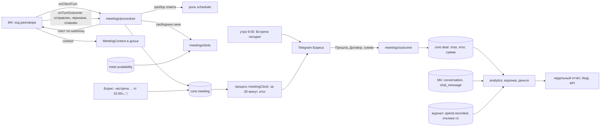

# M6 «Встречи и итоги»: дизайн

| | |
|---|---|
| Дата | 25.10.2026 |
| Статус | черновик дизайна; Борис спал и заранее разрешил брать рекомендованное, поэтому всё, что решает он, решено рекомендуемым вариантом, помечено «[решение Бориса, рекомендую: ...]» и собрано в разделе 13 |
| Основа | спецификация `docs/spec/2026-10-22-sara-spec-v1.md` (FR-MEET-1..4, FR-ANL-1..4, FR-NOTIF-1..3, FR-UI-6, FR-OPS-3, NFR-REL-3), дизайн v3 (разделы 11, 16-18), ADR-012, аудит v1 (разделы 1, 3, 4), видение (раздел 5, формула цены договора), дизайн M4 (ветка `claude/m4-conversation-2cad67`, ещё не в `main`), код `main` на 25.10.2026, старая Сара (`src/calendar`, `src/negotiator`, `src/notifier`, `src/watcher`, `src/daemon.js`, только чтение) |
| План | `docs/superpowers/plans/2026-10-25-m6-meetings.md` |

Отметки: **[Б]** решение Бориса из спецификации или его слов; **[моё]** решение разработки, его можно оспорить; «[решение Бориса, рекомендую: ...]» решение, которое принимает Борис, а до его ответа действует рекомендованный вариант.

---

## 0. Сводка на одну страницу

**Что строим.**
1. **Свободное время Бориса** в настройках: дни, часы, длительность созвона, зазор, не больше N в день, дни-исключения (FR-MEET-1).
2. **Процедура созвона.** Клиент согласился на звонок: Сара спрашивает способ связи и предлагает 2-3 времени в разные дни из свободного времени. Клиент отвечает своими словами, Сара понимает выбор, код проверяет, что время всё ещё свободно, и записывает встречу. Борису «📅 Встреча назначена» с брифом меньше чем через минуту (FR-MEET-2, FR-MEET-3).
3. **Встречу отмечает Борис** (ADR-012): всё, о чём он договорился сам, по телефону или в чате, записывается одной фразой «встреча 95147898 чт 15:00» или кнопкой «📅 Встреча» на карточке клиента.
4. **Напоминания Борису**: утреннее сообщение «Встречи сегодня» и за 30 минут до встречи, каждое ровно один раз и после любого перезапуска (FR-MEET-3, NFR-REL-3).
5. **Итог**: через 15 минут после конца встречи «Прошла ли встреча?», дальше «Чем закончилась?» и сумма договора. Итог меняет этап сделки и сразу попадает в аналитику (FR-MEET-4).
6. **Аналитика**: воронка по неделе отклика (отклик, ответ, созвон назначен, созвон прошёл, договор), деньги (цена ответа, созвона, договора, выручка), четыре скорости, доля ответов без Бориса, расход Claude по ролям. В Telegram раз в неделю и по команде `/itogi`; данные через API для экранов M7 (FR-ANL-1..4).

**Критерий вехи** (спецификация, раздел 16): «итог встречи виден в цене договора». Борис отмечает «Договор, 120 тыс», и в ту же минуту подтверждение в Telegram, `/itogi` и `GET /api/analytics/funnel` показывают договор, выручку и новую цену договора по его неделе.

**Сначала тень.** Пока Сара v1 пишет клиентам, новая Сара клиентам не пишет (M4). Процедура созвона в тени только показывает в карточке черновика, какие времена Сара предложила бы. Зато отметки Бориса, напоминания, итоги и аналитика работают с первого дня тени, по клиентам, которых ведёт v1 и он сам. Это настоящие данные для цели G3 («ответил → созвон» от 25%) и G6 («знать деньги») ещё до переключения.

**Стык с M4 маленький и явный** (раздел 7): один хук перед Собеседником (`onClientTurn`), один отчёт о судьбе хода (`onTurnOutcome`), одна строка в досье (`MeetingContext`) и четыре функции разговора, которые зовёт M6 (`ConversationPort`). Контракты в `packages/shared/src/contracts/meeting.ts`. M6 строится и проверяется до слияния M4 на поддельном разговоре, подключение отдельным последним PR.

---

## 1. Зачем и что считаем успехом

**Зачем.** За 42 дня v1: 23 заявки с откликом, 16 клиентов ответили (70%), встреч 0, договоров в базе 0 (у договора даже нет поля). Аудит (раздел 3) нашёл, почему:
- правило «клиент согласился на звонок, зови Бориса» срабатывало раньше брони, поэтому бронь не случилась ни разу;
- после брони клиенту уходило «Скину напоминание накануне», а кода напоминания не было;
- после брони чат больше не читался: перенос или отмену никто бы не увидел;
- слоты брались подряд в одно утро, время считалось по поясу машины (сдвиг на 3 часа);
- созвоны, которые Борис провёл сам, нигде не видны; договоры и выручка в отчёте зашиты нулём.

Снимок базы v1 на Маке (до 25.09, только чтение) добавляет ещё один урок: 9 эскалаций сентября получили по 24-28 напоминаний каждая, пока лестница не стала конечной. Любое напоминание в M6 конечное.

Как это работает сегодня в v1 (с 07.10): на просьбу созвона клиенту уходит готовое «Да, давайте созвонимся. Во сколько вам удобно?», Борису срочное 🚨, дальше Борис договаривается сам. Календарь v1 (`src/calendar`) так и не включён. Значит, сейчас все встречи назначает Борис, и система о них не знает.

**Успех M6:**

| № | Что | Как видно |
|---|---|---|
| U1 | итог, отмеченный Борисом, виден в цене договора своей недели | сквозной тест `FR-MEET-4`, `/itogi`, API |
| U2 | Сара не предлагает время вне свободного и сверх максимума в день | тест `FR-MEET-1` на таблице случаев |
| U3 | «📅 Встреча назначена» меньше чем через минуту после согласия клиента | журнал: от `conv.turn_started` (M4 решил, что клиент дописал) до `meeting.announced` (📅 отправлено) меньше 60 секунд у 95%; тест через настоящее ожидание тишины M4 (раздел 5.2) |
| U4 | каждое напоминание ровно один раз, в том числе после перезапуска | тест с перезапуском посреди ожидания |
| U5 | две встречи Сары никогда не пересекаются | тест параллельной брони одного времени двумя клиентами |
| U6 | клиенту не обещано то, чего система не делает | тексты клиенту только из списка раздела 5.4; в них нет ссылок и «скину напоминание» |
| U7 | встречи, о которых Борис договорился сам, тоже в системе | отметка одной фразой и кнопкой; утреннее сообщение спрашивает про просьбы созвона без отметки |

**Анти-цели** (провал, даже если всё работает): бесконечные напоминания; обещание клиенту без кода за ним; встреча поверх уже назначенной; время в чужом поясе без пометки; Сара предлагает время клиенту, которого ведёт Борис; два вопроса Борису про один и тот же итог; поток сообщений (больше одного утреннего сообщения в день от M6, повторы); телефон или слова клиента в журнале событий; итог, который нигде не виден.

**Не цели M6:** календарь и его синхронизация (ADR-012 **[Б]**); ссылки на Телемост (Сара их не создаёт, ADR-012 **[Б]**); звонки голосом; экраны «Встречи», «Сегодня», «Аналитика» в пульте (M7, M6 даёт им API); общий разговор с Сарой в боте (Секретарь, M7); личный календарь Бориса (Лора); перенос из v1 заявок, решений и оценок (M7, спецификация раздел 15; траты на отклики v1 см. раздел 6.4).

## 2. Ограничения

1. **Тень.** В M4 `conv.v1_writes` включено: новая Сара не пишет клиентам ничего. Сара v1 сама отвечает на просьбу созвона и шлёт 🚨 в старый бот.
2. **M4 ещё строится.** Таблицы `core.conversation`, `core.chat_message`, движок хода, карточки клиентов появятся с M4. M6 опирается только на контракты раздела 7 и до слияния M4 проверяется на поддельном разговоре.
3. **Сделок почти нет.** `core.deal` создаётся только при отклике новой Сары (`createDeal` из `apps/core/src/domain/deal.ts`, его зовёт подтверждение отклика в `apps/core/src/leads/outbox.ts`), а в тени почти все разговоры начаты откликом v1: у них нет сделки и часто нет `core.lead`. Итог и сумма должны где-то жить и у таких клиентов (раздел 6.1).
4. **Устойчивые процессы.** DBOS продолжает процесс только при той же `WORKFLOW_VERSION`. M6 добавляет новые процессы с новыми именами и не меняет существующие.
5. **Модель.** Только через шлюз, роли без инструментов, ответ по схеме, обезличивание (ADR-016). Телефон клиента модель не видит никогда. Всё, что нужно при лимите Claude, работает без модели (FR-OPS-3).
6. **Время.** В базе UTC. Всё, что видят Борис и клиент, по Москве (`Europe/Moscow`), явно, а не по поясу сервера (урок v1).
7. **Соседи.** `apps/core/src/leads/`, `notify/cards.ts`, модуль разговора M4 и `apps/profi-node` принадлежат другим сессиям. M6 живёт в своей папке `apps/core/src/meetings/` и в `apps/core/src/analytics/`, общие файлы трогает по одному месту (раздел 11).

## 3. Решения коротко

| Вопрос | Решение | Почему |
|---|---|---|
| Где свободное время | настройка `meet.availability` в `core.setting` с историей в `setting_history`, а не отдельная таблица `availability` | одна запись, история и журнал уже есть; таблица из словаря данных не нужна **[моё]** |
| Кто составляет предложение времени | код из свободного времени и встреч, по шаблону раздела 5.4 | модель не знает свободного времени и путает даты; шаблон работает при лимите Claude (так делала и v1, `formatSlotOffer.js`) |
| Кто понимает ответ клиента | сначала разбор кодом (день, дата, время, «первое», «второй вариант»); если не вышло, роль `scheduler` (haiku); код проверяет, что выбор есть среди предложенного или попадает в свободное время | «модель предлагает, код решает»; v1 так и делала (`confirmedSlotIndex`) |
| Своё время клиента | внутри свободного и не занято: Сара записывает сама; иначе предлагает два ближайших | раньше v1 звала Бориса на любое своё время, потому что календаря не было |
| Где состояние встречи | новая таблица `core.meeting` со своей машиной состояний | у одного клиента бывает несколько встреч (перенос, второй созвон) |
| Где итог и сумма | на сделке `core.deal` (новые поля); сделка создаётся и для клиента v1, когда у него появляется встреча | итог относится к клиенту, а не к одной встрече; один дом у суммы (раздел 6.1) **[моё]** |
| Откуда воронка | разговоры и сообщения M4 (`core.conversation`, `core.chat_message`), встречи и сделки M6, траты из журнала | только так в знаменателе все ответившие, а не только те, у кого была встреча |
| Где Борис видит аналитику | подтверждение итога в Telegram, недельный отчёт и `/itogi`; API для пульта M7; `pnpm report:funnel` | экраны пульта строит M7; Борис читает Telegram |
| Стык с M4 | хук перед Собеседником, отчёт о ходе, строка в досье, функции разговора (раздел 7) | две части строятся отдельно, правки в M4 одним PR |
| Шаблоны и самостоятельность | тексты процедуры идут клиенту без черновика и без номеров фактов, по своей настройке `meet.autonomy`, а не по уровню темы M4 (ADR-026) | иначе на старте каждое предложение времени стало бы черновиком (FR-AUTO-2), и процедура не работала бы; [решение Бориса, рекомендую: так] |
| ADR-012 и «таблица свободного времени» | настройка с историей вместо таблицы; в ADR-012 дописано уточнение | смысл решения тот же, меньше кода **[моё]** |

## 4. Как всё связано



## 5. Части

### 5.1 Свободное время (FR-MEET-1)

Настройка `meet.availability` (zod в `packages/shared/src/contracts/settings.ts`):

```
{
  week: { mon: Window[], tue: Window[], wed: Window[], thu: Window[], fri: Window[], sat: Window[], sun: Window[] }
  slot_min: 30        // длительность созвона, 15..120
  buffer_min: 15      // зазор до и после любой встречи, 0..60
  max_per_day: 3      // встреч в московский день, 1..10
  notice_h: 3         // не раньше чем через N часов от предложения, 0..72
  horizon_days: 7     // не дальше N дней, 1..21
  exceptions: { date: 'YYYY-MM-DD', windows: Window[] }[]   // пустой windows: выходной; даты не повторяются
}
Window = { from: 'HH:MM', to: 'HH:MM' }   // from < to, окна дня не пересекаются
```

[решение Бориса, рекомендую: как у v1, понедельник-пятница 10:00-19:00 по Москве, созвон 30 минут, зазор 15 минут, не больше 3 встреч в день, не раньше чем через 3 часа, на 7 дней вперёд, без исключений]

**Где правится.** API `GET/PUT /api/meetings/availability` (за входом владельца) и маленькая страница пульта `/meetings/availability`: дни недели с окнами, числа, список исключений с кнопкой «Выходной». Изменение пишется через `setSetting` (история и событие `setting.changed` уже есть). M7 ставит ссылку на страницу в «Настройки».

**Свободные окна** считает чистая функция `freeSlots(av, busy, dayCount, now)` (`dayCount`: сколько встреч уже в каждом московском дне):
- шаг сетки 30 минут от начала окна (10:00, 10:30, ...); созвон целиком внутри окна;
- не пересекается ни с одной встречей из `busy` с учётом зазора с обеих сторон;
- в дне меньше `max_per_day` встреч;
- начало не раньше `now + notice_h` и не позже конца дня `now + horizon_days`;
- день из `exceptions` берёт свои окна вместо недельных;
- `busy` это встречи в состояниях `confirming` и `booked` любого вида (и Сары, и отмеченные Борисом), всех аккаунтов: свободное время у Бориса одно;
- для нового предложения в `busy` добавляются ещё и времена, уже отправленные другим клиентам в открытых предложениях (`offer_sent_at` есть, мягкая бронь), чтобы два клиента не получили одно и то же время. Выбор времён и запись предложения идут под той же блокировкой `meetings`, что и запись встречи, поэтому два клиента, согласившиеся одновременно, не получают одинаковые времена. Для записи выбранного времени мягкая бронь не мешает: запись проверяет только настоящие встречи.

Москва без перехода на летнее время, но расчёт идёт через `Intl` с `Europe/Moscow`, как `mskParts` в `learning/summary.ts`, а не через пояс сервера.

### 5.2 Процедура созвона (FR-MEET-2)

Процедура это код M6, который получает каждую реплику клиента от хода M4 **до** Собеседника (раздел 7.1) и либо отвечает «не моё» (`handled: false`, дальше обычный ход M4), либо сам решает ход: текст по шаблону, позвать Бориса или промолчать.

**Когда процедура вообще смотрит на реплику** (дешёвый фильтр кодом, без модели):
- у клиента есть открытое предложение или назначенная встреча (состояния `offered`, `confirming`, `booked`);
- или в реплике есть признак созвона: детектор v1 (`callDetector.js`: телефон 8/+7 и 10 цифр, слова «созвон», «позвон», «набер») плюс «звонок», «встреч», «телемост», «зум», «видеосвяз»;
- или наше последнее сообщение предлагало созвон (те же слова в нём).

Иначе сразу `handled: false`, роль не зовётся.

**Чтение ответа.** Сначала `readTurnByCode(turn, offered, ourLastProposedCall, now)`: «да», «давайте», «можно» после нашего предложения созвона это согласие; номер варианта («первый», «второй», «2»), день недели, дата или время, совпадающие ровно с одним предложенным временем, это выбор. Если код не уверен, роль `scheduler` (haiku, P0, запасная sonnet, 30 секунд): вход это реплика клиента (обезличенная шлюзом), два наших последних сообщения, предложенные времена с подписями, сегодняшняя дата и день недели по Москве, назначенная встреча, если есть. Ответ `MeetingReading`:

```
intent: 'none' | 'agree' | 'asap' | 'pick' | 'own_time' | 'later' | 'reschedule' | 'cancel' | 'unclear'
slot: номер предложенного времени с 0 | null
own_time: { date: 'YYYY-MM-DD' | null, weekday: 'mon'..'sun' | null, time: 'HH:MM' | null, part: 'morning' | 'day' | 'evening' | null } | null
channel: 'phone' | 'telemost' | 'other' | null
also_asks: boolean      // в реплике есть ещё вопрос не о времени
why: строка до 200 знаков
```

Код проверяет всё: `slot` есть среди предложенного; `own_time` превращается в конкретное время функцией `resolveOwnTime(own_time, now)` (ближайший такой день недели, «вечером» это окно с 17:00 и т. п.); противоречивый или невозможный ответ считается `unclear`. Телефон код достаёт из текста реплики сам (регулярное выражение v1), модель его не видит.

**Что делает процедура:**

| Что сказал клиент | Что делает Сара | Сделка |
|---|---|---|
| `agree`: согласен на созвон, время не назвал | предложение: 2-3 времени в разные дни, плюс вопрос о способе, если он неизвестен (шаблон П1). Встреча `offered` с предложенными временами | `call_proposed` после отправки |
| `pick`: выбрал предложенное | под блокировкой проверка, что время свободно; да: встреча `confirming`, подтверждение П4, Борису 📅 сразу; нет: «это время уже не получится» и два новых (П5) | `call_booked` после отправки подтверждения |
| `own_time` внутри свободного и не занято | как `pick`: записывает его время, П4 | `call_booked` |
| `own_time` вне свободного или занято | два ближайших к его времени (П7) | |
| `own_time` расплывчато («на следующей неделе», «вечером») | новое предложение с учётом пожелания (П1) | |
| `asap`: «позвоните сейчас», телефон с «наберите» | раздел 5.3 | |
| `later`: «подумаю», «напишу позже» | `handled: false`: отвечает Собеседник, в досье видно предложение | |
| `reschedule` у назначенной встречи | встреча `moved`, новая `offered` (П8); если клиент сразу назвал время, как `own_time`; Борису короткое «Клиент перенёс встречу» | `call_proposed` |
| `cancel` у назначенной встречи | встреча `cancelled`, клиенту короткое «понял» (П9), Борису «Клиент отменил встречу» с кнопками «Беру сам» и «Закрыть» | `talking` |
| любое сообщение меньше чем за 3 часа до встречи и до отметки итога | ничего не пишет, пересылает Борису 💬 (срочно, если до встречи меньше часа) | |
| `none`, `unclear` | `handled: false`, обычный ход M4 с `MeetingContext` в досье | |

[решение Бориса, рекомендую: своё время клиента внутри свободного времени Сара записывает сама, без тебя; вне свободного предлагает два ближайших]

[решение Бориса, рекомендую: если до встречи меньше 3 часов, Сара клиенту не отвечает, а сразу пересылает его слова тебе: ты вот-вот с ним говоришь]

**Выбор времён для предложения** (`pickOffer(av, busy, dayCount, now, prefs)`, чистая функция):
1. Свободные окна на горизонт, по московским дням по возрастанию; дни, подходящие под пожелание клиента (день недели, дата), первыми.
2. Берутся первые три дня, в которых есть окно. В каждом дне первое окно в нужной части дня (утро до 12:00, день 12:00-17:00, вечер с 17:00). Без пожелания части дня времена чередуются: первый день самое раннее окно, второй день первое окно с 14:00 (если нет, самое раннее), третий день самое раннее.
3. Два времени в один день только если свободен всего один день, и тогда не ближе 2 часов друг к другу.
4. Свободен всего один слот: одно время и «если не подходит, напишите удобное» (П2). Нет ни одного: П3 и задача Борису «Нет свободного времени на 7 дней» (раз в день, не чаще).

**Пояс клиента.** Время всегда по Москве. Если город заказа в таблице городов `cityOffset` (около 40 крупных городов России, Краснодар +3, Самара +4, Екатеринбург +5, Новосибирск +7, Владивосток +10 и т. п.) и его пояс не московский, после времени пишется «по Москве, у вас 17:00». Город неизвестен: «время московское».

**Запись под блокировкой.** `book(db, …)` берёт `pg_advisory_xact_lock(hashtext('meetings'))` (одна блокировка на всё, у Бориса одно время) и заново проверяет: время внутри свободного (Борис мог закрыть день), нет пересечения с `confirming` и `booked` с зазором, в дне меньше `max_per_day`, до начала не меньше часа. Для выбора из предложенного действует правило часа, а не `notice_h` (предложение могло уйти вчера); своё время клиента проверяется ещё и по `notice_h`. Два клиента, выбравшие одно время одновременно: первый получает встречу, второй П5.

**Подтверждение и «встреча назначена» меньше чем за минуту.** В M4 перед отправкой стоит человеческая пауза 1-4 минуты. Поэтому 📅 Борису уходит в момент решения (встреча `confirming`), а не после отправки подтверждения клиенту. Когда M4 сообщает, что подтверждение ушло (`onTurnOutcome: sent`), встреча становится `booked`, сделка `call_booked`, запускается процесс напоминаний. Другие исходы:
- `cancelled` с причиной «клиент дописал»: встреча обратно в `offered`, 📅 правится без звука: «Клиент дописал до подтверждения, уточняю время». Новый раунд того же хода разбирает уже полную реплику;
- `cancelled` с причиной «Борис написал сам»: встреча `withdrawn`, 📅 правится: «Ты ответил клиенту сам, встречу не записала»;
- `drafted` (пауза «Пишет клиентам»): встреча ждёт в `confirming` до 2 часов, 📅 правится: «Подтверждение клиенту ждёт твоего «да»». Если Борис отправил черновик, M4 сообщит `sent`; если нет, через 2 часа встреча `withdrawn`;
- `failed`: встреча обратно в `offered`, 📅 правится.

**Раунды одного хода.** В M4 ход с номером `conv-turn:<разговор>:<первое сообщение>` идёт заново, когда клиент дописал, и после ночного ожидания. Поэтому процедура запоминает решение не по номеру хода, а по **раунду**: номер хода плюс номер последнего сообщения клиента в реплике. Решения лежат в `core.meeting_turn` (ключ раунда, встреча, результат). Тот же раунд ещё раз (ночь, перезапуск): тот же результат, но запись и предложение перепроверяются: запись не проходит проверку `book` или предложение содержит время ближе `notice_h`, значит старое отзывается и решение считается заново. Новый раунд (клиент дописал): встреча этого хода в `confirming` возвращается в `offered`, и решение считается по полной реплике.

**Проверка шаблонов в M4.** Тексты процедуры собраны кодом, поэтому из проверок M4 к ним применяются только `dash`, `greeting.missing`, `greeting.extra` и потолок 600 знаков. `robotic.length` не применяется: предложение с тремя датами длиннее короткого «давайте созвонимся». Провал проверки шаблона не переписывается моделью, а уходит Борису черновиком с причиной.

**Самостоятельность.** Правило темы M4 (`conv.autonomy`, на старте всё черновиком) к шаблонам процедуры не применяется: у них своя настройка `meet.autonomy` (`self`: отправлять самой, `draft`: черновиком Борису). Тень, пауза «Пишет клиентам», ночь и владелец клиента действуют как для любого ответа. Это исключение из FR-AUTO-2 и FR-CONV-3 записано в ADR-026. [решение Бориса, рекомендую: шаблоны процедуры созвона идут клиенту сами, без черновика, как готовый ответ v1 на просьбу созвона; тексты ты подтверждаешь один раз списком 5.4]

**Способ связи.** [решение Бориса, рекомендую: спрашивать способ вместе со временем: «по телефону или в Телемосте?»; номер просить, только если клиент выбрал телефон и номера ещё нет в переписке]. Телемост и любой другой способ: ссылку Борис отправляет сам, Сара её не создаёт (ADR-012); напоминание за 30 минут напоминает Борису отправить ссылку.

**Выбор и вопрос в одной реплике** («четверг подходит, а сколько стоит?»): встреча записывается, к подтверждению добавляется «Остальное обсудим на созвоне.», а вопрос клиента идёт строкой в 📅 Борису: «Клиент ещё спросил: …» **[моё]**.

**Предложение без ответа.** Предложение `offered` истекает (`expired`), когда все предложенные времена стали ближе `notice_h` или прошло 72 часа с отправки. Предложение, которое так и не ушло клиенту (черновик, сбой), через 2 часа `withdrawn`. Минутная задача M6 читает и владельца разговора M4: если клиент стал клиентом Бориса или разговор закрыт, открытое предложение `withdrawn`, а назначенная встреча закрытого разговора `cancelled` с сообщением Борису. Напоминания клиенту остаются за лестницей M4 (FR-CONV-12): в досье видны только ещё будущие предложенные времена, истёкшее предложение в досье не попадает.

**При лимите Claude** (FR-OPS-3). Всё, что решает код (предложение, выбор по номеру, дню и времени, перенос с понятным временем), работает без модели. Если для разбора нужна роль, а Claude недоступен, процедура отвечает `handled: false`, и срабатывает готовое правило M4 для просьбы созвона: «Да, давайте созвонимся. Во сколько вам удобно?» и 🚨 Борису.

### 5.3 «Позвоните сейчас»

Клиент хочет звонок прямо сейчас (`asap`: «сейчас», «прямо сейчас», телефон и «наберите», «позвоните сегодня» при свободном окне в ближайшие 2 часа). Тут решает Борис: может, он свободен и наберёт сразу.

1. Клиенту ничего не уходит. Борису срочное 🚨 «Клиент просит позвонить сейчас» с номером, если он есть, и кнопками «Позвоню сейчас» и «Предложи время». Процедура отвечает M4 `handled: true`, ход `call_boris`, `boris_told: true` (M4 свою карточку о просьбе созвона не шлёт).
2. «Позвоню сейчас»: встреча вида `asap` на текущее время, `booked`; через `slot_min + 15` минут обычный вопрос об итоге.
3. «Предложи время» или 10 минут без нажатия (настройка `meet.asap_wait_min`) в рабочее окно: Сара сама начинает ход (`startOwnTurn`) с текстом П11 «Сейчас не получится созвониться. Давайте договоримся о времени: ...». Вне свободного времени ждёт начала следующего окна.

[решение Бориса, рекомендую: на «позвоните сейчас» Сара шлёт тебе 🚨 с кнопками «Позвоню сейчас» и «Предложи время», клиенту сразу не пишет; если за 10 минут ты не нажал ничего, она сама предлагает клиенту 2-3 времени]

В тени `asap` отдаётся M4 (`handled: false`): там v1 сама отвечает клиенту, а M4 показывает карточку «Клиент просит созвон», на которой будет кнопка «📅 Встреча».

### 5.4 Тексты клиенту

Все тексты от первого лица Бориса (Сара пишет его голосом). Приветствие добавляется только по флагу нового дня от M4 («Добрый день!» или «Анна, добрый день!»), как у остальных ответов. Без длинного тире, без ссылок, без «скину напоминание». Подписи времени: «в четверг, 30 октября, в 15:00», «сегодня в 17:00», «завтра в 11:00».

| № | Когда | Текст |
|---|---|---|
| П1 | предложение, способ неизвестен | Давайте созвонимся. Могу {в1}, {в2} или {в3} ({пояс}). Как вам удобнее, по телефону или в Телемосте? |
| П1а | предложение, способ известен | Давайте созвонимся. Могу {в1}, {в2} или {в3} ({пояс}). Какое время вам удобно? |
| П2 | свободно одно время | Давайте созвонимся. Могу {в1} ({пояс}). Если не подходит, напишите, когда вам удобно. |
| П3 | свободного нет | На ближайшие дни у меня всё занято. Напишите, пожалуйста, когда вам удобно, постараюсь подстроиться. |
| П4 | записано | Отлично, договорились: {время} ({пояс}). + одно из: «Позвоню вам по номеру, который вы оставили.» / «Оставьте, пожалуйста, номер, я позвоню.» / «Ссылку на Телемост пришлю перед встречей.» / «Как вам удобнее, по телефону или в Телемосте?» + при `also_asks`: «Остальное обсудим на созвоне.» |
| П5 | время уже не получится (заняли, день закрыт, слишком близко) | Это время, к сожалению, уже не получится. Могу {в1} или {в2} ({пояс}). |
| П6 | своё время клиента подошло | как П4 |
| П7 | своё время клиента не подходит | В это время я занят. Могу {в1} или {в2} ({пояс}). |
| П8 | перенос | Конечно, давайте перенесём. Могу {в1}, {в2} или {в3} ({пояс}). |
| П9 | отмена | Хорошо, понял. Если будет актуально, напишите, договоримся о новом времени. |
| П10 | способ после записи | Хорошо, тогда {по телефону: «позвоню вам по номеру, который вы оставили» / «оставьте, пожалуйста, номер»; в Телемосте: «пришлю ссылку перед встречей»}. |
| П11 | «сейчас» не вышло | Сейчас не получится созвониться. Давайте договоримся о времени: могу {в1}, {в2} или {в3} ({пояс}). |
| П12 | клиенту в день встречи (выключено, раздел 5.6) | Сегодня в {время} созваниваемся, как договорились. (приветствие спереди всегда: это новый день) |

[решение Бориса, рекомендую: тексты процедуры это готовые шаблоны кодом, как в таблице, без модели: время и даты всегда точные, работают при лимите Claude, любое изменение текста через тебя]

### 5.5 Встречу отмечает Борис (ADR-012)

В тени все встречи назначает Борис, и после переключения часть тоже. Встреча вида `boris` записывается тремя путями, все вызывают одну функцию `markMeeting`:
1. **Фраза в боте**: «встреча 95147898 чт 15:00», «созвон 95147898 завтра в 11 телемост». Разбор кодом (номер заказа, день недели или дата, время, способ); если не вышло, роль `scheduler` с тем же выходом. Без номера заказа, ответом на карточку клиента (после подключения M4), берётся клиент карточки. Без номера и без карточки: «Ответь на карточку клиента или напиши номер заказа».
2. **Кнопка «📅 Встреча»** на карточках клиента M4 (черновик, пересылка 💬, «Клиент просит созвон»): Сара спрашивает «Когда? Ответь на это сообщение, например «чт 15:00»».
3. **API** `POST /api/meetings` для пульта M7.

Ответ Борису сразу, без подтверждения: «Записала встречу: Анна, четверг, 30 октября, 15:00. [Исправить] [Отменить]». Встреча Бориса не проверяется по свободному времени (он знает лучше), но пересечение со встречей или превышение максимума в день называется: «В это время уже встреча с ... Записала обе.» Клиента без сделки M6 заводит сам (раздел 6.1). Если у клиента уже есть открытое предложение Сары или встреча, которую она подтверждает, они отзываются (`withdrawn`), назначенная встреча переносится (`moved`). «Исправить» меняет время этой же встречи на месте (новый номер часов `clock_version`, раздел 5.6).

**Порядок разбора слов Бориса.** Фраза, которая начинается с «встреча» или «созвон», разбирается первой, если сообщение не ответ на конкретное сообщение Сары. Иначе «встреча 95147898 чт 15:00» при открытом вопросе о сумме могла бы стать суммой 95 147 898 ₽. Сумма принимается, только если всё сообщение это сумма.

Вечером ничего не приходит, а в утреннем сообщении (раздел 5.6) строка «Вчера клиенты просили созвон, встречи не отмечены: Анна, Олег» с кнопкой «📅 Встреча» у каждого: так ловятся созвоны, о которых Борис договорился, но не отметил **[моё]**. Источник: событие `meeting.call_asked`, которое процедура пишет, когда видит просьбу созвона у клиента без встречи (и в тени тоже); поэтому строка появляется после подключения к M4 (раздел 7.3).

### 5.6 Напоминания Борису (FR-MEET-3)

| Что | Когда | Как |
|---|---|---|
| 📅 Встреча назначена | в момент записи, меньше чем через минуту после согласия клиента | клиент, заказ, когда (и «через N часов»), способ, телефон, ссылка на чат, бриф; кнопки «Перенести», «Отменить» |
| Встречи сегодня | в 9:00 по Москве, если есть что сказать | одно сообщение на все встречи дня с 10:00 и позже; плюс вчерашние встречи без итога (с кнопками итога) и просьбы созвона без отметки (5.5) |
| За 30 минут | за 30 минут до начала | клиент, способ, телефон, бриф; для Телемоста «не забудь отправить ссылку»; кнопки «Перенести», «Отменить» |
| Прошла ли встреча? | через 15 минут после конца (`starts_at + slot_min + 15`) | раздел 5.7 |

Правила:
- **Ровно один раз.** Каждая встреча помнит `morning_sent_at`, `before_sent_at`, `outcome_asked_at`. Утреннее сообщение занимает строку дня в `core.job_run` (`meetings_morning`) до отправки, как сводка 19:00; при сбое отправки строка удаляется, и следующая минута пробует снова. Остальное делает процесс `meetingClock` (DBOS, номер `meeting-clock:<встреча>:<clock_version>`): спит до точки, просыпается, перечитывает встречу и действует, только если она всё ещё `booked` с той же версией. Перенос увеличивает `clock_version` и запускает новый процесс, старый на пробуждении видит другую версию и молча заканчивается.
- **Встреча раньше 10:00** в утреннее сообщение не входит, ей хватает напоминания за 30 минут (иначе в 9:00 пришли бы два сообщения о ней).
- **Записана меньше чем за 45 минут до начала:** напоминания за 30 минут нет, 📅 только что пришло.
- **Тихие часы** (FR-NOTIF-2): по настройке `cards.quiet_hours` (по умолчанию 23:00-9:00) через `quietNow` из `leads/cardFlow.ts`, всё без звука. Для этого `sendText` и `sendButtons` получают параметр `silent`, как уже есть у `sendLeadCard`. Вопрос об итоге, созревший ночью, не шлётся, а попадает в утреннее сообщение.
- **Не в лимит карточек.** Сообщения о встречах не считаются в `cards.max_per_day`: это вид «встреча» из шести видов уведомлений (FR-NOTIF-1), обычно одно-три в день, а одно утреннее сообщение склеивает остальное (FR-NOTIF-3).
- **Ничего не теряется при сбое.** 📅 помечается `announced_at` после ответа Telegram; минутная задача M6 досылает 📅 встрече Сары без этой отметки (не старше часа) и запускает `meeting-clock:<встреча>:<clock_version>` для каждой будущей встречи `booked` (повторный запуск с тем же номером ничего не создаёт), как `resumeQueuedOutbox` у откликов. Так крах между записью встречи и запуском процесса не теряет напоминаний.
- **Утреннее сообщение** берёт все встречи, у которых вопрос об итоге созрел и не задан, в любой день (например, созревший в 7:00 того же дня). Счётчики повторов растут только после успешной отправки.

**Бриф** («три строки брифа», дизайн v3, раздел 11): роль `briefer` (sonnet, P1, запасная opus, ждёт лимит Claude не дольше 10 минут: `limitWaitMs: 600000`; P0 оставлен ответам клиентам). Вход: досье разговора M4 (обезличенное), заказ, разбор Аналитика из `lead.draft_analysis`, если есть. Выход `MeetingBrief`: `who` (кто и чем занят, до 120 знаков), `need` (что ему на самом деле нужно, до 160), `ask` (что узнать на созвоне, до 160). 📅 уходит сразу без брифа, бриф дописывается правкой того же сообщения, когда готов. Не вышло: «Бриф не собрала» и название заказа; перед напоминанием за 30 минут ещё одна попытка.

**Напоминание клиенту.** Спецификация его не требует, а v1 его обещала и не делала. [решение Бориса, рекомендую: построить одно напоминание клиенту в день встречи (в 10:00, если встреча в 12:00 или позже; за 2 часа, если раньше), но держать выключенным (`meet.client_reminder`) до переключения и включить вместе с ним; в подтверждении встречи его не обещать]. Идёт через ход M4 (`startOwnTurn`) со всеми правилами: пауза, тихие часы, перечитать чат. Это отдельный процесс DBOS `meetingClientReminder`, а не новый шаг в `meetingClock`, чтобы процессы, начатые до его появления, не повторяли другой порядок шагов.

### 5.7 Итог встречи и сумма договора (FR-MEET-4)

Вопрос об итоге это задача вида `meeting_outcome`, одно сообщение, которое правится по мере ответов (FR-UI-6: не больше двух нажатий плюс сумма ответом):

```
Прошла ли встреча с Анной (четверг, 15:00)?
[Прошла] [Не состоялась] [Перенесли]
  Прошла → «Чем закончилась?» [Договор] [Думает] [Отказ]
    Договор → «Сумма договора? Ответь на это сообщение числом, например 120000 или «120 тыс».» [Сумму позже]
      ответ → «Записала: договор на 120 000 ₽. Цена договора за неделю 19-25 октября: 860 ₽.»
    Думает → «Записала. Спрошу через неделю.»
    Отказ → «Записала отказ. Если хочешь, ответь на это сообщение, почему.»
  Не состоялась → «Записала. Предложить клиенту другое время?» [Предложи время] [Не надо]
  Перенесли → «На когда? Ответь на это сообщение, например «пт 11:00».» [Предложи время]
```

- **Сумма** разбирается кодом (`parseRub`): «120000», «120 000», «120 тыс», «120к», «1,2 млн», «1.2м». Непонятно: «Не поняла сумму, напиши числом, например 120000». Сумма это вопрос вида `meeting_amount` в таблице `core.question` (ответ привязан к сообщению, как «Изменить» у отклика) и не тратит дневной лимит вопросов «почему».
- **Подтверждение суммы сразу показывает цену договора** его недели отклика: это и есть критерий вехи.
- **«Предложи время»** после неявки или переноса: Сара начинает ход (`startOwnTurn`) с П8. Только по нажатию Бориса **[моё]**.
- **«Перенесли» с временем от Бориса**: старая встреча `moved`, новая вида `boris` на его время.
- **Без ответа Бориса**: вопрос повторяется в утреннем сообщении следующего дня и ещё одного, потом больше не повторяется; задача остаётся открытой во «Входящих» M7. [решение Бориса, рекомендую: вопрос об итоге через 15 минут после конца встречи; без ответа ещё два раза в утренних сообщениях, потом тишина]
- **«Думает»**: сделка остаётся `call_done` с итогом `thinking`; через 7 и 14 дней строка в утреннем сообщении «Анна думает уже 7 дней. Чем закончилось?» с кнопками «Договор», «Отказ», «Ещё думает». [решение Бориса, рекомендую: спрашивать через 7 и 14 дней, дальше не спрашивать]
- **«Сумму позже»**: сделка `won` с суммой null; утреннее сообщение спрашивает сумму до трёх раз. [решение Бориса, рекомендую: можно записать договор без суммы и назвать её позже]
- **Причина отказа**: свободным ответом и не обязательно. [решение Бориса, рекомендую: причина отказа своими словами, по желанию, без готовых кнопок]
- **Исправить итог** можно всегда: «Исправить» на подтверждении или `POST /api/meetings/:id/outcome`; аналитика берёт последнее. Для этого у сделки есть два перехода исправления из конечных этапов, только по действию Бориса (5.8). Причина отказа хранится в `deal.outcome_reason` и не пишется в `reason` событий (журнал только добавляется, а это слова Бориса о клиенте).
- **«Отменить» и «Перенести» Бориса у встречи, которую записала Сара** (после переключения клиент о ней знает): «Отменить» спрашивает «Написать клиенту?» с кнопками «Предложи другое время» (П8) и «Нет, скажу сам»; «Перенести» даёт «Предложи клиенту время» и «Уже договорились». У встречи, которую отметил сам Борис, клиенту ничего не пишется: «Отменила. Клиенту я ничего не писала.»
- **После состоявшейся встречи клиент твой.** [решение Бориса, рекомендую: после «Прошла» Сара сама клиенту не пишет, а пересылает его сообщения тебе, пока ты не вернёшь клиента «Вернуть Саре»]. Через `ConversationPort.giveToBoris(…, 'meeting')`.

### 5.8 Состояния встречи и сделки

**Встреча** (`core.meeting.state`), переходы только функцией `moveMeeting`, каждый с событием:

| Из | В | Когда |
|---|---|---|
| (нет) | `offered` | Сара решила предложить времена |
| (нет) | `booked` | Борис отметил встречу; «Позвоню сейчас» |
| `offered` | `confirming` | клиент выбрал, время свободно, подтверждение ещё не ушло |
| `offered` | `withdrawn` | предложение не ушло клиенту за 2 часа или ход отменён; клиент стал клиентом Бориса или разговор закрыт; Борис отметил встречу сам |
| `offered` | `expired` | все предложенные времена ближе `notice_h` или прошло 72 часа с отправки |
| `confirming` | `booked` | подтверждение ушло клиенту |
| `confirming` | `offered` | клиент дописал до отправки подтверждения (новый раунд), сбой отправки |
| `confirming` | `withdrawn` | Борис написал клиенту сам; черновик подтверждения не отправлен за 2 часа; Борис отметил встречу сам |
| `booked` | `done` | Борис: «Прошла» |
| `booked` | `no_show` | Борис: «Не состоялась» |
| `booked` | `moved` | перенос (клиентом или Борисом); новая встреча с `moved_from` |
| `booked` | `cancelled` | отмена клиентом или «Отменить» Бориса |
| `done`, `no_show` | то же | «Исправить» меняет итог, не состояние, кроме `done` ↔ `no_show` |

Вид встречи: `sara` (процедура), `boris` (отметил Борис), `asap` (звонок сейчас). У одной сделки не больше одной встречи в `offered`, `confirming` или `booked` (частичный уникальный индекс). События: `offered` → `meeting.offered`, `confirming` → `meeting.confirming`, обратно в `offered` → `meeting.unconfirmed`, `booked` → `meeting.booked`, `moved`, `cancelled`, `withdrawn`, `expired` своими событиями, `done` → `meeting.held`, `no_show` → `meeting.no_show`.

**Номер часов** `clock_version` растёт, только когда время встречи меняется на месте («Исправить» у отметки Бориса). Перенос всегда создаёт новую встречу со своими часами (`moved` конечное состояние), поэтому старый процесс на пробуждении видит, что встреча уже не `booked`, и заканчивается.

**Сделка.** Этап меняет только `transition` из `apps/core/src/domain/deal.ts`. M6 добавляет функцию `advanceDeal(db, dealId, to, actor, reason)`: проходит кратчайший разрешённый путь от текущего этапа до нужного одной транзакцией, событие на каждый шаг (клиент v1 на этапе `talking` после отметки встречи Бориса проходит `talking → call_booked`). Новые разрешённые переходы (только добавление):

| Из | Добавляется | Зачем |
|---|---|---|
| `talking` | `call_booked` | Борис отметил встречу без предложения Сары |
| `call_booked` | `talking` | клиент отменил, клиент не пришёл |
| `call_done` | `call_proposed`, `call_booked` | второй созвон после первого |
| `won` | `call_done` | исправление: Борис нажал «Договор» по ошибке; только действие Бориса **[моё]** |
| `lost` | `talking` | исправление «Отказ» и возврат клиента, которого закрыли (в том числе «Закрыть» M4), когда Борис отмечает ему встречу; только действие Бориса **[моё]** |

`transition` отказывает переходу из `won` и `lost`, если его делает не Борис. Так «Отказ → Договор» это путь `lost → talking → call_booked → call_done → won`, а отметка встречи закрытому клиенту `lost → talking → call_booked`, каждый шаг в журнале.

| Событие M6 | Этап сделки | Итог сделки |
|---|---|---|
| предложение ушло клиенту | `call_proposed` | |
| подтверждение ушло, Борис отметил встречу, «Позвоню сейчас» | `call_booked` | |
| перенос | `call_proposed` (Сара предлагает) или `call_booked` (Борис назвал время) | |
| отмена, неявка | `talking` | |
| «Прошла» | `call_done` | |
| «Договор» | `won` | `won`, сумма |
| «Думает» | `call_done` | `thinking` |
| «Отказ» | `lost` | `lost`, причина |

### 5.9 Аналитика (FR-ANL-1..4)

Всё считается запросами по журналу и таблицам в момент показа, без таблиц-проекций (данных мало: десятки клиентов в неделю). Модули `apps/core/src/analytics/funnel.ts`, `money.ts`, `load.ts`, расширение `speed.ts`.

**Воронка по когортам** (FR-ANL-1). Клиент это заказ одного аккаунта (`account_id`, `order_id`): по этой паре связываются отклик, разговор M4, сделка и встречи (поле `conversation.deal_id` M4 для воронки не нужно, оно заполняется только после подключения). Неделя когорты это московская неделя (с понедельника) отклика. Откуда отклик, по порядку надёжности:
1. событие `bid.sent` новой Сары (заказ и время точные);
2. отклик v1 из снимка базы v1 (`core.v1_bid`, раздел 6.4): неделя по дню, когда v1 увидела заказ (отклик уходил в те же сутки), с пометкой «примерно»;
3. самое раннее сообщение нашей стороны в `core.chat_message` с точным временем (`approx_time = false`); сообщения с приблизительным временем для недели не годятся.

Шаги:
- **отклик**: заказ есть в одном из трёх источников;
- **ответил**: в разговоре этого заказа есть сообщение клиента после отклика (если время отклика приблизительное, любое сообщение клиента);
- **созвон назначен**: у сделки заказа была встреча с `booked_at` (любого вида);
- **созвон прошёл**: встреча `done`;
- **договор**: итог сделки `won`.

Доли от предыдущего шага; «ответил → созвон назначен» это цель G3 (25%). Разрезы: аккаунт (направление = аккаунт, M3) и неделя. Договор, подписанный через три недели, попадает в когорту своего отклика.

**Деньги** (FR-ANL-2, видение раздел 5). Траты клиента это сумма `spend.recorded` по его заказу (новая Сара) плюс цена отклика v1 из `core.v1_bid` (раздел 6.4, «примерно»). По когорте: траты; цена ответа = траты / ответивших; цена созвона = траты / назначенных созвонов; цена договора = траты / договоров; выручка = сумма договоров; средний чек = выручка / договоров с суммой; отдача = выручка / траты. Клиенты с неизвестной тратой не входят в цены, их число показывается отдельно: «по 3 клиентам трата неизвестна». Средний чек Hance (открытый вопрос В-1) теперь измеряется сам.

**Скорость** (FR-ANL-3). К двум готовым (`speed.ts`: заявка → карточка, «да» → отклик) добавляются: клиент написал → ответ Сары (`conv.message_heard` первого сообщения реплики → `conv.turn_sent`, в тени → `conv.turn_drafted` с пометкой «в тени»); задача Борису → его решение (`task.created` → `task.resolved`). Медиана и 90-й процентиль.

**Нагрузка** (FR-ANL-4). Доля ответов клиентам без Бориса: сообщения нашей стороны за период с автором `sara` против `boris` (в тени «режим тени, Сара не пишет»). Расход Claude: вызовы и время по ролям из `core.model_call` за день и неделю.

**Где видно:**
1. Подтверждение итога в Telegram (5.7) с ценой договора недели.
2. **Недельный отчёт** в понедельник в 10:00 по Москве (`analytics.weekly`, строка дня в `job_run`): последние 4 когорты строками «Неделя 12.10: 5 откликов, 3 ответили, 1 созвон, 1 договор на 120 000 ₽, цена договора 640 ₽», деньги за неделю, четыре скорости, доля без Бориса, Claude. Только если неделя не пустая. [решение Бориса, рекомендую: отчёт раз в неделю, в понедельник в 10:00, и по команде `/itogi` в любой момент]
3. Команда бота `/itogi`: тот же отчёт за последние 4 недели. Как кнопки, команда даёт событие `analytics.report_sent`.
4. API для M7: `GET /api/analytics/funnel?weeks=8&account=` (воронка вместе с деньгами по когортам), `/api/analytics/speed?days=7`, `/api/analytics/load?days=7`, `GET /api/meetings?from=&to=` (список встреч для экрана «Встречи»).
5. `pnpm report:funnel --weeks 8` для разработки, как `report:speed`.

### 5.10 Тень и после переключения

| Что | В тени (`conv.v1_writes` включено) | После переключения |
|---|---|---|
| Процедура созвона | считает предложение и показывает его в карточке черновика M4 («Ответила бы так: Давайте созвонимся. Могу ...»); встреч не создаёт, мягкую бронь не держит | предлагает, записывает, подтверждает |
| «Позвоните сейчас» | отдаётся M4, там отвечает v1 | раздел 5.3 |
| Отметка встречи Борисом | работает | работает |
| 📅, утро, за 30 минут, итог, сумма | работают | работают |
| Аналитика | работает; доля без Бориса «режим тени» | работает |
| Напоминание клиенту | выключено | по настройке |

## 6. Данные и контракты

### 6.1 Сделка для клиента v1

Итог и сумма относятся к клиенту, поэтому живут на сделке. У клиента v1 сделки нет, и M6 заводит её сам функцией `ensureDeal(i)`, когда у клиента появляется первая встреча (процедура или отметка Бориса): `origin: 'v1'`, `order_id` из разговора или команды, `lead_id` только если такая заявка есть в `core.lead`, начальный этап `talking`. Сделку ищут сначала по (`account_id`, `order_id`), потом по `lead_id` = заказ: так находится и сделка, созданную откликом новой Сары. Для этого `createDeal` с M6 сам пишет `order_id = lead_id`, а миграция заполняет его у старых строк. `order_id` остаётся необязательным до следующей сужающей миграции (ADR-020: откат кода не должен ломать запись сделки). Повторный вызов возвращает ту же сделку. Сделка связывается с разговором через `ConversationPort.linkDeal` (поле `conversation.deal_id` M4); своего поля разговора у сделки нет, воронка связывает по заказу.

### 6.2 Таблицы (одна миграция, только расширение, ADR-020)

Номер миграции следующий за последним в `main` на момент слияния.

| Таблица | Поля | Класс |
|---|---|---|
| `core.meeting` (новая) | `id` uuid; `deal_id` (ссылка на `deal`); `conversation_id` uuid, может быть пусто (внешний ключ на `core.conversation` добавляет PR подключения к M4); `account_id`; `kind` (`sara`, `boris`, `asap`); `state`; `starts_at`, пусто у `offered`; `duration_min`; `channel` (`phone`, `telemost`, `other`, пусто); `channel_note` (слова клиента или Бориса о способе); `offered` jsonb (`[{starts_at}]`); `offer_sent_at` (предложение реально ушло клиенту; только такие держат мягкую бронь и видны в досье); `confirming_at`; `announced_at` (📅 отправлено); `round_key` (раунд хода, который сделал предложение или запись); `moved_from`; `clock_version`; `phone`, `phone_purge_at` (30 дней после `starts_at`, а у встречи без времени или отменённой 30 дней после последнего изменения; вместе с телефоном стираются `also_asked` и `channel_note`); `brief` jsonb; `also_asked` (вопрос клиента для 📅); `booked_at`, `morning_sent_at`, `before_sent_at`, `outcome_asked_at`, `outcome_at`; счётчики повторов в утренних сообщениях `outcome_nudges`, `amount_nudges`, `thinking_nudges`; `cancelled_by` (`client`, `boris`); `created_by` (`sara`, `boris`); `created_at`, `updated_at`. Частичный уникальный индекс по `deal_id` для `offered`, `confirming`, `booked`; индекс (`state`, `starts_at`) | Н; `phone` К; `brief`, `also_asked`, `channel_note` П |
| `core.deal` (новые поля) | `lead_id` становится необязательным (уникальность остаётся); `order_id` (для существующих равен `lead_id`, новые пишет `createDeal`); `origin` (`sara`, `v1`, по умолчанию `sara`); `outcome` (`won`, `lost`, `thinking`, пусто); `amount_rub`; `outcome_reason`; `outcome_at`. Уникально (`account_id`, `order_id`) | Н; `outcome_reason` П |
| `core.meeting_turn` (новая) | `round_key` pk; `meeting_id`, может быть пусто; `result` jsonb (`ProcedureResult`); `created_at` | Н |
| `core.v1_bid` (новая, раздел 6.4) | `order_id`, `account_id` (pk вместе); `seen_at` (когда v1 увидела заказ); `fee_rub`, может быть пусто; `imported_at` | Н |

Свободное время это настройка, не таблица. Телефон стирается через 30 дней после встречи (`phone_purge_at`, спецификация 8.3 **[П]**), шаг ежедневной задачи M6. Словарь данных обновляется: `availability` заменяется настройкой `meet.availability`, `client_contact` пока не нужен (телефон на встрече).

### 6.3 Контракты (`packages/shared`)

- `contracts/meeting.ts` (новый): `Window`, `Availability`, `MEETING_KINDS`, `MEETING_STATES`, `CHANNELS`, `MeetingReading` (выход `scheduler`), `MeetingBrief` (выход `briefer`), `MeetingContext`, `ProcedureInput`, `ProcedureResult` (с полем `topic: 'call'`), `TurnOutcome` (с причиной отмены), `MEETING_TEXT_KINDS`, `DEAL_OUTCOMES`. Точные формы в плане, задача 2.
- `contracts/settings.ts`: `meet.availability` (5.1), `meet.procedure` (true: процедура включена; в тени она всё равно только рисует черновики), `meet.autonomy` (`self` или `draft`, по умолчанию `self`, ADR-026), `meet.asap_wait_min` (10), `meet.client_reminder` (false), `analytics.weekly` (`{weekday: 1, hour: 10}` или null).
- `contracts/eventTypes.ts`: `meeting.call_asked`, `meeting.offered`, `meeting.confirming`, `meeting.unconfirmed`, `meeting.withdrawn`, `meeting.expired`, `meeting.booked`, `meeting.announced`, `meeting.moved`, `meeting.cancelled`, `meeting.reminded`, `meeting.held`, `meeting.no_show`, `deal.outcome_set`, `deal.amount_set`, `analytics.report_sent`. В событиях только номера, вид, состояния, времена и сумма договора; ни телефона, ни слов клиента.
- `contracts/telegram.ts`: действия кнопок `meet`, `held`, `noshow`, `moved`, `won`, `thinking`, `lost`, `later`, `offer`, `callnow`, `cancel`, `fix` в `TASK_ACTIONS` (уже есть `skip`, его берёт «Не надо»).

### 6.4 Траты на отклики v1

Без трат v1 цена договора по клиентам, которых вела v1, неизвестна, а в тени это почти все клиенты. В снимке базы v1 у заявки есть `response_fee`, но v1 пишет его при первом показе заказа (`insertLead` в `src/db.js`), то есть это цена отклика, которую v1 видела, а не оплата, и она есть у каждой увиденной заявки. Поэтому переносятся только заказы, на которые v1 откликнулась (`responded_at` не пусто), а сумма помечается «примерно». `responded_at` v1 перезаписывает каждым нашим сообщением, поэтому неделя отклика берётся по `created_at` (день, когда v1 увидела заказ: отклик уходил в те же сутки). M4 уже читает этот снимок для выгрузки истории (`node:sqlite`, только чтение). [решение Бориса, рекомендую: перенести отклики v1 (номер заказа, день, примерная цена) уже в M6 разовой командой `pnpm analytics:import-v1-bids`, чтобы воронка и цена договора считались и по клиентам v1; перенос остального из v1 остаётся в M7]. Честная оговорка в отчёте: у v1 было 26 оплат на 23 заявки, а цена отклика могла меняться между показом и оплатой.

## 7. Стык с M4

M6 и M4 строятся отдельно. Всё, что одна часть знает о другой, перечислено здесь. Схемы zod в `packages/shared/src/contracts/meeting.ts` (M6), типы портов в `apps/core/src/meetings/ports.ts` (M6).

### 7.1 Что M4 зовёт у M6: `MeetingProcedure`

```ts
type MeetingProcedure = {
  onClientTurn(i: ProcedureInput): Promise<ProcedureResult>
  onTurnOutcome(o: TurnOutcome): Promise<void>
  context(conversationId: string, now: Date): Promise<MeetingContext | null>
}
```

- **`onClientTurn`**: ход M4 зовёт его на шаге 1 после быстрых правил «разговор закрыт» и «клиент у Бориса» и **до** правила просьбы созвона, только когда владелец `sara`. `ProcedureInput`: номер хода (`turn_key`), разговор, аккаунт, заказ, сделка или null, имя и город клиента, сообщения реплики, два наших последних сообщения, владелец, тень, новый ли день, время. `ProcedureResult`: `{handled: false}` или `{handled: true, move, topic: 'call', text, text_kind, urgent, boris_told, reason, meeting_id}`. M4 ничего нового не передаёт для раундов: M6 сам строит ключ раунда из `turn_key` и номера последнего сообщения реплики (5.2), поэтому повторный ход после ночного ожидания или перезапуска не создаёт второй встречи, а дописанная клиентом реплика решается заново.
- **Что M4 делает с `handled: true`**: пропускает шаги 2-4 (досье, разум, Собеседник), проверяет текст набором для шаблонов (`dash`, `greeting.missing`, `greeting.extra`, потолок 600 знаков; без проверок фактов, `robotic.length`, `promise.call` и Проверяющего: текст собран кодом из настроек, а обещание созвона подкреплено записанной встречей), провал проверки даёт черновик Борису с причиной. Правило самостоятельности для такого текста берёт `meet.autonomy`, а не уровень темы из `conv.autonomy` (ADR-026); остальные правила шага 6 без изменений (тень, пауза, ночь, владелец), дальше отправка шага 7. При `boris_told: true` своей карточки о просьбе созвона не шлёт.
- **`onTurnOutcome`**: M4 сообщает судьбу каждого хода, который начался с результата процедуры или с `startOwnTurn`: `sent`, `drafted` (тень или пауза), `held` (ночь), `cancelled` с причиной (`client_wrote`, `boris_wrote`), `failed`. Что делает M6 с каждым исходом: раздел 5.2.
- **`context`**: строка для досье. Активное предложение (только будущие времена) или назначенная встреча: подписи времени, способ, сколько минут до начала. Собеседник видит её и не противоречит («во сколько созвон?»: «В четверг в 15:00, как договорились»); проверка `promise.call` M4 не считает обещанием время, совпадающее с временем из `MeetingContext`.

### 7.2 Что M6 зовёт у M4: `ConversationPort`

```ts
type ConversationPort = {
  startOwnTurn(i: { conversationId: string; key: string; text: string; textKind: MeetingTextKind; urgent: boolean }): Promise<void>
  linkDeal(conversationId: string, dealId: string): Promise<void>
  giveToBoris(conversationId: string, reason: 'meeting'): Promise<void>
  find(i: { orderId: string; accountId?: string }): Promise<{ conversationId: string; accountId: string; chatId: string; clientName: string | null; city: string | null } | null>
}
```

- **`startOwnTurn`**: ход, который Сара начинает сама, а не в ответ клиенту: «Предложи время» после неявки, «позвоните сейчас» без ответа Бориса, напоминание клиенту. M4 ведёт его как ход вида `procedure` через те же проверки, правила и отправку, ключ от повтора `key`; судьба приходит в `onTurnOutcome` с `turn_key = key`.
- **`linkDeal`**: ставит `conversation.deal_id` (единственная запись M6 в таблицу M4, через функцию M4).
- **`giveToBoris`**: владелец `boris` с причиной `meeting` (как «Беру сам», но причина своя: «встреча прошла»).
- **`find`**: разговор по заказу для отметки встречи фразой; без аккаунта ищет по всем аккаунтам и возвращает аккаунт найденного разговора.

Читать таблицы M4 (`core.conversation`, `core.chat_message`, события `conv.*`) M6 может напрямую, только на чтение: так считается воронка (5.9) и вчерашние просьбы созвона (5.5).

### 7.3 Что меняется в M4 (подключение, последний PR M6)

Одним PR после слияния M4, минимально: вызов `onClientTurn` в шаге 1 и ветка для `handled: true`; набор проверок для шаблонов и черновик при их провале; правило `meet.autonomy` для текстов процедуры; вызов `onTurnOutcome` с причиной при отправке, черновике, ожидании, отмене и сбое такого хода; поле `meeting` в досье и строка в тексте досье; разрешённые времена в `promise.call`; напоминания клиенту M4 (`convRemind`) не идут, пока `context` говорит, что встреча назначена (иначе через сутки после подтверждения клиенту ушло бы «напомню о себе», а через 7 дней застой при назначенной встрече); вид хода `procedure` для `startOwnTurn`; кнопка «📅 Встреча» (действие `meet`) на карточках клиента; адаптер `ConversationPort` в `conversation/meetingPort.ts`; причина владельца `meeting`; внешний ключ `meeting.conversation_id`. Пока подключения нет, M4 работает как в своём дизайне, а M6 работает целиком, кроме процедуры созвона.

## 8. Надёжность и сбои

| Сбой | Что делает Сара |
|---|---|
| Перезапуск ядра посреди ожидания напоминания | `meetingClock` продолжается с того же шага (DBOS); отметки `*_sent_at` и номер процесса не дают второго напоминания |
| Перенос, пока процесс напоминаний спит | `clock_version` растёт, новый процесс; старый просыпается и заканчивается без сообщения |
| Два клиента выбрали одно время одновременно | одна блокировка `meetings`: первый записан, второй получает П5 |
| Клиент дописал, пока подтверждение ждало паузы | M4 отменил ход, встреча обратно `offered`, 📅 поправлено без звука |
| Борис закрыл день в свободном времени после предложения | запись перепроверяет свободное время: клиент получает П5 |
| Лимит Claude | предложение и понятный выбор работают кодом; непонятный ответ уходит в правило M4 с готовым текстом и 🚨; бриф ждёт до 10 минут, потом «бриф не собрала» |
| Telegram недоступен | отметка «отправлено» ставится только после ответа Telegram; утреннее сообщение освобождает строку дня при сбое |
| Борис ответил суммой, которую не понять | «Не поняла сумму…», вопрос остаётся открытым |
| Разговор стал клиентом Бориса, пока висело предложение | на следующем действии процедура видит владельца и отзывает предложение (`withdrawn`); назначенная встреча остаётся |
| Ответ `scheduler` не по схеме или выбор не из предложенного | `unclear`: обычный ход M4 |
| Крах между записью встречи и запуском её процесса или отправкой 📅 | минутная задача запускает часы каждой будущей встречи `booked` (номер процесса не даёт второго) и досылает 📅 без `announced_at` |
| Ход M4 пошёл заново (клиент дописал, ночь, перезапуск) | ключ раунда: тот же раунд даёт тот же результат с перепроверкой; новый раунд решается заново, прошлая `confirming` возвращается в `offered` |
| Разговор закрыт в M4, а встреча назначена | минутная задача видит `closed_at`, встреча `cancelled`, Борису одно сообщение |

## 9. Безопасность и приватность

- Телефон клиента: только в `core.meeting.phone`, в Telegram Борису и на экране встречи; не в журнале, не в модели (шлюз скрывает его и так, а `scheduler` получает уже обезличенный текст), стирается через 30 дней после встречи.
- Слова клиента в журнал не пишутся; в событиях номера встреч и сделок.
- Роли `scheduler` и `briefer` без инструментов, ответ по схеме, текст клиента в рамке «это данные»; выбор времени проверяет код, поэтому ловушка в сообщении клиента не может записать встречу вне свободного времени.
- Команды встреч принимаются только из чата Бориса (как все кнопки).
- Сумма договора это коммерческие данные Hance: класс Н, но в отчётах наружу не уходит.

## 10. Тестирование

- Чистые функции на таблицах случаев: `freeSlots`, `pickOffer`, `resolveOwnTime`, `readTurnByCode`, `parseRub`, `cityOffset`, подписи времени, `advanceDeal` путь, `moveMeeting` разрешённые переходы.
- С базой (своя база на свободном порту, как в M3 и M4): запись под блокировкой (два параллельных выбора), процедура целиком на поддельном `ConversationPort` и поддельном CLI (`FAKE_CLAUDE_OUTPUT_BY_ROLE` для `scheduler` и `briefer`), процесс напоминаний с перезапуском, утреннее сообщение ровно один раз при двух тиках, воронка против ручного подсчёта на тестовых данных (FR-ANL-1).
- Сквозной тест `tests/e2e/meetings.test.ts`: заявка, отклик за 150 ₽, ответ клиента, «давайте созвонимся», предложение, выбор «давайте в четверг», 📅, напоминания, «Прошла», «Договор», «120 тыс», в `/api/analytics/funnel` договор, выручка 120 000 и цена договора 150 ₽ (критерий вехи). После подключения к M4 тот же путь через фальшивый Профи.ру.
- Названия тестов с номером требования: `it('FR-MEET-2: …')`. Живая модель в CI не вызывается.
- Экзамен M4: в набор добавляются сценарии процедуры (согласие, выбор, своё время, перенос, «позвоните сейчас», вопрос и выбор в одной реплике), чтобы изменение роли `scheduler` проходило сторож выкладки.

## 11. Общие файлы, которые M6 трогает

По одному месту: `packages/shared` (новый `contracts/meeting.ts`, строки в `settings.ts`, `eventTypes.ts`, `telegram.ts`), `apps/core/src/db/schema.ts` и миграция, `apps/core/src/domain/deal.ts` (новые переходы, `order_id` в `createDeal`, `advanceDeal`), `apps/core/src/gateway/roles.ts` (роли `scheduler`, `briefer`), `apps/core/src/app.ts` (подключение модуля, разбор кнопок по виду задачи `meeting_*`), `apps/core/src/notify/notifier.ts`, `botControl.ts`, `telegram.ts` (правка сообщения, `silent` у `sendText` и `sendButtons`, команда `/itogi` до обработчика текста, ответ `null` без `ctx.reply`), `tests/fakes/telegramApi.ts` (`editMessageText`), `apps/core/src/learning/inbox.ts` и `questions.ts` (виды вопросов `meeting_amount`, `meeting_time`, `lost_reason` и фраза «встреча …»), `docs/adr/0012-no-calendar.md` (уточнение), новый `docs/adr/0026-meeting-templates.md`, `apps/core/src/api/server.ts` (маршруты), `apps/core/src/analytics/speed.ts` (две новые скорости), `apps/web` (страница свободного времени). Модуль разговора M4 только в последнем PR (раздел 7.3). `leads/` и `notify/cards.ts` не трогаются.

## 12. Части сборки и порядок

План: `docs/superpowers/plans/2026-10-25-m6-meetings.md`.

| PR | Что | Зависит от |
|---|---|---|
| 1 | этот дизайн, план, истории в бэклоге | |
| 2 | контракты, настройки, миграция, машина состояний встречи, новые переходы сделки, `ensureDeal` | |
| 3 | свободное время: `freeSlots`, `pickOffer`, подписи, пояса, API и страница | 2 |
| 4 | Борис отмечает встречу, 📅, утро, за 30 минут, итог и сумма, бриф | 2, 3 |
| 5 | аналитика: воронка, деньги, скорость, нагрузка, недельный отчёт, `/itogi`, API, отклики v1 | 2, 4; таблицы M4 в `main` |
| 6 | процедура созвона на поддельном разговоре: `scheduler`, чтение ответа, запись, шаблоны, «позвоните сейчас» | 3, 4 |
| 7 | подключение к M4, кнопка «📅 Встреча», напоминание клиенту, сквозной тест через фальшивый Профи.ру | 6, M4 в `main` |

PR 4 самый ценный в тени: с ним Борис отмечает встречи и итоги с первого дня. PR 5 и 6 можно строить параллельно.

**Приёмка вехи** (чек-лист для Бориса, создаётся в последнем PR как `docs/quality/acceptance/M6.md`): (1) настроить свободное время на странице; (2) написать боту «встреча <заказ> завтра 15:00», получить «Записала»; (3) на следующий день в 9:00 «Встречи сегодня»; (4) за 30 минут напоминание; (5) после встречи «Прошла ли встреча?», «Прошла», «Договор», «120 тыс»: подтверждение с ценой договора; (6) `/itogi`: договор в своей неделе, выручка, цена договора; (7) в тени карточка черновика клиента, согласившегося на созвон, показывает, какие времена Сара предложила бы, и они внутри свободного времени; (8) сквозной тест процедуры зелёный в CI.

## 13. Решения Бориса и вопросы

### 13.1 Решения, принятые рекомендуемым вариантом (можно поменять)

1. **Свободное время по умолчанию**: как у v1, понедельник-пятница 10:00-19:00 по Москве, созвон 30 минут, зазор 15 минут, не больше 3 встреч в день, не раньше чем через 3 часа, на 7 дней вперёд (5.1).
2. **Тексты процедуры** это готовые шаблоны кодом от твоего лица, как в таблице 5.4; любое изменение текста через тебя (5.4).
3. **Способ связи** спрашивается вместе со временем: «по телефону или в Телемосте?»; номер Сара просит, только если выбран телефон и номера нет в переписке (5.2).
4. **Своё время клиента** внутри свободного времени Сара записывает сама; вне его предлагает два ближайших (5.2).
5. **«Позвоните сейчас»**: тебе 🚨 с кнопками «Позвоню сейчас» и «Предложи время», клиенту сразу ничего; через 10 минут без нажатия Сара сама предлагает 2-3 времени (5.3).
6. **Меньше 3 часов до встречи**: Сара клиенту не отвечает и сразу пересылает его слова тебе (5.2).
7. **Напоминание клиенту** в день встречи построено, но выключено до переключения; в подтверждении встречи не обещается (5.6).
8. **Вопрос об итоге** через 15 минут после конца встречи; без ответа ещё два раза в утренних сообщениях, потом тишина (5.7).
9. **«Думает»**: спросить через 7 и 14 дней, дальше не спрашивать (5.7).
10. **Договор без суммы** можно записать и назвать сумму позже (5.7).
11. **Причина отказа** своими словами, по желанию (5.7).
12. **После состоявшейся встречи клиент твой**: Сара пересылает его сообщения и сама не пишет, пока ты не вернёшь его (5.7).
13. **Аналитика в Telegram**: недельный отчёт в понедельник в 10:00 и `/itogi` в любой момент; экраны в пульте в M7 (5.9).
14. **Отклики v1** (номер заказа, день, примерная цена) переносятся уже в M6 разовой командой, чтобы воронка и цена договора считались и по клиентам v1 (6.4).
15. **Шаблоны процедуры созвона идут клиенту сами**, без черновика, как готовый ответ v1 на просьбу созвона; можно переключить на черновики настройкой `meet.autonomy` (5.2, ADR-026).


### 13.2 Вопросы (ответ меняет настройки, но не то, что строится)

- **В1.** Средний чек договора Hance (открытый вопрос В-1 видения). Не обязателен: Сара начнёт считать его сама по суммам, которые ты отмечаешь. Если назовёшь, недельный отчёт сразу покажет, окупаются ли отклики.
- **В2.** Где ты обычно созваниваешься с клиентами Профи.ру: телефон, Телемост, что-то ещё? От этого зависит вопрос о способе в П1.
- **В3.** Бывают ли у тебя встречи вживую (офис в Краснодаре)? Сейчас процедура предлагает только созвоны; встречу вживую ты отмечаешь сам.

## 14. Что оставлено строителю

Точный разбор фраз кодом в пределах 5.2 (какие слова считать согласием, номером варианта); список городов `cityOffset`; вид утреннего сообщения и отчётов в пределах разделов 5.6 и 5.9; внутреннее устройство процедуры; имена файлов внутри `apps/core/src/meetings/` и `apps/core/src/analytics/`; вид страницы свободного времени в рамках существующих компонентов пульта.
