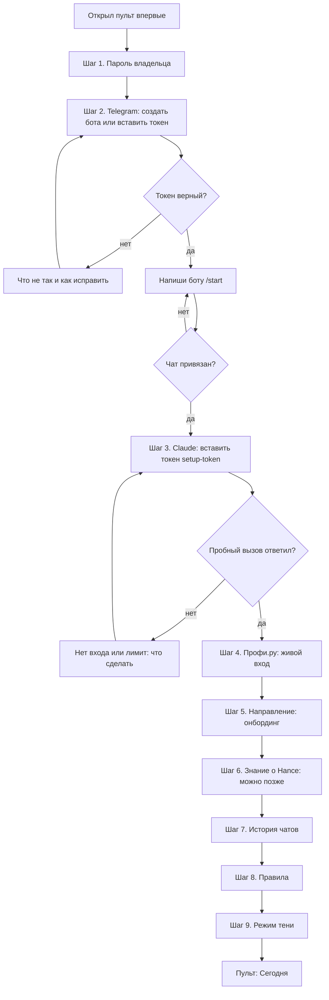
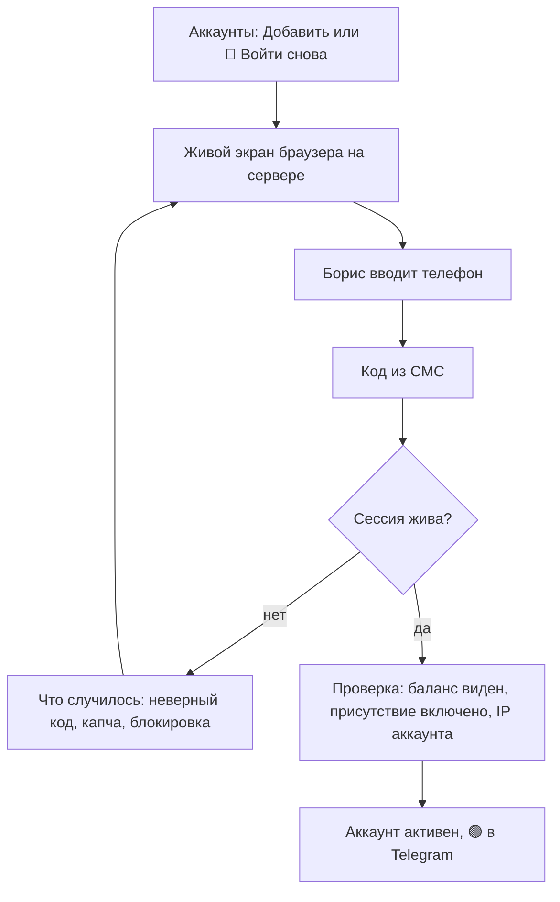
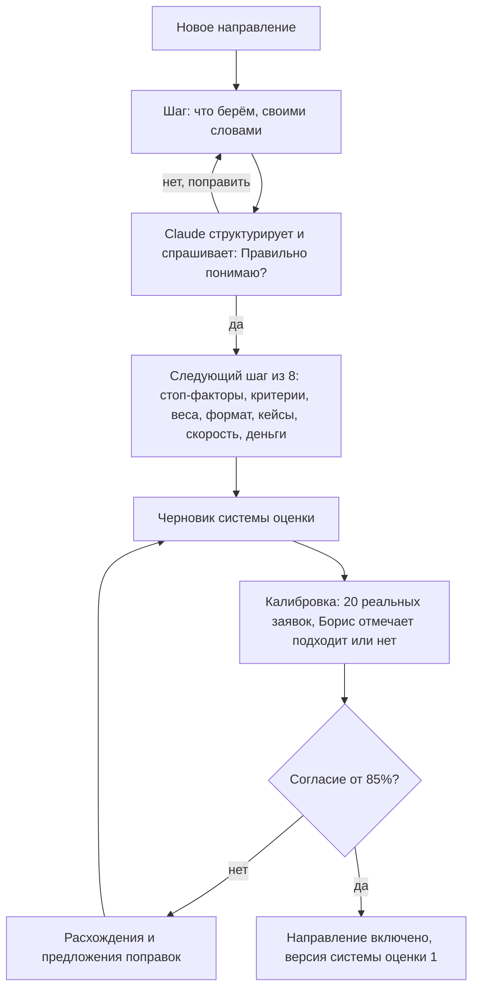
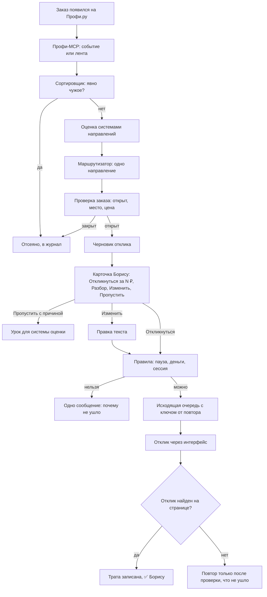
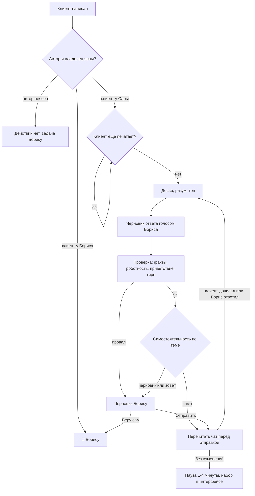
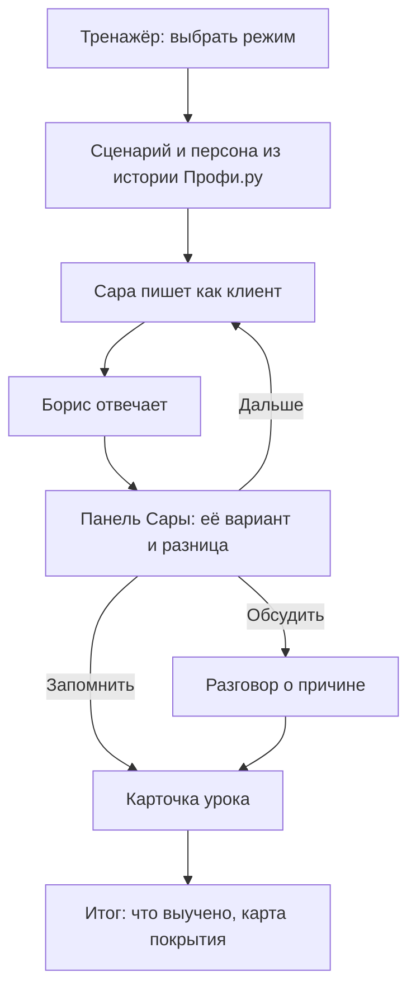
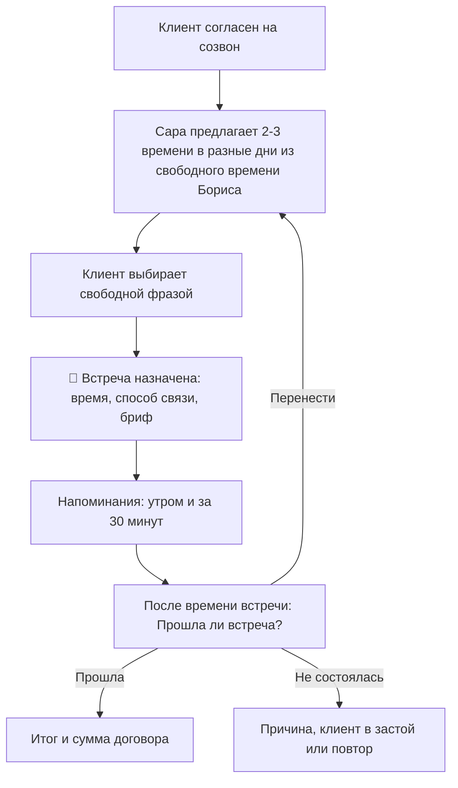
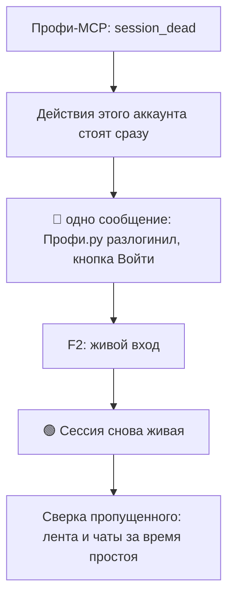

# Пользовательские потоки

| | |
|---|---|
| Версия | 1.0, 22.10.2026 |
| Связано | карта сущностей и экраны: дизайн v3, разделы 16-19; требования FR-SET, FR-ACC, FR-LEAD, FR-CONV, FR-TRAIN, FR-MEET |

Поток показывает путь человека по экранам и решения системы между ними.
Каркасы экранов рисуются перед вехой, в которой экран строится (правило
DoR), и опираются на эти потоки.

## F1. Мастер первого запуска (M0, M1, M4, M7)

Правило: прогресс сохраняется после каждого шага; вернуться можно к
любому шагу; «Состояние системы» повторяет все проверки.

## F2. Добавить аккаунт или войти снова (M1)

## F3. Направление: онбординг и калибровка (M3)

## F4. Заявка: от появления до отклика (M0 скелет, M2)

## F5. Сообщение клиента (M4)

## F6. Тренировка (M5)

## F7. Созвон и итог (M6)

## F8. Сбой: разлогин (M1)

